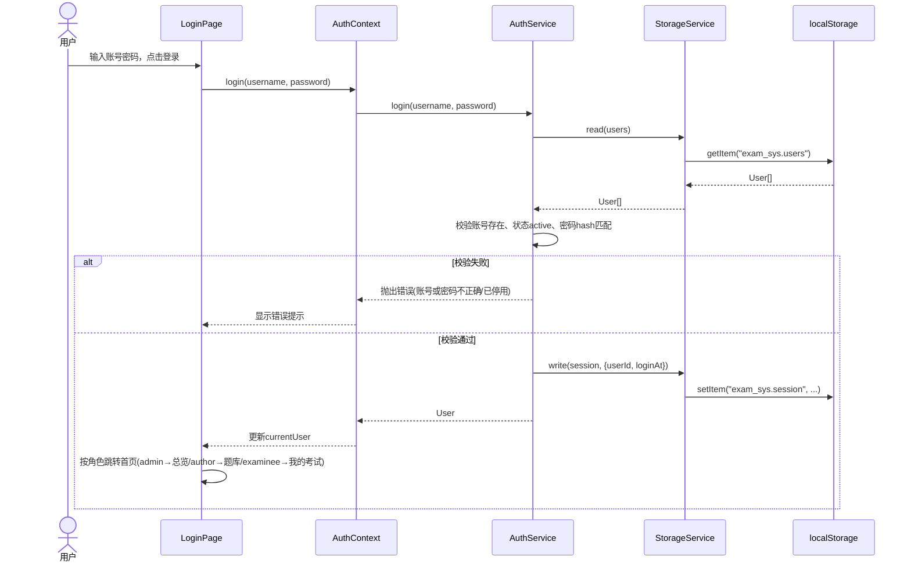
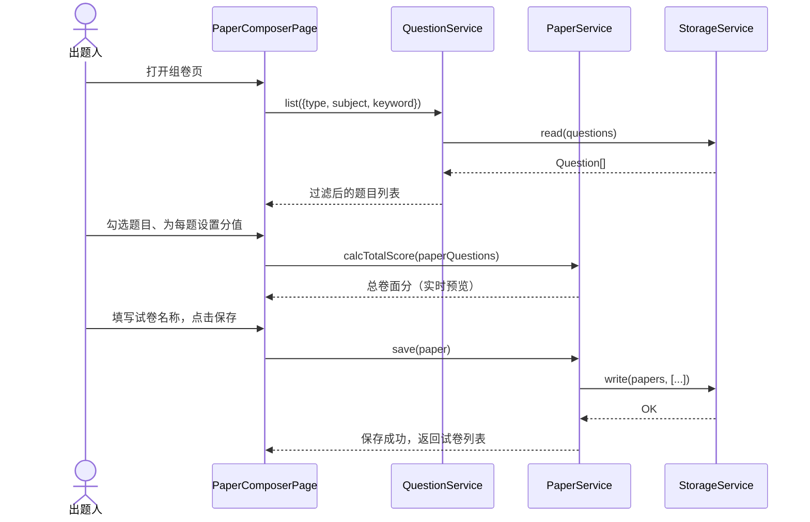
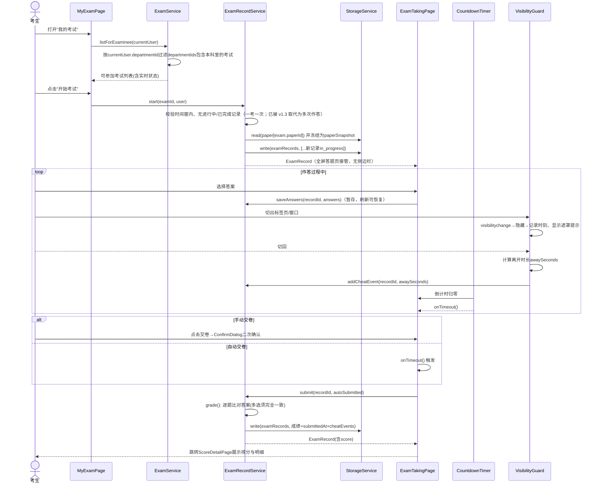
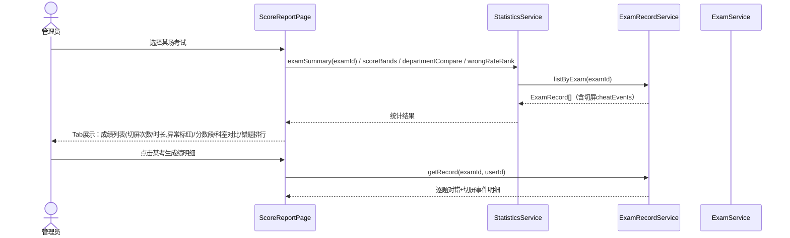
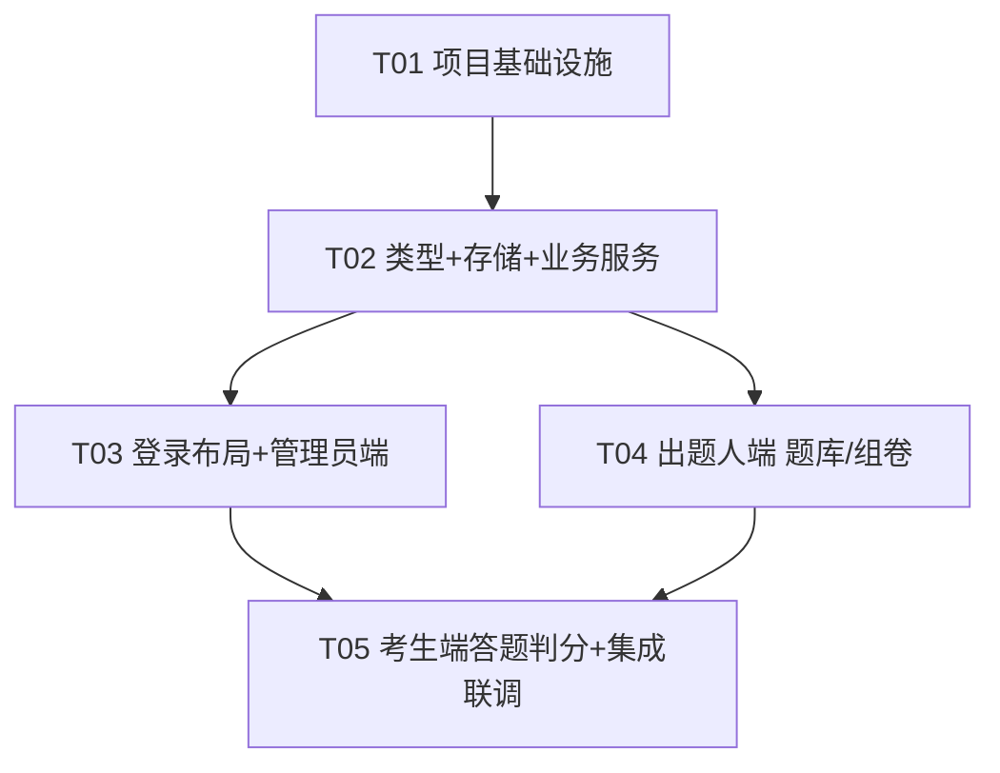

# 企业内部在线考试系统 — 系统架构设计与任务分解

> 文档版本：v1.0 ｜ 架构师：高见远（Bob/Gao）｜ 日期：2025-10-12
> 上游输入：docs/01-PRD.md（许清楚，v1.0）
>
> ⚠️ **本文为 v1.0 基线快照，部分断言已被后续增量架构取代**（前后端分离、多题库组卷、Vue 3 前端、**考试多次作答**、用户部门名等）。**以 `docs/04-architecture-increment.md`（当前 v1.3）为准**；下文凡被取代处均已就地标注「已被 v1.3 取代」。

---

# Part A：系统设计

## 1. 实现方案与框架选型

### 1.1 核心技术挑战

1. **多角色数据共享与隔离**：管理员/出题人/考生三角色操作同一份业务数据，且考生只能见本科室考试——需要统一的鉴权 + 数据过滤层。
2. **本地化运行、无云端部署**：系统交付给用户本地运行，无服务器，需解决"数据存哪、多角色如何共享数据"的问题。
3. **客观题自动判分**：单选/判断全对得分、多选完全匹配才得分，判分逻辑必须 100% 准确且集中在一处。
4. **考试过程防作弊与可靠性**：倒计时自动交卷、切屏检测（visibilitychange 记录次数与时长）、答案暂存——页面可能被切换/刷新，状态必须可恢复。
5. **P1 报表预留**：统计报表（平均分/及格率/分数段/科室对比/错题率）本期架构需预留，不阻塞 P0。

### 1.2 部署形态决策：**纯前端 SPA + 浏览器本地存储（localStorage）**

评估了两个方案：

| 方案 | 优点 | 缺点 |
|------|------|------|
| A. 纯前端 + localStorage | 零安装零部署、双击即用、开发/测试成本最低、数据全在本机可控 | 多角色数据共享依赖同一浏览器；数据量受 localStorage ~5MB 限制；无法真正多人跨机使用 |
| B. 前端 + 轻量本地后端（Python FastAPI + SQLite） | 真正多人使用、数据持久化更稳 | 用户需安装 Python/Node 运行时并启动服务，交付门槛高；本期无云端要求，复杂度收益不匹配 |

**结论：选择方案 A**，理由：

1. PRD 明确"交付给用户本地运行的系统、无云端部署要求"，方案 A 双击打开即用，最符合交付形态。
2. PRD 的核心价值流（录题→组卷→发布→答题→判分→成绩→防作弊记录）在三角色切换于同一浏览器的使用模式下完整可演示、可验收（验收要点均为功能性验收，不涉及跨机并发）。
3. 50 题试卷 + 百人级成绩记录的数据量远小于 localStorage 5MB 上限，容量无忧。
4. **为平滑升级预留架构空间**：所有数据读写收敛到唯一的 `StorageService`（Key-Value 存储适配器接口），未来若需多人使用，仅需将 `LocalStorageAdapter` 替换为调用本地后端 API 的 `ApiStorageAdapter`，业务服务层与 UI 层零改动。

### 1.3 框架与库选型

| 类别 | 选型 | 理由 |
|------|------|------|
| 构建工具 | Vite 5 | 默认栈，启动快、生态成熟 |
| UI 框架 | React 18 + TypeScript | 默认栈；TS 强类型对判分/状态机等核心逻辑的正确性保障价值大 |
| 组件库 | MUI v5 | 默认栈；自带 DataGrid/Dialog/AppBar/Snackbar，后台布局开箱即用 |
| CSS | **不引入 Tailwind CSS**（调整项） | MUI 的 `sx` 与主题系统已完全覆盖本项目样式需求；Tailwind preflight 与 MUI 样式存在已知冲突需额外配置，引入收益为负，故裁剪 |
| 路由 | react-router-dom v6 | 事实标准，支持嵌套路由与守卫 |
| 状态管理 | React Context + useReducer | 仅需登录会话全局共享，引入 Redux 属过度设计 |
| 日期 | dayjs | 轻量，满足倒计时/时间窗计算 |
| 图表（P1 预留） | recharts | React 生态最简图表库，报表页预留挂载点，本期只声明依赖不实现页面 |
| ID 生成 | 自研 `nanoid` 风格工具函数（无依赖） | 本地场景无需 uuid 库 |

### 1.4 架构模式

分层架构 + 仓库模式（Repository over Key-Value Storage）：

```
UI 层（pages / components）
   ↓ 调用
服务层（services/*Service.ts —— 业务逻辑、判分、状态机、数据过滤）
   ↓ 读写
存储层（services/storage.ts —— LocalStorageAdapter，统一 key 规范、JSON 序列化、种子数据初始化）
```

- **鉴权**：`AuthContext` 持有当前用户；路由层 `RoleGuard` 按 `menuConfig` 做菜单与页面双重权限控制。
- **数据隔离**：服务层方法统一接收 `currentUser`，考生角色在 `examService.listForExaminee()` 内做科室过滤，UI 层不做过滤判断（防止越权逻辑散落）。
- **考试状态机**：不存储状态，由 `time < startTime / 时间窗内 / time > endTime` 实时推导（`未开始→进行中→已结束`），天然自动流转，避免定时任务。

---

## 2. 文件列表（完整）

```
package.json
vite.config.ts
tsconfig.json
tsconfig.node.json
index.html
.gitignore
README.md
src/
  main.tsx                          # 入口：挂载 App、ThemeProvider、BrowserRouter
  App.tsx                           # 根组件：AuthProvider + 路由表 + RoleGuard
  theme.ts                          # MUI 主题（蓝色主色调 #1976d2，中文字体栈）
  vite-env.d.ts
  types/
    index.ts                        # 全部实体类型 + 角色/题型/状态枚举（单一类型源）
  constants/
    index.ts                        # 存储key、角色常量、判分规则、切屏提示阈值等
  utils/
    id.ts                           # genId() 短随机ID
    datetime.ts                     # 时间格式化、考试状态推导 getExamStatus()
    format.ts                       # 时长/分数格式化
  services/
    storage.ts                      # StorageService：localStorage 读写、seedSeedData()
    authService.ts                  # 登录、登出、会话恢复、修改密码
    departmentService.ts            # 科室 CRUD
    userService.ts                  # 用户 CRUD、重置密码、停用
    questionService.ts              # 试题 CRUD + 筛选（题型/科目/关键字，P1-3 一并实现）
    paperService.ts                 # 试卷 CRUD、组卷、卷面分计算、快照
    examService.ts                  # 考试 CRUD、状态推导、考生端科室隔离查询
    examRecordService.ts            # 开考、暂存答案、手动/自动交卷、判分核心、切屏事件记录
    statisticsService.ts            # P1 预留：平均分/及格率/分数段/科室对比/错题率（本期实现基础版供报表页）
  context/
    AuthContext.tsx                 # 全局会话：currentUser、login/logout
  components/
    layout/
      AppLayout.tsx                 # 左侧导航 + 顶栏 + 内容区（答题页不用此布局）
      menuConfig.tsx                # 按角色生成菜单项
    common/
      RoleGuard.tsx                 # 路由角色守卫
      PageHeader.tsx                # 页标题 + 操作区
      ConfirmDialog.tsx             # 通用二次确认（交卷/删除）
      StatusChip.tsx                # 考试状态彩色标签
      EmptyState.tsx                # 空数据占位
  pages/
    LoginPage.tsx                   # 登录页（全角色共用）
    admin/
      DashboardPage.tsx             # 数据总览（卡片 + 近期考试）
      DepartmentPage.tsx            # 科室管理
      UserPage.tsx                  # 用户管理（含新建/编辑弹窗、重置密码）
      ExamManagePage.tsx            # 考试管理（列表 + 新建/编辑弹窗）
      ExamFormDialog.tsx            # 新建考试表单：选试卷→选科室(多选)→时间窗/时长/及格线
      ScoreReportPage.tsx           # 成绩报表：Tab（成绩列表/分数段/科室对比/错题排行）+ 切屏列标红
    author/
      QuestionBankPage.tsx          # 题库列表 + 筛选 + 批量入口
      QuestionFormDialog.tsx        # 新增/编辑试题：题型→题干→动态选项→答案→解析→科目
      PaperPage.tsx                 # 试卷列表
      PaperComposerPage.tsx         # 组卷：筛选勾选题目→设分值→预览
      PaperPreviewPage.tsx          # 试卷预览（整卷渲染）
    exam/
      MyExamPage.tsx                # 我的考试（本科室+时间窗过滤，已结束置灰）
      ExamTakingPage.tsx            # 全屏答题页：无侧边栏布局
      MyScorePage.tsx               # 我的成绩列表（P1-5 历史成绩）
      ScoreDetailPage.tsx           # 成绩明细：得分、逐题对错、切屏记录提示
      components/
        QuestionCard.tsx            # 单题渲染与作答（单选/多选/判断三形态）
        AnswerSheet.tsx             # 答题卡网格（已答/未答/当前）
        CountdownTimer.tsx          # 常驻倒计时（最后5分钟变红，到点回调自动交卷）
        VisibilityGuard.tsx         # visibilitychange 监听 + 遮罩提示 + 事件上报
```

共 44 个文件（7 配置/入口 + 8 类型常量工具 + 9 服务/上下文 + 6 通用组件 + 17 页面/答题组件）。

---

## 3. 数据结构与接口（类图）

```mermaid
classDiagram
    %% ===== 枚举与基础类型 =====
    class Role {
        <<enumeration>>
        admin
        author
        examinee
    }
    class QuestionType {
        <<enumeration>>
        single 单选
        multiple 多选
        judge 判断
    }
    class ExamStatus {
        <<enumeration>>
        not_started 未开始
        ongoing 进行中
        ended 已结束
    }
    class RecordStatus {
        <<enumeration>>
        in_progress 答题中
        submitted 已交卷
    }

    %% ===== 实体 =====
    class Department {
        +string id
        +string name
        +string description
        +string createdAt
    }
    class User {
        +string id
        +string username
        +string passwordHash
        +string name
        +Role role
        +string departmentId
        +string departmentName
        +string status
        +string createdAt
    }
    class Question {
        +string id
        +QuestionType type
        +string stem
        +string[] options
        +number[] answer
        +number defaultScore
        +string analysis
        +string subject
        +string createdBy
        +string createdAt
    }
    class PaperQuestion {
        +string questionId
        +number score
    }
    class Paper {
        +string id
        +string name
        +string description
        +PaperQuestion[] questions
        +number totalScore
        +string createdBy
        +string createdAt
    }
    class Exam {
        +string id
        +string name
        +string paperId
        +string[] departmentIds
        +string startTime
        +string endTime
        +number durationMinutes
        +number passScore
        +number maxAttempts
        +string createdBy
        +string createdAt
    }
    class CheatEvent {
        +string at
        +number awaySeconds
    }
    class ExamRecord {
        +string id
        +string examId
        +string userId
        +number attemptNo
        +string departmentId
        +Paper paperSnapshot
        +RecordStatus status
        +Record~string, number[]~ answers
        +string startedAt
        +string submittedAt
        +boolean autoSubmitted
        +number score
        +CheatEvent[] cheatEvents
    }
    class Session {
        +string userId
        +string loginAt
    }

    %% ===== 服务层 =====
    class StorageService {
        -read$T$(string key) T
        -write(string key, unknown value) void
        +initSeedData() void
    }
    class AuthService {
        +login(username, password) User
        +logout() void
        +restoreSession() User | null
    }
    class UserService {
        +list() User[]
        +save(User) void
        +remove(string id) void
        +resetPassword(string id) void
    }
    class DepartmentService {
        +list() Department[]
        +save(Department) void
        +remove(string id) void
    }
    class QuestionService {
        +list(filter) Question[]
        +save(Question) void
        +remove(string id) void
    }
    class PaperService {
        +list() Paper[]
        +save(Paper) void
        +remove(string id) void
        +calcTotalScore(PaperQuestion[]) number
    }
    class ExamService {
        +list(User) Exam[]
        +listForExaminee(User) Exam[]
        +getExamStatus(Exam) ExamStatus
        +save(Exam) void
        +remove(string id) void
    }
    class ExamRecordService {
        +start(examId, User) ExamRecord
        +getRecord(examId, userId) ExamRecord | null
        +saveAnswers(recordId, answers) void
        +addCheatEvent(recordId, awaySeconds) void
        +submit(recordId, auto) ExamRecord
        -grade(ExamRecord) number
        +listByExam(examId) ExamRecord[]
        +listByUser(userId) ExamRecord[]
    }
    class StatisticsService {
        +examSummary(examId) ExamSummary
        +scoreBands(examId) BandItem[]
        +departmentCompare(examId) DeptItem[]
        +wrongRateRank(examId) WrongItem[]
    }
    class AuthContext {
        +User | null currentUser
        +login(u, p) Promise~void~
        +logout() void
    }

    %% ===== 关系 =====
    Paper *-- PaperQuestion : 组成
    Exam --> Paper : paperId 关联
    Exam }o-- Department : departmentIds 多对多
    ExamRecord --> Exam : examId
    ExamRecord --> User : userId
    ExamRecord *-- CheatEvent : 切屏记录
    ExamRecord ..> Paper : paperSnapshot 冻结副本
    User --> Department : departmentId 归属
    Question --> User : createdBy

    AuthService ..> StorageService : 读写 users/session
    UserService ..> StorageService
    DepartmentService ..> StorageService
    QuestionService ..> StorageService
    PaperService ..> StorageService
    ExamService ..> StorageService
    ExamRecordService ..> StorageService
    StatisticsService ..> ExamRecordService : 读取成绩数据
    ExamRecordService ..> ExamService : 校验考试时间窗
    AuthContext ..> AuthService : 调用
    ExamService ..> ExamStatus : 实时推导
    Question ..> QuestionType
    Exam ..> ExamStatus
    ExamRecord ..> RecordStatus
    User ..> Role
```

> **已被 v1.3 取代的相关断言**：本文多处（含上面类图的 `ExamRecordService.getRecord(examId, userId)`、§4.3 时序图「一考一次」、§5 待明确事项 #4）体现的是 v1.0「**一场考试每人仅一条记录、已交卷不可重考**」的假设。**该假设已被 v1.3 取代**：现支持多次作答（`ExamRecord.attemptNo` + `Exam.maxAttempts`，唯一键 `(exam_id,user_id,attempt_no)`），`start` 逻辑见 `docs/04-architecture-increment.md` §4.5 与 §7.4；报表每人取 `MAX(attempt_no)` 记录（§9-20）。上表 `User.departmentName`、`Exam.maxAttempts`、`ExamRecord.attemptNo` 为 v1.3 新增字段。

**判分规则（ExamRecordService.grade）**：
- 单选/判断：`answers[qid]` 长度为 1 且等于 `question.answer[0]` → 得该题分值，否则 0 分。
- 多选：`answers[qid]` 排序后与 `question.answer` 排序后完全相等 → 得分，否则 0 分（漏选/错选均 0 分，与 PRD Q1 假设一致）。
- 总分 = 各题得分之和，四舍五入保留 1 位小数。

---

## 4. 程序调用流程（时序图）

### 4.1 登录鉴权



### 4.2 组卷（出题人）



### 4.3 参加考试（开考 → 作答 → 判分）



### 4.4 管理员成绩报表与防作弊审查（P0 成绩列表 + P1 预留 Tab）



---

## 5. 待明确事项（UNCLEAR / 已作假设）

| # | 事项 | 架构假设 |
|---|------|----------|
| 1 | 多选题是否按比例给分 | 按全对才得分实现；判分逻辑集中在 `grade()` 一处，改规则只动一个函数 |
| 2 | 切屏是否强制交卷 | 仅记录不强制（P0）；`VisibilityGuard` 与 `ExamRecordService.addCheatEvent` 已解耦，P1 加阈值判断只需在遮罩回调处加一行 |
| 3 | 账号创建方式 | 管理员后台手动创建，无自助注册；密码本地简单哈希存储（sha256 via Web Crypto，本地演示级安全） |
| 4 | 一场考试可否重考 | ~~每场考试每人仅一次；`start()` 内校验已有记录则直接恢复进行中记录（兼顾刷新页面续考），已交卷不可重考~~ **（已被 v1.3 取代：支持多次作答，由 `exams.max_attempts` 限定每人可交卷次数，`start` 续考幂等 + 次数用完返回 1008；见 `docs/04-architecture-increment.md` §4.5 / §9-18、19）** |
| 5 | 成绩可见范围 | 考生仅见本人；统计报表仅管理员路由可达；出题人无任何成绩入口 |
| 6 | 密码找回 | 无邮箱验证，管理员"重置密码"为唯一途径 |
| 7 | localStorage 清空风险 | 明确写入 README：浏览器清除站点数据会丢失全部数据，属本地存储方案固有约束 |
| 8 | 数据量上限 | 按 50 题卷、百人规模设计；若超规模需升级方案 B（存储适配器已预留接口） |

---

# Part B：任务分解

## 6. 依赖包列表

```
dependencies:
- react@^18.3.1: UI 框架
- react-dom@^18.3.1: DOM 渲染
- react-router-dom@^6.26.0: 路由
- @mui/material@^5.16.0: 组件库
- @mui/icons-material@^5.16.0: 图标
- @emotion/react@^11.13.0: MUI 样式引擎
- @emotion/styled@^11.13.0: MUI 样式引擎
- dayjs@^1.11.0: 日期与倒计时计算
- recharts@^2.12.0: 报表图表（P1 预留，报表 Tab 本期可用 MUI 表格实现，图表组件可后补）

devDependencies:
- vite@^5.4.0: 构建工具
- @vitejs/plugin-react@^4.3.0: React 插件
- typescript@^5.5.0: 类型系统
- @types/react@^18.3.0: 类型声明
- @types/react-dom@^18.3.0: 类型声明
```

> 注意：**不包含 tailwindcss**（理由见 1.3 节）。

## 7. 任务列表（按依赖顺序，共 5 个任务）

### T01：项目基础设施
- **Source Files**：`package.json`、`vite.config.ts`、`tsconfig.json`、`tsconfig.node.json`、`index.html`、`.gitignore`、`README.md`、`src/vite-env.d.ts`、`src/main.tsx`、`src/App.tsx`、`src/theme.ts`
- **Dependencies**：无
- **Priority**：P0
- **要点**：npm install 可跑通；`main.tsx` 挂载 ThemeProvider + BrowserRouter；`App.tsx` 先放占位路由；`theme.ts` 定义蓝色主色调（primary #1976d2）与中文字体栈；README 写明本地运行方式与"清除浏览器数据会丢数据"提示。

### T02：类型定义 + 存储层 + 全部业务服务（数据层）
- **Source Files**：`src/types/index.ts`、`src/constants/index.ts`、`src/utils/id.ts`、`src/utils/datetime.ts`、`src/utils/format.ts`、`src/services/storage.ts`、`src/services/authService.ts`、`src/services/departmentService.ts`、`src/services/userService.ts`、`src/services/questionService.ts`、`src/services/paperService.ts`、`src/services/examService.ts`、`src/services/examRecordService.ts`、`src/services/statisticsService.ts`
- **Dependencies**：T01
- **Priority**：P0
- **要点**：这是全系统核心，必须先行且自洽。`types/index.ts` 为单一类型源；`storage.ts` 统一 key 常量（见第 8 节）并提供 `initSeedData()`（内置 1 管理员 + 1 出题人 + 2 科室 + 若干考生 + 示例试题的种子数据，便于测试）；`examRecordService.grade()` 实现判分规则；`examService.getExamStatus()` 实时推导状态机；`examService.listForExaminee()` 实现科室隔离；`statisticsService` 实现基础统计（平均分/及格率/分数段/科室对比/错题率），供 T05 报表页直接调用。

### T03：登录鉴权 + 全局布局 + 管理员端（组织/考试/成绩）
- **Source Files**：`src/context/AuthContext.tsx`、`src/components/layout/AppLayout.tsx`、`src/components/layout/menuConfig.tsx`、`src/components/common/RoleGuard.tsx`、`src/components/common/PageHeader.tsx`、`src/components/common/ConfirmDialog.tsx`、`src/components/common/StatusChip.tsx`、`src/components/common/EmptyState.tsx`、`src/pages/LoginPage.tsx`、`src/pages/admin/DashboardPage.tsx`、`src/pages/admin/DepartmentPage.tsx`、`src/pages/admin/UserPage.tsx`、`src/pages/admin/ExamManagePage.tsx`、`src/pages/admin/ExamFormDialog.tsx`、`src/pages/admin/ScoreReportPage.tsx`
- **Dependencies**：T02
- **Priority**：P0
- **要点**：`AuthContext` 会话持久化（刷新恢复）；`App.tsx` 接入真实路由表与 `RoleGuard`；管理员端四页（科室/用户/考试/成绩报表）+ 数据总览；考试新建弹窗流程：选试卷→多选科室→时间窗/时长/及格线；成绩报表页以 MUI Tabs 预留四个 Tab 结构（成绩列表 P0 完整实现，其余三个 Tab 调 `statisticsService` 基础版渲染，图表后补）。

### T04：出题人端（题库 + 组卷）
- **Source Files**：`src/pages/author/QuestionBankPage.tsx`、`src/pages/author/QuestionFormDialog.tsx`、`src/pages/author/PaperPage.tsx`、`src/pages/author/PaperComposerPage.tsx`、`src/pages/author/PaperPreviewPage.tsx`
- **Dependencies**：T02（布局组件可引用 T03 产出，集成联调放 T05；若与 T03 并行开发，先按接口约定自测）
- **Priority**：P0
- **要点**：试题表单按题型动态渲染（判断题固定两选项、多选答案多选框、分值默认值）；筛选条件题型/科目/关键字（P1-3 顺带完成）；组卷页勾选题目→行内设分值→实时总卷面分；试卷预览整卷渲染。

### T05：考生端（答题判分防作弊）+ 成绩展示 + 全局集成联调
- **Source Files**：`src/pages/exam/MyExamPage.tsx`、`src/pages/exam/ExamTakingPage.tsx`、`src/pages/exam/MyScorePage.tsx`、`src/pages/exam/ScoreDetailPage.tsx`、`src/pages/exam/components/QuestionCard.tsx`、`src/pages/exam/components/AnswerSheet.tsx`、`src/pages/exam/components/CountdownTimer.tsx`、`src/pages/exam/components/VisibilityGuard.tsx`、`src/App.tsx`（最终路由集成修订）
- **Dependencies**：T03、T04
- **Priority**：P0
- **要点**：答题页全屏布局（不经 AppLayout）；倒计时基于 `startedAt + durationMinutes - now` 计算（刷新页面时间不重置）；答案暂存到 localStorage 可恢复；`VisibilityGuard` 监听 visibilitychange，遮罩提示 + 上报切屏事件；交卷二次确认 + 到时自动交卷；交卷即跳成绩明细页（得分 + 逐题对错）；考生"我的成绩"历史列表（P1-5）；最后做三角色全流程回归：录题→组卷→发布→考生作答→判分→管理员报表与切屏审查。

## 8. 共享知识（跨文件约定）

1. **存储 key 命名**：统一前缀 `exam_sys.`，常量集中定义于 `src/constants/index.ts`：
   `exam_sys.users` / `exam_sys.departments` / `exam_sys.questions` / `exam_sys.papers` / `exam_sys.exams` / `exam_sys.examRecords` / `exam_sys.session` / `exam_sys.seeded`（种子初始化标记）
2. **API/服务返回**：无后端，服务层直接返回数据或抛 `Error(中文消息)`，UI 层 try-catch 后用 Snackbar 展示。
3. **类型单一来源**：所有实体/枚举只从 `src/types/index.ts` 导入，禁止页面内重复定义；新增字段必须先改类型文件。
4. **日期存储格式**：一律 ISO 8601 字符串（`dayjs().toISOString()`），展示层用 `utils/datetime.ts` 格式化为 `YYYY-MM-DD HH:mm`。
5. **答案数据格式**：`answers: Record<questionId, number[]>`（选项索引数组）；单选/判断恒为长度 1；多选保存前按索引升序排序。
6. **ID**：`genId()` 生成（时间戳+随机串），全库通用。
7. **角色守卫双重控制**：菜单按角色显隐（`menuConfig`）+ 路由 `RoleGuard` 校验，二者必须同步维护。
8. **判分与状态机不得在 UI 层实现**：只允许调用 `examRecordService` / `examService`。
9. **考试状态实时推导**：不落库，`getExamStatus(exam)` 基于当前时间计算，所有页面统一调用。
10. **切屏事件**：只增不改，`cheatEvents` 数组追加式写入；报表"异常"判定阈值为切屏次数 ≥3 或累计离开 ≥120 秒（常量可调）。

## 9. 任务依赖图


