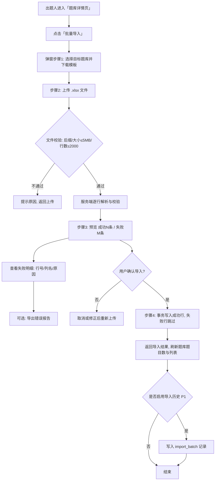
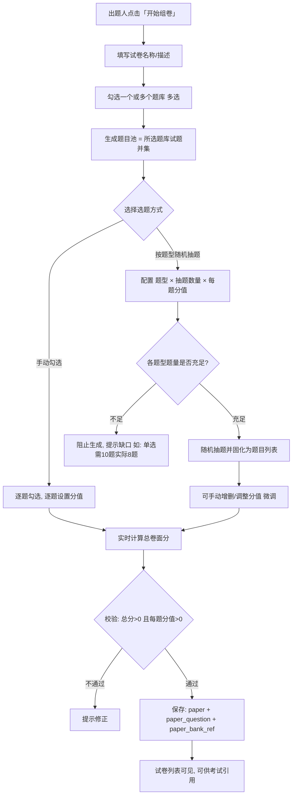
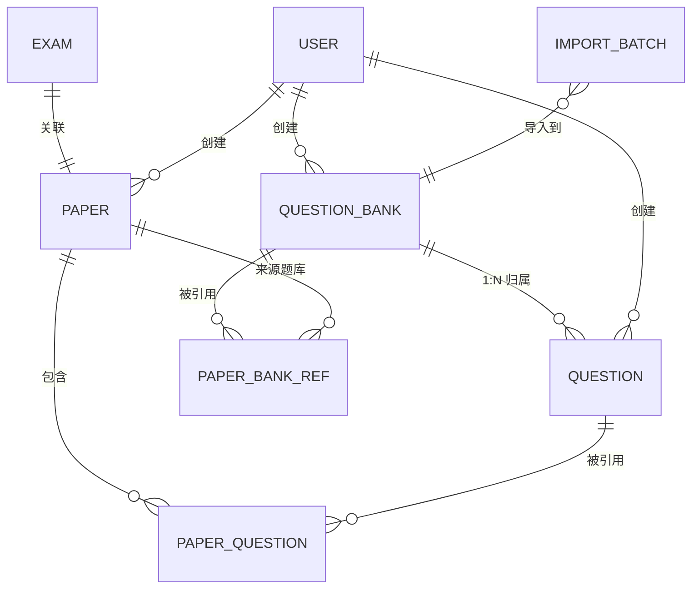

# 企业内部在线考试系统 — 增量 PRD（v1.3）

> 本文档为 **docs/01-PRD.md（v1.0）的增量补丁**，只描述本次相对现有版本的变化，不重写原有功能的完整 PRD。

---

## 1. 文档信息

| 项目 | 内容 |
| --- | --- |
| 文档版本 | v1.3（增量：答题次数上限 + 答题页考生信息） |
| 日期 | 2025-10-13 |
| 作者 | 产品经理 许清楚 |
| 变更类型 | 增量（架构变更 + 新功能 + UI 升级 + 前端框架重写 + 答题次数上限/考生信息展示） |
| 基线文档 | `docs/01-PRD.md`（v1.0）、`docs/02-architecture.md`（v1.0）、`README.md` |
| 现有形态 | 纯前端 SPA（Vite 5 + React 18 + TS + MUI v5，本次将整体重写为 Vue 3），数据存于浏览器 localStorage |
| 目标形态 | 前后端分离：Node.js + MySQL 后端（REST API）+ **Vue 3 + Element Plus 前端**；前端整体视觉升级 |

### 文档变更记录

| 版本 | 日期 | 作者 | 变更说明 |
| --- | --- | --- | --- |
| v1.2 | 2025-10-13 | 许清楚 | 前端框架由 React 18 + MUI v5 变更为 Vue 3 + Element Plus（组合式 API + Pinia + vue-router 4 + ECharts）；后端与接口契约不变；UI 设计 token 与交互不变，仅承载技术变更 |
| v1.3 | 2025-10-13 | 许清楚 | 新增「考试答题次数上限」（考试设置字段，1–10，默认 1，真实生效）与「答题页展示考生信息」（姓名·所属科室，第 N 次作答标记）；用户信息接口新增返回科室名称；报表统计口径改为按每人最后一次已交卷记录 |

---

## 2. 本次增量目标

一句话：**将系统由「纯前端 + localStorage」升级为「前后端分离（Node.js + MySQL）」架构，并新增独立「题库管理」模块（支持 Excel 批量导入），改造组卷流程为「先选题库（可多选）→ 再从题库生成试卷」，同时完成前端 UI 整体视觉升级。**

可验收目标（3~5 条）：

1. **架构可用**：后端 Node.js 服务 + 本地 MySQL（`enterprise_exam_system`）可一键启动，提供完整 REST API；前端数据访问层由 localStorage 改为调用 API，三角色（管理员/出题人/考生）核心流程（录题→组卷→发布→答题→判分→报表）在前后端分离形态下**全流程跑通**。
2. **题库可用**：新增独立「题库管理」模块，支持题库增删改查；题库可手动新增试题，也可通过 **Excel（.xlsx）批量导入**（含模板下载、错误逐行反馈、导入预览）。
3. **组卷可用**：新增试卷时必须**先选择一个或多个题库**，再从所选题库的**并集题目池**中选题（支持手动勾选 + 按题型随机抽题），实时计算总卷面分。
4. **数据可控**：用户口令改为后端签发 JWT 登录态，用户数据不再落 localStorage（仅存 Token）；密码以 bcrypt 加盐存储，无明文。
5. **体验升级**：前端以 Vue 3 + Element Plus 重写，完成整体视觉升级（配色/导航/卡片/表格/空态与加载态统一设计 token），Chrome/Edge 桌面端正常。

---

## 3. 变更范围总览

| 模块 | 变更类型 | 说明 |
| --- | --- | --- |
| 后端服务（Node.js + MySQL） | **新增** | 全新后端：REST API、JWT 鉴权、数据持久化、种子数据初始化；数据库连接参数经 `.env` 注入 |
| 前端框架 | **重写** | React 18 + MUI v5 → Vue 3（组合式 API + `<script setup>`）+ Element Plus + Pinia + vue-router 4 + ECharts；旧 React 代码删除（已备份 `.backup/react-frontend-20261012.tar.gz`） |
| 前端数据访问层（services） | **修改** | 改为 Vue 3 的 `src/api/`（axios 实例 + 拦截器）与 `src/services/`（组合式数据访问函数），由 localStorage 改为调用后端 API |
| 登录鉴权 | **修改** | 由本地会话改后端 JWT；401 自动登出并跳登录页 |
| 题库管理模块 | **新增** | 独立模块：题库（QuestionBank）增删改查 + 题库内试题管理 |
| Excel 批量导入 | **新增** | 模板下载、上传解析、逐行校验、预览、确认导入、导入历史（P1） |
| 试卷管理 / 组卷 | **修改** | 组卷流程改为「先选题库（多选）→ 再选题」；新增按题型随机抽题；落库试卷-题库关联 |
| 试题实体 | **修改** | `Question` 新增 `bankId`（归属题库）；数据源由 localStorage 改为 MySQL |
| 考试管理 | **修改** | 新增「答题次数（每人最多，1–10，默认 1）」上限并真实生效；列表新增「答题次数」列（详见 §11） |
| 在线答题 / 判分 / 防作弊 | **修改（含数据源迁移）** | 判分规则、切屏检测、倒计时逻辑不变；答题页顶部新增考生「姓名·所属科室」（无科室显示「未分配科室」）与「第 N 次作答」标记（详见 §12） |
| 成绩报表 | **修改（含数据源迁移）** | 功能不变；新增「作答次数」标注，统计口径改为按每人最后一次已交卷记录（详见 §11.2） |
| 科室管理 / 用户管理 | **修改（含数据源迁移）** | 功能不变；用户信息接口（登录/当前用户/用户列表）新增返回「所属科室名称」（详见 §12.2） |
| UI 样式 / 布局 | **修改** | 基于 Element Plus + SCSS 变量覆盖实现整体视觉升级；导航新增「题库管理」入口 |

---

## 4. 用户故事

### 4.1 出题人（author）

**US-A1：题库管理**
- As a 出题人，I want 创建并维护多个题库（名称、描述、分类），so that 我能按业务主题把试题分门别类沉淀。
- 验收标准 AC：
  - 可新建/编辑/删除题库；列表展示题库名称、分类、题目数量、创建人、创建时间。
  - 删除有试题的题库时，需二次强确认并明确告知「将同时删除 N 道试题（其中 M 道已被 K 份试卷引用）」，或引导先迁移试题。
  - 题库分类（category）用于分组展示与导入默认科目，不作为强制约束。

**US-A2：题库内手动新增试题**
- As a 出题人，I want 在某个题库内手动新增/编辑/删除试题，so that 少量题目无需走 Excel。
- 验收标准 AC：
  - 题库详情页可手动新增（单选/多选/判断，含题干、选项、答案、分值、解析、科目）。
  - 新增的试题自动归属当前题库（`bankId` = 当前题库）。

**US-A3：Excel 批量导入试题**
- As a 出题人，I want 通过 Excel 批量导入试题到指定题库，so that 大量存量题目可快速入库。
- 验收标准 AC：
  - 支持下载标准模板；支持 `.xlsx` 上传；上传前必须先选定目标题库。
  - 解析后展示预览：成功 N 条 / 失败 M 条；失败明细可查看（第几行、哪一列、错误原因），可导出错误报告。
  - 用户确认后才真正写库；成功行写入，失败行跳过（见 §6.1）。
  - 单次导入不超过 2000 行；文件不超过 5MB；超限给出明确提示。

**US-A4：基于题库组卷**
- As a 出题人，I want 新增试卷时先选择一个或多个题库，再从题库并集中选题组卷，so that 我能复用题库资产、跨题库组合出卷。
- 验收标准 AC：
  - 新增试卷流程：填名称/描述 → 选择 1~N 个题库（多选）→ 从并集题目池选题。
  - 支持手动勾选；支持按题型设置「抽题数量 × 每题分值」随机抽题。
  - 实时显示已选题数与总卷面分；分值默认取题目默认分值，可逐题覆盖。
  - 保存后落库试卷-题库关联，试卷详情可回显「来源题库」。

### 4.2 管理员（admin）

**US-M1：系统监管（含题库/试卷）**
- As a 管理员，I want 查看并管理全系统的题库与试卷，so that 我能对内容资产进行监管与兜底维护。
- 验收标准 AC：
  - 管理员对「题库管理 / Excel 导入 / 试卷管理」具备与出题人一致的可见与可操作权限。
  - 管理员仍负责考试发布与成绩报表（原有能力不变，数据源改为 API）。

**US-M2：架构迁移无感**
- As a 管理员，I want 迁移后各项管理功能行为与原来一致，so that 升级不带来额外学习成本。
- 验收标准 AC：
  - 科室/用户/考试/成绩报表的字段、交互与判分结果与 v1.0 一致。
  - 首次启动后端自动初始化种子数据（演示账号、2 科室、10 道示例题、示例试卷与考试，并补 2 个示例题库）。

### 4.3 考生（examinee）

**US-E1：考试与成绩（保持不变）**
- As a 考生，I want 登录后仍能参加本科室考试、答题并查看成绩，so that 迁移前后体验一致。
- 验收标准 AC：
  - 登录/答题/交卷/判分/成绩查询行为与 v1.0 一致。
  - 未登录或 Token 失效时被阻断并跳转登录页（401 自动登出）。

### 4.4 全体用户

**US-ALL1：视觉与加载体验**
- As a 用户，I want 界面更现代、加载与空数据有明确反馈，so that 操作更清晰顺畅。
- 验收标准 AC：
  - 页面加载有骨架屏/全局 loading；接口异常有统一错误提示（如 `el-message`）。
  - 列表空数据显示统一空态插画文案；表格/卡片风格统一。

---

## 5. 需求池

> P0 = 本期必须实现（发布红线）；P1 = 本期应实现，资源不足可顺延；P2 = 本期不做，预留扩展。

| 编号 | 需求 | 优先级 | 验收要点 |
| --- | --- | --- | --- |
| P0-1 | Node.js + MySQL 后端服务 + REST API，数据落库 | P0 | 后端可启动；API 可读写 MySQL；`.env` 注入数据库连接，不硬编码 |
| P0-2 | 前端 services 层全面改为调用 API | P0 | 三大角色核心流程端到端跑通，无 localStorage 业务数据残留 |
| P0-3 | 后端签发 JWT 登录态；401 自动登出跳登录 | P0 | 登录返回 Token；前端仅存 Token；Token 失效自动跳登录 |
| P0-4 | 数据库种子数据初始化（保留演示账号 + 2 科室 + 10 示例题 + 补题库示例） | P0 | 首次启动自动建表并写入种子；账号 `admin/admin123`、`author/author123`、`zhangsan|lisi|wangwu/123456` 可登录 |
| P0-5 | 题库管理模块（QuestionBank 增删改查） | P0 | 可新建/编辑/删除题库；列表显示题目数量；删除有题题库需二次强确认 |
| P0-6 | 题库内手动新增/编辑/删除试题 | P0 | 试题归属题库；题型/答案/分值校验与 v1.0 一致 |
| P0-7 | Excel 模板下载 + 上传解析 + 逐行校验 + 预览 | P0 | 支持 `.xlsx`；错误逐行反馈（行/列/原因）；预览显示成功/失败数量 |
| P0-8 | Excel 确认导入（成功行写入，失败跳过） | P0 | 确认后写库；结果反馈；单次 ≤2000 行 |
| P0-9 | 组卷：先选题库（多选）→ 从并集题目池选题 | P0 | 多题库并集；手动勾选可用；试卷-题库关联落库可回显 |
| P0-10 | 组卷：按题型随机抽题（数量 × 分值） | P0 | 按题型配置抽题；题量不足阻止并提示；抽题结果固化为题目列表 |
| P0-11 | 每题分值可覆盖 + 实时总卷面分 + 保存校验 | P0 | 总分实时更新；保存时校验总分>0 且每题分值>0 |
| P0-12 | 前端 UI 整体视觉升级（配色/导航/卡片/表格/空态/加载态） | P0 | 统一设计 token；基于 Element Plus + SCSS 变量覆盖；桌面端布局正常 |
| P0-13 | 权限矩阵落地（菜单 + 路由 + 接口三重控制） | P0 | 三角色按 §附录 权限矩阵可见可操作 |
| P0-14 | 分页：试题列表、成绩列表默认每页 20 条 | P0 | 列表分页可用；总数与页码正确 |
| P0-15 | 密码 bcrypt 加盐存储 | P0 | 数据库中无明文口令；登录校验通过 |
| P1-1 | 导入历史记录（导入批次：文件、行数、成功/失败、操作人、时间） | P1 | 可查看历史导入记录 |
| P1-2 | 题库详情页试题查询（题型/科目/关键字筛选 + 分页） | P1 | 筛选组合生效 |
| P1-3 | 题库删除时「迁移试题到其他题库」辅助操作 | P1 | 可批量迁移试题归属 |
| P1-4 | 试卷详情回显来源题库与逐题来源题库 | P1 | 详情展示来源题库名称 |
| P2-1 | 一题多库（M:N）支持 | P2 | 本期按 1:N 实现，预留扩展 |
| P2-2 | 人手一卷动态随机（每次进入随机生成、可复现种子） | P2 | 本期仅「随机一次、固定成卷」 |
| P2-3 | Excel 导入账号（用户批量导入） | P2 | 本期仅试题导入 |

---

## 6. 核心流程

### 6.1 Excel 批量导入流程



**Excel 模板列定义（第一行为表头，可留空列）**

| 列 | 列名 | 必填 | 说明 |
| --- | --- | --- | --- |
| A | 题型 | 是 | 单选 / 多选 / 判断（亦接受 `single` / `multiple` / `judge`） |
| B | 题干 | 是 | 题目正文文本 |
| C | 选项A | 单选/多选必填 | |
| D | 选项B | 单选/多选必填 | |
| E | 选项C | 否 | |
| F | 选项D | 否 | |
| G | 选项E | 否 | 选项数量上限 6 项（A~F） |
| H | 选项F | 否 | |
| I | 正确答案 | 是 | 见下方「答案填写规范」 |
| J | 分值 | 否 | 正整数；缺省为 10 |
| K | 解析 | 否 | 答案解析文本 |
| L | 科目 | 否 | 缺省继承目标题库「分类」；填写则以此为准（见关键规则 3） |

**答案填写规范**

| 题型 | 填写方式 | 示例 |
| --- | --- | --- |
| 单选 | 单个选项字母 | `A` |
| 多选 | 多个字母连续填写（亦接受逗号分隔） | `ABD` 或 `A,B,D` |
| 判断 | `对` / `错`（亦接受 `正确` / `错误` / `A`（=对）/`B`（=错）/`true` / `false`） | `对` |

> 判断题的 C~H 选项列可留空，系统自动填充 `正确` / `错误`。

**逐行校验规则**

| # | 校验项 | 失败示例提示 |
| --- | --- | --- |
| 1 | 题型合法 | 「题型『填空』不合法，仅支持 单选/多选/判断」 |
| 2 | 题干非空 | 「题干不能为空」 |
| 3 | 选项数量与题型匹配（单选/多选 ≥2 且 ≤6；判断固定 2） | 「单选题至少需要 2 个选项」 |
| 4 | 选项须从 A 起连续填写，不得出现空位后仍有内容 | 「选项B为空，但选项C已填写，请连续填写选项」 |
| 5 | 答案不得越界（引用不存在的选项） | 「答案 C 越界（当前仅 A、B）」 |
| 6 | 单选/判断答案恰好 1 个；多选至少 2 个 | 「多选题至少需要选择 2 个正确答案」 |
| 7 | 分值必须为正数（非法格式按错误处理） | 「分值『abc』不合法，必须为正数」 |

> 错误反馈格式（逐行）：`{ 行号, 列名, 原始值, 错误原因 }`，例如 `第 7 行 | 正确答案 | C | 答案 C 越界（当前选项仅 A、B）`；支持「导出错误报告」。

**关键规则**

1. **目标题库**：上传前必须选择（弹窗第一步），导入的所有试题归属该题库。
2. **写入策略（推荐）**：**成功行写入、失败行跳过（部分成功）**；且该批「成功行」的写入在**单个数据库事务**内完成（要么整批成功行全写入，要么全部回滚），避免中途异常产生半批脏数据。
   - 理由：2000 行批量导入中个别脏数据不应导致整批失败（体验），同时批内原子保证一致性（正确性）。
3. **科目冲突处理**：Excel「科目」列为空 → 继承目标题库的「分类」；若填了且与题库分类不同 → **以 Excel 为准（保留试题自身科目）**，预览时对不一致行给出**黄色提示**（不阻断导入）。
   - 理由：试题科目是试题属性，题库分类是容器属性，二者无需强制一致；提示而非阻断，避免用户困惑。

### 6.2 多选题库组卷流程



**组卷核心规则（明确、可执行）**

1. **题库多选**：新增试卷必须至少选择 1 个题库；题目池 = 所选题库的**试题并集**（因 1:N 归属，无需去重）。
2. **选题方式**：支持两种，且可**混用**（先随机抽题生成草稿，再手动增删/调整）。
3. **按题型随机抽题**：
   - 交互：按题型分组配置「抽题数量」与「每题分值」，如：单选 10 题 × 2 分、多选 5 题 × 4 分、判断 5 题 × 4 分。
   - 范围：所选题库并集内、该题型的全部试题。
   - **题量不足**：若某题型实际题量 < 设定数量，则**阻止生成并明确提示缺口**（如「单选题库不足：需要 10 题，实际 8 题」），用户可调低数量或补充题库；**不做静默按实际数量补齐**，避免卷面总分与预期不符。
   - 可复现性：随机抽题**生成一次即固化为题目列表**（快照式），保存后不再变化；本期**不持久化随机种子**，不做「人手一卷」（列为 P2）。
4. **分值**：默认取题目 `defaultScore`，可**逐题覆盖**；实时总卷面分 = 各题分值之和（保留 1 位小数）。
5. **保存校验**：总分 > 0 且每题分值 > 0（硬校验）；若设置「期望总分」与实际总分不一致，仅**软提示**，不阻断保存。
6. **试卷-题库关联**：**落库**（见 §8 `paper_bank_ref`），用于回显来源题库与追溯。
7. **编辑试卷时重选题库**：**允许**重新选题库。因试卷保存的是 `questionId` 引用（与题库归属解耦），已选题目**默认保留**，但列表中标注「非当前题库」标签提示，用户可手动移除；保存时同步更新 `paper_bank_ref`。
   - 理由：不打断已完成的选题工作，同时给出清晰的来源提示。

---

## 7. UI 设计稿说明

> 本次为**整体视觉升级**，基于 **Element Plus** 组件体系 + **SCSS 变量覆盖**实现整体视觉升级（布局与交互不变，仅承载技术变更）。

### 7.1 视觉方向与设计 Token（建议具体色值）

整体方向：**现代、清爽、专业的后台风格**。浅色侧栏 + 白色顶栏 + 柔和卡片阴影 + 大圆角；主色收敛为一支蓝色，状态用语义色区分。

| Token | 建议值 | 用途 |
| --- | --- | --- |
| `primary.main` | `#2563EB` | 主按钮、激活菜单、链接、强调数字 |
| `primary.light` | `#60A5FA` | hover / 浅色底 |
| `primary.dark` | `#1D4ED8` | active / 深色场景 |
| `secondary.main` | `#7C3AED` | 次强调、图形点缀 |
| `success.main` | `#16A34A` | 及格、成功、已交卷 |
| `warning.main` | `#F59E0B` | 待处理、导入 warning |
| `error.main` | `#DC2626` | 危险操作、不及格、异常 |
| `info.main` | `#0EA5E9` | 提示信息 |
| `background.default` | `#F5F7FB` | 页面底色 |
| `background.paper` | `#FFFFFF` | 卡片/表格底 |
| `text.primary` | `#0F172A` | 主文本 |
| `text.secondary` | `#64748B` | 次要文本 |
| `divider` | `#E2E8F0` | 分割线/边框 |
| 圆角 `borderRadius` | `10` | 卡片/按钮/输入框统一圆角 |
| 卡片阴影 | `0 1px 2px rgba(16,24,40,.06), 0 1px 3px rgba(16,24,40,.10)` | 卡片/弹窗 |
| 表格表头底色 | `#F8FAFC` | 表头 |
| 表格行 hover | `#F1F5F9` | 行悬停 |
| 考试状态色 | 未开始 `#64748B` / 进行中 `#2563EB` / 已结束 `#94A3B8` | StatusChip |

**Token 落地方式（Vue 3 + Element Plus）**

- 通过 `src/styles/element/index.scss` 覆盖 Element Plus 的 SCSS 变量：用 `@forward 'element-plus/theme-chalk/src/common/var.scss' with (...)` 映射 `$colors`（如 `$colors: ('primary': ('base': #2563EB))`）、`$border-radius`，并生成 `--el-color-primary` 等 CSS 变量。
- 上表中的 `primary/secondary/success/warning/error/info`、`background/text/divider` 等语义色一一映射到 Element Plus 对应变量；`borderRadius:10` 映射 `$border-radius`。
- 业务自定义变量（侧栏宽度、卡片阴影、表格表头底色、状态色等）抽为 `src/styles/variables.scss`，在组件中以 SCSS 变量/CSS 变量消费。
- 引入顺序：先 `element/index.scss`（变量覆盖）后 Element Plus 官方样式，确保覆盖生效。

### 7.2 导航布局（左侧栏 + 顶栏）

侧栏宽度 240px、可折叠；顶栏含面包屑 + 当前用户菜单；内容区最大宽度自适应，主内容卡片化。

```
┌──────────────┬──────────────────────────────────────────────────────────┐
│ 🎓 在线考试   │  首页 / 题库管理 / 题库详情          [搜索]  李四(出题人)▾ │  ← 顶栏
│              ├──────────────────────────────────────────────────────────┤
│ 出题人        │                                                          │
│ ▸ 题库管理 ●  │                     内容区（卡片化）                        │
│ ▸ 试卷管理    │                                                          │
│              │                                                          │
│ ───────────  │                                                          │
│ 管理员(全)    │                                                          │
│  · 数据总览   │                                                          │
│  · 科室管理   │                                                          │
│  · 用户管理   │                                                          │
│  · 题库管理   │                                                          │
│  · 试卷管理   │                                                          │
│  · 考试管理   │                                                          │
│  · 成绩报表   │                                                          │
└──────────────┴──────────────────────────────────────────────────────────┘
```
- 激活菜单：浅蓝底 `#EEF2FF` + 主色文字 + 左侧 3px 主色指示条。
- 顶栏右侧：当前用户头像/姓名 + 角色标签 + 下拉（个人设置/退出登录），使用 Element Plus 的 `el-dropdown` 实现。

### 7.3 题库管理页（QuestionBank 列表）

顶部为标题+「新建题库」按钮；下方题库以**卡片网格**呈现，每卡显示题库名、分类标签、题目数、创建信息与操作。

```
┌────────────────────────────────────────────────────────────────────────┐
│ 题库管理                                        [＋ 新建题库]            │
├────────────────────────────────────────────────────────────────────────┤
│ ┌────────────────────┐  ┌────────────────────┐  ┌────────────────────┐  │
│ │ 安全知识题库        │  │ 企业文化题库        │  │ 新员工入职题库      │  │
│ │ 分类: 安全知识      │  │ 分类: 企业文化      │  │ 分类: 通用          │  │
│ │ 题目数: 6           │  │ 题目数: 4           │  │ 题目数: 0           │  │
│ │ 王出题 · 10-13      │  │ 王出题 · 10-13      │  │ 王出题 · 10-13      │  │
│ │ [详情] [编辑] [删除] │  │ [详情] [编辑] [删除] │  │ [详情] [编辑] [删除] │  │
│ └────────────────────┘  └────────────────────┘  └────────────────────┘  │
│                                                                          │
│ （空数据时：居中空态插画 + 「还没有题库，点击右上角新建题库开始沉淀」）      │
└────────────────────────────────────────────────────────────────────────┘
```

### 7.4 题库详情页（题库内试题）

左侧题库信息卡（名称/分类/题目数/描述 + 「批量导入」入口），右侧试题表格（`el-table` + 筛选条件 + **`el-pagination`** 分页）。

```
┌──────────────────┬────────────────────────────────────────────────────┐
│ 安全知识题库       │ 试题（6）            [＋ 手动新增] [⬆ 批量导入 Excel] │
│ 分类: 安全知识     │ 筛选: [题型▾][科目▾][关键字____]                     │
│ 题目数: 6         │ ┌────────────────────────────────────────────────┐ │
│ 创建: 王出题      │ │ 题干              │题型│科目│分值│操作             │ │
│ 10-13            │ │ 下列哪种行为…      │单选│安全│10 │编辑/删除         │ │
│                  │ │ 发现数据泄露…      │单选│安全│10 │编辑/删除         │ │
│ [编辑题库]        │ │ 以下哪些属于强密码… │多选│安全│10 │编辑/删除         │ │
│ [删除题库]        │ └────────────────────────────────────────────────┘ │
│                  │ 分页: ‹ 1 2 3 ›  每页 20 条                          │
└──────────────────┴────────────────────────────────────────────────────┘
```

### 7.5 Excel 导入弹窗（`el-steps` 步骤条）

> 弹窗内步骤条使用 Element Plus `el-steps` 实现，步骤为：① 选题库 → ② 上传 → ③ 预览 → ④ 完成。

```
┌───────────────────────────────────────────────────────────────┐
│ 批量导入试题                                             [×]  │
│  ① 选题库 ─── ② 上传 ─── ③ 预览 ─── ④ 完成                    │
├───────────────────────────────────────────────────────────────┤
│ 步骤③ 预览结果                                                │
│  ┌─────────────────────────────┐                             │
│  │ ✅ 成功 48 条   ❌ 失败 2 条 │   [下载错误报告]              │
│  └─────────────────────────────┘                             │
│  失败明细:                                                    │
│  ┌────┬───────────────┬──────────┬─────────────────────────┐  │
│  │ 行 │ 列            │ 值       │ 原因                    │  │
│  │ 7  │ 正确答案       │ C        │ 答案越界(选项仅 A、B)   │  │
│  │ 15 │ 分值           │ abc      │ 分值必须为正数          │  │
│  └────┴───────────────┴──────────┴─────────────────────────┘  │
│  提示: 确认后仅写入成功的 48 条，失败行将被跳过。              │
├───────────────────────────────────────────────────────────────┤
│                              [上一步]  [取消]  [确认导入]      │
└───────────────────────────────────────────────────────────────┘
```

### 7.6 新组卷页（先选题库 → 再选题）

采用**三栏/上下分区**：顶部选题库，左中为抽题配置/题目池，右侧为试卷信息与已选清单。

```
┌──────────────────────────────────────────────────────────────────────────┐
│ 开始组卷                                          [返回列表] [保存试卷]    │
├──────────────────────────────────────────────────────────────────────────┤
│ 来源题库(可多选):  ☑ 安全知识题库   ☐ 企业文化题库   ☐ 新员工入职题库        │
├───────────────────────────────────────┬──────────────────────────────────┤
│ 抽题方式:  ( )手动勾选  (•)按题型抽题   │ 试卷信息                          │
│ ┌────────┬──────────┬───────────────┐ │ 名称: [安全知识月考卷______]       │
│ │ 题型   │ 抽题数量 │ 每题分值      │ │ 描述: [____________________]      │
│ │ 单选   │ [ 10 ]   │ [ 2 ] 分      │ │                                  │
│ │ 多选   │ [  5 ]   │ [ 4 ] 分      │ │ 已选题目 (15)                     │
│ │ 判断   │ [  5 ]   │ [ 4 ] 分      │ │ 1. 下列哪种行为…    [2 分][×]     │
│ └────────┴──────────┴───────────────┘ │ 2. 以下哪些属于…    [4 分][×]     │
│ ⚠ 单选需 10 题，当前题库共 6 题，数量不足 │ …                                │
│ [生成试卷草稿]                          │ ───────────────────────────────  │
│                                       │ 总卷面分      40 分                │
│ （生成后可在下方题目列表中手动增删微调） │                                  │
└───────────────────────────────────────┴──────────────────────────────────┘
```

### 7.7 视觉升级清单

- [ ] 主题 token 全量替换（配色/圆角/阴影/字体；通过 `src/styles/element/index.scss` 变量覆盖 + `src/styles/variables.scss` 自定义变量落地）。
- [ ] 布局升级：侧栏 240px + 可折叠、顶栏含面包屑与用户菜单、内容区卡片化。
- [ ] 表格统一样式（`el-table`）：表头底色、行 hover、斑马纹可选、`el-pagination` 分页器统一样式。
- [ ] 按钮/输入框/标签（`el-tag`）按新 token 重绘；危险操作红色语义。
- [ ] 空态（EmptyState）统一插画+文案；加载态统一骨架屏（`el-skeleton`）/ 全局 loading 遮罩。
- [ ] 接口错误统一 `el-message` 提示；401 自动登出跳登录。
- [ ] 答题页（全屏）保持专注布局，仅同步新配色与倒计时警示样式。
- [ ] 导航新增「题库管理」入口（出题人 + 管理员）。

---

## 8. 数据实体建议

> 说明：以下为产品层面建议，具体字段类型/索引/约束由架构师设计。

| 实体 | 关键字段 | 说明 | 变更 |
| --- | --- | --- | --- |
| **QuestionBank（题库）** | `id`、`name`、`description`、`category`(分类/科目域)、`created_by`、`created_at`；`question_count`(派生统计) | 试题的容器/分类；与试卷、考试无关的独立资产 | **新增** |
| **Question（试题）** | 原字段 + **`bank_id`**（归属题库，FK） | 一道题归属**一个**题库（1:N，见下）；其余字段（type/stem/options/answer/default_score/analysis/subject）不变 | **修改** |
| **Paper（试卷）** | 原字段（id/name/description/total_score/created_by/created_at）+ 题目列表 `paper_question` | 试卷本身仍保题目引用与分值 | 修改 |
| **PaperQuestion（试卷题目）** | `paper_id`、`question_id`、`score`、`sort_order` | 试卷与试题的关联（保留原语义） | 修改 |
| **PaperBankRef（试卷-题库关联）** | `paper_id`、`bank_id` | 记录试卷来源题库（多对多）；用于回显与追溯 | **新增** |
| **ImportBatch（导入批次，P1）** | `id`、`bank_id`、`file_name`、`total_rows`、`success_count`、`fail_count`、`errors_json`、`operator_id`、`created_at` | 导入历史记录 | **新增（P1）** |
| **User（用户）** | 原字段（username/name/role/department_id/status/created_at）；`password_hash` 改为 **bcrypt 加盐** | 用户数据不再存 localStorage；登录态改为 JWT | 修改 |
| **Department / Exam / ExamRecord / CheatEvent / PaperSnapshot** | 字段保持不变 | 数据源由 localStorage 迁至 MySQL | 不变 |

**试题与题库关系推荐：1:N（一道题归属一个题库）**

- 理由：
  1. **语义清晰**：题库定位为「容器/分类」，一道题有唯一的归属，避免「它属于哪个题库」的歧义。
  2. **导入简单**：Excel 导入时目标题库唯一，写入无需处理多对多冲突。
  3. **组卷不受限**：组卷使用「多题库并集」的题目池，一道题可被多份试卷引用，1:N 不影响跨题库组卷。
  4. **权限与统计更简单**：题目归属唯一，便于按题库统计与授权。
- 若未来确需「一题多库」，可升级为 M:N（`question_bank_ref`），列为 P2 预留。

**实体关系（示意）**



**删除规则建议**

| 实体 | 规则 |
| --- | --- |
| 题库 | 无试题：一次确认即可删除；**有试题：默认禁止直接删除**，弹窗提供两条路径 —— (a) 先把试题迁移到其他题库（推荐，P1）；(b) 勾选「连同 N 道试题一起删除」并通过**二次强确认**（显示受影响题数与试卷引用数）。<br>理由：题库是容器，删除语义天然是「连内容一起清空」，故提供级联选项而非强制迁移；但通过强确认 + 显示影响面来防止误删。 |
| 试题 | 保留 v1.0 规则：可直接删除；已被试卷引用的历史不受影响（由试卷快照保证）。 |
| 试卷 | 保留 v1.0 规则：被考试引用时禁止删除。 |
| 用户 / 科室 / 考试 | 保留 v1.0 规则。 |

---

## 9. 接口需求概览

> 仅到「需求层面」，具体请求/响应结构、状态码、错误码由架构师设计。统一前缀 `/api`；除登录外均需携带 JWT。

| 方法 | 路径建议 | 用途 | 权限 |
| --- | --- | --- | --- |
| POST | `/api/auth/login` | 登录，签发 JWT | 公开 |
| POST | `/api/auth/logout` | 登出 | 已登录 |
| GET | `/api/auth/me` | 获取当前登录用户 | 已登录 |
| **题库** | | | |
| GET | `/api/banks` | 题库列表（含题目数量） | admin / author |
| POST | `/api/banks` | 新建题库 | admin / author |
| GET | `/api/banks/:id` | 题库详情 | admin / author |
| PUT | `/api/banks/:id` | 编辑题库 | admin / author |
| DELETE | `/api/banks/:id?cascade=true` | 删除题库（可级联删题） | admin / author |
| GET | `/api/banks/:id/questions` | 题库内试题列表（筛选+分页） | admin / author |
| **试题** | | | |
| POST | `/api/questions` | 新增试题（指定 bankId） | admin / author |
| PUT | `/api/questions/:id` | 编辑试题 | admin / author |
| DELETE | `/api/questions/:id` | 删除试题 | admin / author |
| **Excel 导入** | | | |
| GET | `/api/questions/import/template` | 下载导入模板（.xlsx） | admin / author |
| POST | `/api/questions/import/preview` | 上传并解析预览（成功/失败明细） | admin / author |
| POST | `/api/questions/import/commit` | 确认导入（成功行写入） | admin / author |
| GET | `/api/import-batches` | 导入历史列表（P1） | admin / author |
| **试卷 / 组卷** | | | |
| GET | `/api/papers` | 试卷列表（含来源题库） | admin / author |
| POST | `/api/papers` | 新建试卷（含 examIds/bankIds/题目分值） | admin / author |
| GET | `/api/papers/:id` | 试卷详情（题目 + 来源题库） | admin / author |
| PUT | `/api/papers/:id` | 编辑试卷 | admin / author |
| DELETE | `/api/papers/:id` | 删除试卷（被考试引用则拒绝） | admin / author |
| POST | `/api/papers/draw-questions` | 按题型随机抽题（输入 bankIds + 各题型数量） | admin / author |
| **考试 / 成绩（迁移）** | | | |
| GET/POST/PUT/DELETE | `/api/exams`、`/api/exams/:id` | 考试 CRUD | admin |
| GET | `/api/exams/my` | 考生可见考试列表（科室隔离） | examinee |
| POST | `/api/exams/:id/start` | 开始考试（生成记录 + 快照） | examinee |
| PUT | `/api/records/:id/answers` | 暂存答案 | examinee |
| POST | `/api/records/:id/submit` | 交卷判分 | examinee |
| GET | `/api/records/my` | 我的成绩列表 | examinee |
| GET | `/api/reports/exams/:id/summary` 等 | 成绩报表统计 | admin |
| **组织（迁移）** | | | |
| GET/POST/PUT/DELETE | `/api/departments`、`/api/departments/:id` | 科室 CRUD | admin |
| GET/POST/PUT/DELETE | `/api/users`、`/api/users/:id` | 用户 CRUD | admin |

---

## 10. 非功能需求

| 项 | 要求 |
| --- | --- |
| Excel 单次导入上限 | ≤ **2000 行**；文件 ≤ **5MB**；超限直接拒绝并提示 |
| 导入耗时预期 | 2000 行解析+写入 P95 ≤ **10 秒**；超过给出等待提示 |
| 接口并发 | 单机部署，支持 ≥ **50** 并发；列表接口响应 P95 ≤ 500ms |
| 分页 | 试题列表、成绩列表**默认每页 20 条**；支持翻页与总数展示 |
| 密码存储 | **bcrypt 加盐**（cost ≥ 10）；严禁明文；数据库连接参数经 `.env` 注入，不硬编码 |
| 鉴权 | JWT 签发与校验；401 统一处理（前端自动登出跳登录） |
| 数据一致性 | Excel「成功行」批次写入使用单事务；涉及多表写入（如试卷+关联）使用事务保证原子 |
| 前端健壮性 | Vue 3 侧统一封装 `useRequest` 组合式函数处理 loading/error；`el-message` 统一错误提示；`el-skeleton` 加载态；空态占位；401 由 axios 响应拦截器统一登出跳登录；答题页刷新可恢复（沿用 v1.0 逻辑） |
| 浏览器 | Chrome / Edge 最新两个大版本，桌面端 ≥1280px |

---

## 11. 本轮增量（v1.3）：考试「答题次数」上限

**背景**：v1.0 假设「一场考试每人仅可参加一次」。本轮确认改为**真实可配置的多次作答** —— 在考试设置中新增「答题次数（每人最多）」，同一考生对同一场考试最多作答 N 次。

### 11.1 字段定义与取值范围

| 字段 | 所在 | 类型 / 取值 | 默认 | 说明 |
| --- | --- | --- | --- | --- |
| `maxAttempts`（答题次数） | 考试配置（新建/编辑考试）/ 数据库 `exam.max_attempts` | 整数，**1–10** | **1** | 每人对该场考试最多可作答次数；越界（<1 或 >10 或非整数）应被拒绝并提示 |

- 展示：考试管理列表新增「答题次数」列。

### 11.2 业务规则

1. **上限约束**：同一考生对同一场考试**最多作答 N 次**（N = 该考试 `maxAttempts`）。
2. **入口判定**（考生端「我的考试」按当前记录实时推导）：
   - **未达上限 + 无未交卷记录**：可开考。第 1 次入口文案「开始考试」；第 2 次起文案「再考一次」。
   - **存在未交卷记录**：入口文案「继续考试」（续考），**续考不消耗次数**。
   - **已达上限（已交卷次数 ≥ N）且无未交卷记录**：**禁止再开考**，提示「答题次数已用完（最多 N 次）」。
3. **幂等与快照**：首次作答与多次作答**共用同一套试卷快照机制** —— 每次开考（或续考）以该场考试所关联试卷的快照为准，历史作答结果不受后续试卷/题目变更影响；续考沿用同一记录，不新建次数。
4. **次数计数口径**：「已考次数」以**已交卷**的第几次作答为准；未交卷的进行中记录不单独占用次数（可续考）。
5. **统计口径（重要）**：成绩报表（总览统计、分数段、科室对比、错题排行）**一律按每人最后一次（最大作答次数）的已交卷记录**统计，**不得**把同一人的多次作答重复计数。

### 11.3 异常与提示文案

| 场景 | 提示文案 |
| --- | --- |
| 达到上限后再开考 | 「答题次数已用完（最多 N 次）」 |
| 第 2 次及以后的开考入口 | 「再考一次」 |
| 存在未交卷记录 | 「继续考试」 |
| 答题次数非法（越界/非整数） | 表单校验提示「答题次数须为 1–10 的整数」 |

### 11.4 涉及页面的展示变化

| 页面 | 变化 |
| --- | --- |
| 考试表单（新建/编辑考试，管理端） | 新增「答题次数（每人最多）」数字输入，范围 1–10，默认 1 |
| 考试管理列表（管理端） | 新增「答题次数」列 |
| 我的考试（考生端） | 展示「已考 X / N 次」；入口按规则显示「开始考试 / 再考一次 / 继续考试」 |
| 我的成绩、成绩详情（考生端） | 标注「第 N 次作答」 |
| 成绩报表 · 成绩列表（管理端） | 标注「作答次数」 |

### 11.5 验收标准（Given / When / Then）

- **AC-1 默认值**：Given 管理员新建考试未修改答题次数，When 保存并查看，Then 答题次数为 1，列表中显示「1」。
- **AC-2 上限拦截**：Given 某考试答题次数为 1 且考生已完成 1 次并交卷，When 该考生再次尝试开考，Then 被拒绝并提示「答题次数已用完（最多 1 次）」。
- **AC-3 多次作答**：Given 某考试答题次数为 3，When 考生完成第 1 次交卷后再次进入，Then 入口显示「再考一次」且可开始第 2 次作答。
- **AC-4 续考不消耗次数**：Given 考生有未交卷的进行中记录，When 重新进入我的考试，Then 入口显示「继续考试」，进入后不产生新的作答次数。
- **AC-5 次数展示**：Given 考生已作答 2 次（上限 3），When 查看「我的考试」，Then 显示「已考 2 / 3 次」。
- **AC-6 第 N 次标注**：Given 考生在「我的成绩」中有第 2 次作答记录，When 查看成绩列表与详情，Then 均标注「第 2 次作答」。
- **AC-7 统计去重**：Given 同一考生在同一场考试作答 3 次均已交卷，When 管理员查看成绩报表（总览/分数段/科室对比/错题排行），Then 该考生**只按第 3 次（最后一次）**计入，人数与分数不重复计数。
- **AC-8 报表列**：Given 管理员查看成绩报表「成绩列表」，When 存在多次作答记录，Then 列表显示每条的「作答次数」。

---

## 12. 本轮增量（v1.3）：答题页展示考生信息

**背景**：全屏答题页需明确当前作答人身份，避免多人共用设备场景下答错账号。

### 12.1 展示规则

- 全屏答题页**顶部**展示当前考生「**姓名 · 所属科室**」。
- 考生**无归属科室**时，科室位置显示「**未分配科室**」。
- 考生**第 2 次及以后**的作答，额外显示「**第 N 次作答**」标记。

### 12.2 接口字段变化

- 用户信息接口（**登录 / 当前用户 / 用户列表**）新增返回**所属科室名称**（`departmentName`），便于前端直接展示，无需二次查询科室接口。
- `departmentId` 为空或对应科室不存在时，「未分配科室」由前端兜底展示（接口侧不阻断）。

### 12.3 验收标准（Given / When / Then）

- **AC-1 正常展示**：Given 考生张三属于「研发部」并进入答题页，When 页面加载，Then 顶部显示「张三 · 研发部」。
- **AC-2 无科室兜底**：Given 某考生未分配科室，When 进入答题页，Then 顶部显示「<姓名> · 未分配科室」。
- **AC-3 第 N 次标记**：Given 考生第 2 次进入同一场考试作答，When 进入答题页，Then 顶部额外显示「第 2 次作答」；第 1 次作答不显示该标记。
- **AC-4 接口返回科室名**：Given 调用登录 / 当前用户 / 用户列表接口，When 返回用户数据，Then 包含 `departmentName` 字段。

---

## 13. 待确认问题

> 以下各点已由主理人与用户确认拍板，列出供留痕。

1. **【已确认】MySQL 密码**：密码为 `123456`，写入 `server/.env`（连接 `localhost:3306`、用户 `root`、库 `enterprise_exam_system`）。
   > 注：同实例下已存在的 `exam_system` 库属于另一个项目（17 张表），本项目**严禁对其执行任何 DDL/DML**，全部建表与种子只作用于 `enterprise_exam_system`。
2. **【已确认】管理员权限范围**：管理员对「题库管理 / Excel 导入 / 试卷管理」拥有与出题人一致的**全权限**（超级管理员）。
3. **【已确认】试题与题库关系**：采用 **1:N（一题一库）**；一题多库列为 P2 预留。
4. **【已确认】导入失败策略**：采用「**成功行写入、失败行跳过**（批内事务原子）」。
5. **【已确认】随机组卷语义**：本期采用「**随机一次、固定成卷**」；人手一卷 / 动态随机列为 P2。
6. **【已确认】存量数据迁移**：现有 localStorage 业务数据**不迁移**，以后端种子数据重新初始化。
7. **【已确认】前端重写后是否保留旧 React 代码**：**原地替换、删除旧 React 代码**；旧代码已备份至 `.backup/react-frontend-20261012.tar.gz`。
8. **【已确认】考试答题次数上限**：考试设置新增「答题次数（每人最多）」，取值 1–10、默认 1，**真实生效**；同一考生最多作答 N 次，续考不消耗次数；报表按每人**最后一次已交卷记录**统计（见 §11）。
9. **【已确认】答题页展示考生信息**：全屏答题页顶部展示「姓名 · 所属科室」（无科室显示「未分配科室」）、第 2 次起显示「第 N 次作答」；用户信息接口（登录/当前用户/用户列表）新增返回科室名称（见 §12）。

---

*—— 增量 PRD 结束 ——*
