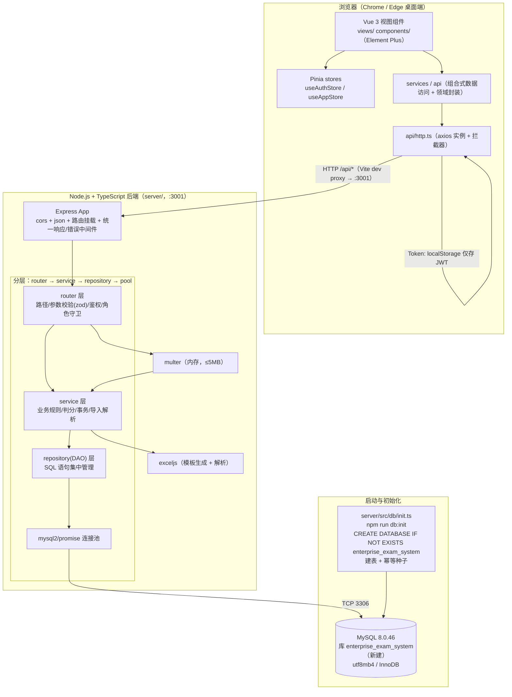
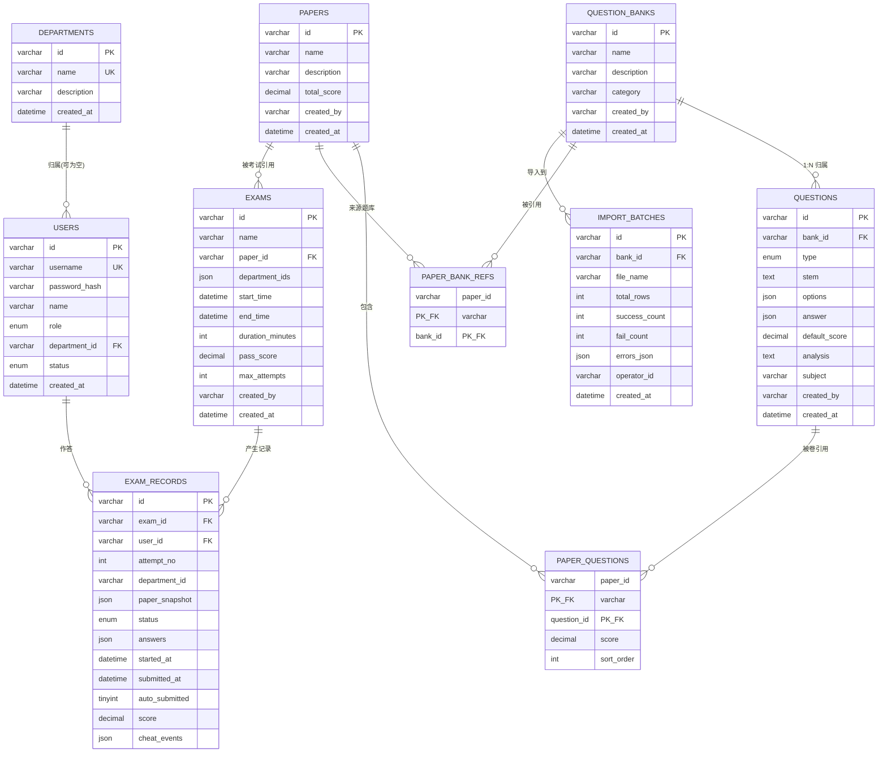
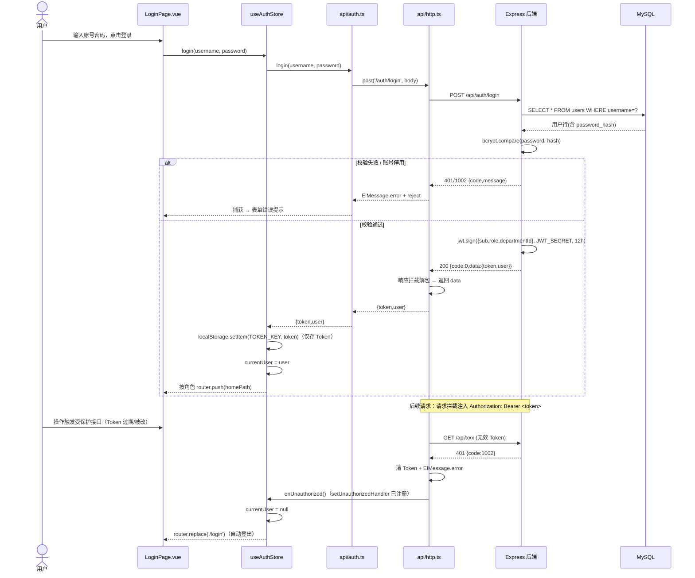
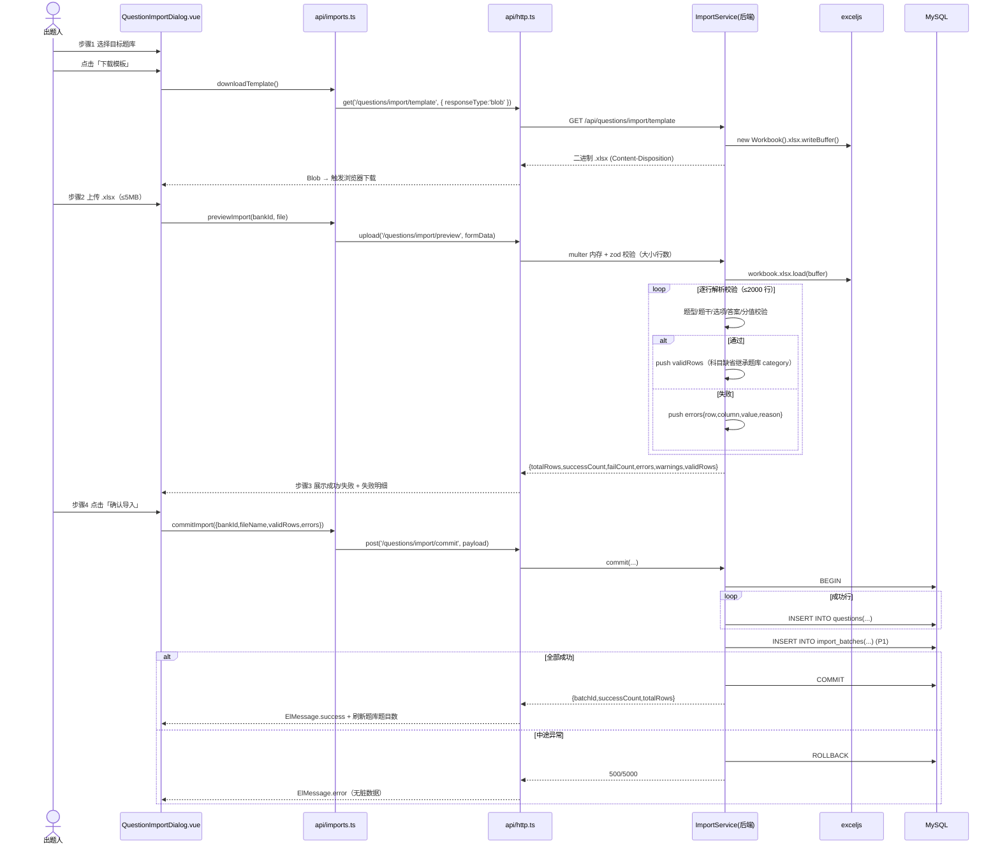
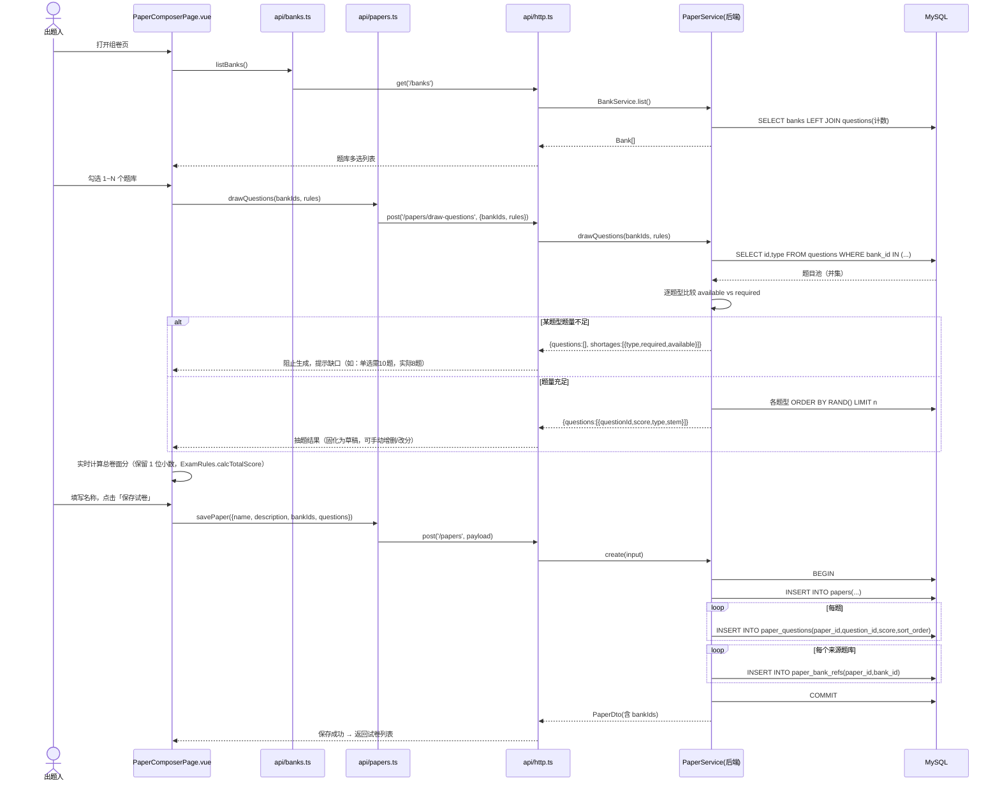
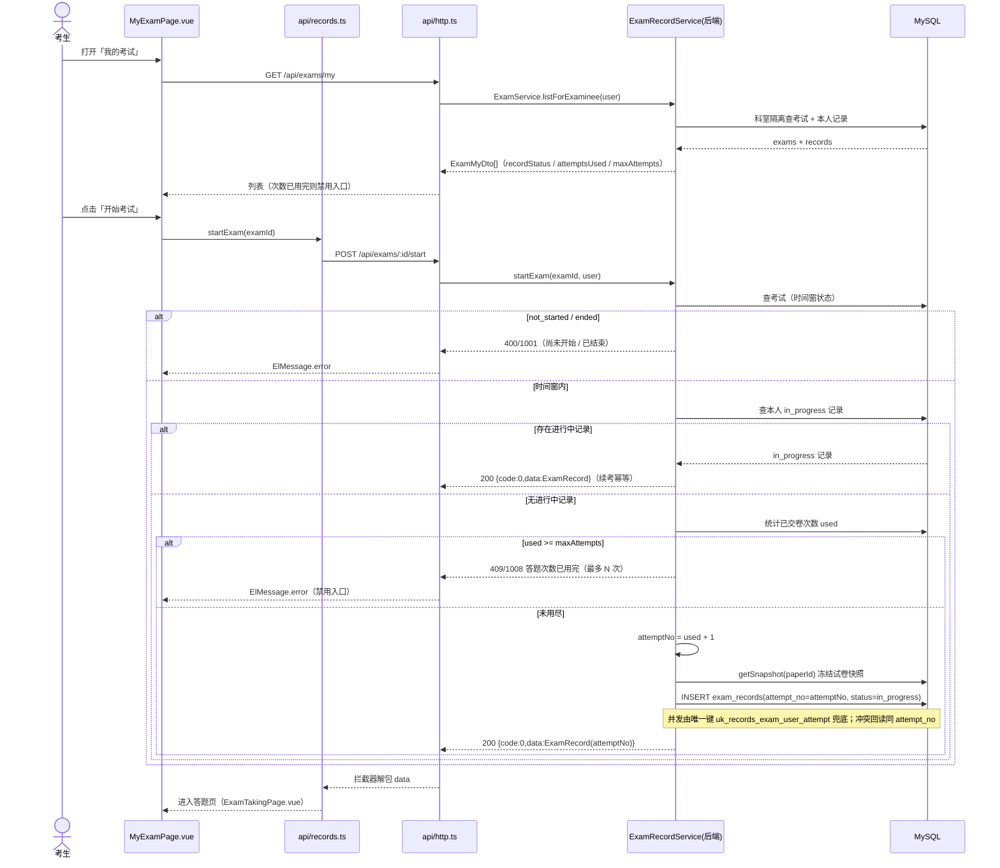
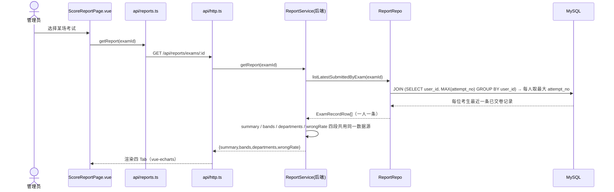
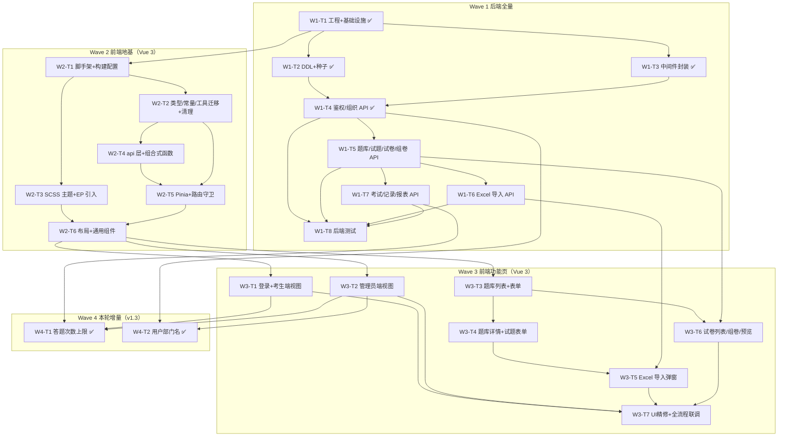

# 企业内部在线考试系统 — 增量架构设计与任务分解（v1.3）

> 文档版本：v1.3（增量 · 多次作答 + 部门名）｜ 架构师：高见远（Bob）｜ 日期：2025-10-13
> 上游输入：`docs/03-PRD-increment.md`（增量 PRD v1.1，许清楚）
> 基线文档：`docs/01-PRD.md`（v1.0）、`docs/02-architecture.md`（v1.0）、`README.md`
> 变更主题：**纯前端 SPA + localStorage → 前后端分离（Node.js + MySQL 后端 REST API）**，新增独立题库管理（含 Excel 批量导入）、改造为多题库组合组卷、前端 UI 整体视觉升级；
> **v1.2 追加变更：前端由 React 18 + MUI v5 整体重写为 Vue 3 + Element Plus（UI 设计 token 与信息架构不变）。后端设计与接口契约保持不变。**
> **v1.3 追加变更（本轮）：**
> **(一) 考试「答题次数」上限真实生效** —— `exams.max_attempts` + `exam_records.attempt_no`（唯一键改 `uk_records_exam_user_attempt`）、新增错误码 **1008 `ATTEMPTS_EXHAUSTED`**、`start` 状态机「续考幂等 / 次数用完拒绝」、`/exams/my` 新增 `attemptsUsed`、**报表统计口径改为「每人取 `MAX(attempt_no)` 的已交卷记录」**；
> **(二) 用户 DTO 增加「部门名」** —— `UserDto.departmentName`（`users LEFT JOIN departments`）。

---

## 0. 前提与已确认决策（直接采纳，不再推翻）

| # | 决策 | 来源 |
| --- | --- | --- |
| D1 | 后端为**真实可运行的 Node.js 服务 + 真实 MySQL**（非 Mock、非仅接口文档） | 主理人确认 |
| D2 | 数据库：`localhost:3306`、`root`、库 **`enterprise_exam_system`**（**新建独立库**，绝不触碰本机已有的 `exam_system` 库），口令经 `.env` 注入，**严禁硬编码**；建表与种子由 **Node 脚本自动执行**（`npm run db:init`），不依赖 mysql CLI。**理由**：`exam_system` 已被另一个项目（Prisma 系学习/考试系统，17 张表）占用，其 users/questions/question_banks/exams/exam_records 表名与本项目冲突，故新建独立库规避 | 主理人确认 |
| D3 | 新增独立「题库管理」模块（QuestionBank 为试题容器）；「试卷管理」独立，新增试卷**先选题库且支持多选（1~N）**，从并集题目池选题 | 主理人确认 |
| D4 | 试题与题库关系 = **1:N**（`question.bank_id`），M:N 列为 P2 预留 | 主理人确认 |
| D5 | Excel 导入：**成功行写入、失败行跳过**，成功行在**单个事务**内写入 | 主理人确认 |
| D6 | 随机组卷语义：**随机一次即固化成卷**，不持久化随机种子，不做人数分卷；题量不足**阻止生成并提示缺口** | 主理人确认 |
| D7 | 管理员 = **超级管理员**，对题库管理 / Excel 导入 / 试卷管理与出题人**同权** | 主理人确认 |
| D8 | **存量数据不迁移**：localStorage 旧数据丢弃，由后端种子重新初始化（保留演示账号 / 2 科室 / 10 示例题 / 示例试卷与考试，并补 2 个示例题库） | 主理人确认 |
| D9 | UI 整体视觉升级：严格按 PRD §7 设计 Token 落地 | 主理人确认 |
| D10（后端） | 后端选型：Node 22 + TS + `tsx`，Express 4，`mysql2/promise`，`jsonwebtoken` + `bcryptjs`，`multer` + **`exceljs`**（禁用 npm `xlsx`/SheetJS），`zod`，`dotenv`/`cors`，后端测试 `vitest` + `supertest` | 主理人约束 |
| D10（前端） | 前端选型：**Vue 3（组合式 API + `<script setup lang="ts">`）** + **Element Plus** + vue-router 4 + Pinia + ECharts/vue-echarts + axios；样式用 **SCSS 变量覆盖主题**（不引入 Tailwind/UnoCSS）；构建 Vite + `@vitejs/plugin-vue` + `vue-tsc`；单测 Vitest（+ `@vue/test-utils` 可选） | 主理人约束 |
| D11 | 数据库名 = `enterprise_exam_system`（**新建独立库**）；本机已核对 **MySQL 8.0.46**，`root/123456` 可连通，无 mysql CLI / 无 Docker，建表与种子只能由 Node 脚本执行 | 主理人实测 + 用户确认 |
| D12 | 前端由 **React 18 + MUI v5 整体重写为 Vue 3 + Element Plus**；UI 设计 token 与信息架构不变，仅承载技术变更；旧 React 代码删除并已备份至 `D:/项目/考试1/.backup/react-frontend-20261012.tar.gz` | 主理人 + 用户确认 |
| D13 | 前端工程位于**项目根目录（原地替换）**，后端位于 `server/`，二者各自独立 `package.json` 与 `node_modules` | 主理人确认 |
| D14 | 考试支持**多次作答**：`exams.max_attempts`（整数 1~10，默认 1）限制每人可交卷次数；每次作答生成独立 `exam_records` 行，以 `attempt_no` 区分（唯一键 `uk_records_exam_user_attempt(exam_id,user_id,attempt_no)`）。**取代** v1.0「一人一场仅一条记录 / 已交卷不可重复考试」的旧断言 | 主理人确认 |
| D15 | 报表（summary/bands/departments/wrongRate）**每人只取 `MAX(attempt_no)` 的那条已交卷记录**参与统计，避免多次作答重复计数 | 主理人确认 |

---

# Part A：系统设计

## 1. 增量架构总览

### 1.1 架构图



### 1.2 分层职责与目录映射

| 层 | 职责 | 目录映射 | 约束 |
| --- | --- | --- | --- |
| 前端视图层 | 页面/组件渲染、交互、loading/空态/错误提示（`<script setup>`） | `src/views`、`src/components` | 不直接调用 axios，只用 store / composable / api |
| 前端状态层 | 全局会话、侧栏折叠等 UI 状态 | `src/stores/*.ts`（Pinia） | 仅放跨页共享状态 |
| 前端领域/访问层 | 领域封装 + 组合式数据访问 | `src/services/*.ts`、`src/composables/*.ts` | 组合式函数统一 loading/error |
| 前端接口层 | 唯一 axios 实例、Token 注入、401 处理、错误归一、按模块接口函数 | `src/api/http.ts`、`src/api/*.ts` | 全项目唯一 axios 实例 |
| 后端 router 层 | 路由定义、**zod 参数校验**、鉴权/角色守卫、调用 service、统一响应 | `server/src/modules/*/*.router.ts` | 只做编排，无业务规则 |
| 后端 service 层 | 业务规则（判分、组卷抽题、导入解析、权限数据过滤、事务边界） | `server/src/modules/*/*.service.ts` | 事务用 `pool.getConnection()` |
| 后端 repository 层 | SQL 语句集中；返回领域对象（含 JSON 列反序列化、时间转 ISO） | `server/src/modules/*/*.repo.ts`、`server/src/db/pool.ts` | 只与 DB 交互 |
| 数据层 | 表结构、种子数据 | `server/src/db/schema.sql`、`server/src/db/seed.ts` | `utf8mb4_unicode_ci` / InnoDB |

> **单一数据出口原则延续**：v1.0 的 `storage.ts` 是唯一 localStorage 出口；本次将该「唯一出口」前移到 `src/api/http.ts` —— 前端所有数据经它出站，业务层只依赖 api/composable。

---

## 2. 技术选型表

### 2.1 后端

| 类别 | 选型 | 版本 | 理由 |
| --- | --- | --- | --- |
| 后端运行时 | Node.js | 22.x（`C:\Users\Administrator\.workbuddy\binaries\node\versions\22.22.2-6`） | 本机既有；原生 ESM、`fetch`、性能稳定 |
| 后端语言 | TypeScript | ^5.5.0 | 类型安全；`tsx` 直跑 TS，`tsc` 构建 |
| TS 运行器 | `tsx` | ^4.19.0 | 开发零构建直跑 TS，免 `ts-node` ESM 配置痛点 |
| Web 框架 | Express | ^4.21.0 | 4.x 稳定、中间件生态成熟、学习成本低 |
| DB 驱动 | `mysql2` | ^3.11.0 | 原生 Promise API + 连接池 + prepared statements（防注入） |
| 鉴权令牌 | `jsonwebtoken` | ^9.0.2 | HS256，成熟稳定 |
| 口令哈希 | `bcryptjs` | ^2.4.3 | 纯 JS 无原生编译依赖（Windows 免编译），cost 10 |
| 上传 | `multer` | ^1.4.5-lts.1 | 内存存储 + 体积限制，简单可靠 |
| Excel | `exceljs` | ^4.4.0 | **替代 npm `xlsx`（停更 + 已知漏洞）**；读写 .xlsx、样式、二进制流输出 |
| 参数校验 | `zod` | ^3.23.8 | 声明式 schema，错误信息可映射为统一错误码 |
| 配置 | `dotenv` | ^16.4.5 | `.env` 注入，杜绝硬编码 |
| 跨域 | `cors` | ^2.8.5 | 开发期直连 / 代理兜底 |
| 后端测试 | `vitest` + `supertest` | ^2.1.9 / ^7.0.0 | 单测 + HTTP 集成测试 |

### 2.2 前端（Vue 3）

| 类别 | 选型 | 版本 | 理由 |
| --- | --- | --- | --- |
| 框架 | `vue` | ^3.5.13 | 组合式 API + `<script setup lang="ts">`；与 Vite 5 完全兼容 |
| 组件库 | `element-plus` | ^2.8.8 | 中后台组件齐备（表格/表单/弹窗/步骤条/分页/骨架）；SCSS 变量可覆盖主题 |
| 图标 | `@element-plus/icons-vue` | ^2.3.1 | 替代 `@mui/icons-material` |
| 路由 | `vue-router` | ^4.4.5 | Vue 3 官方路由，支持 `meta` 权限与全局守卫 |
| 状态管理 | `pinia` | ^2.2.6 | 替代 React Context；`useAuthStore` 承载会话 |
| 图表 | `echarts` + `vue-echarts` | ^5.5.1 / ^7.0.3 | 替代 recharts；成绩报表柱状图 |
| HTTP | `axios` | ^1.7.7 | 统一实例 + 拦截器（注入 Token、401、错误归一） |
| 样式 | `sass`（SCSS） | ^1.80.6 | SCSS 变量覆盖 Element Plus 主题（不引入 Tailwind/UnoCSS） |
| 构建 | `vite` + `@vitejs/plugin-vue` | ^5.4.0 / ^5.1.4 | 沿用 Vite 5；Vue SFC 编译 |
| 按需引入 | `unplugin-auto-import` + `unplugin-vue-components` | ^0.18.6 / ^0.27.4 | 按需自动引入 EP 组件与 API，配合 SCSS 变量覆盖 |
| 类型检查 | `vue-tsc` | ^2.1.10 | 替代 `tsc --noEmit`，识别 `.vue` 类型 |
| 单测 | `vitest` + `@vue/test-utils`（可选） | ^2.1.9 / ^2.4.6 | 纯函数/组合式函数单测；沿用现有 vitest |

> **可行性**：前端 Vue 3 工程仍在项目根目录、仍用 Vite 5，与既有构建体系兼容；后端完全独立（`server/`）。前端唯一重型依赖为 Element Plus（中后台标准选择），符合「不引入冗余依赖」。

---

## 3. MySQL 数据库设计（核心交付物）

### 3.0 库的创建与隔离约定

- 本项目使用**独立库 `enterprise_exam_system`**，与同实例下已有的 `exam_system`（另一个项目）**完全隔离**。
- `db:init` 必须以 root 连接**不指定 database**，先执行
  `CREATE DATABASE IF NOT EXISTS enterprise_exam_system DEFAULT CHARACTER SET utf8mb4 COLLATE utf8mb4_unicode_ci`，
  再 `USE` / 切换连接库建表。
- **严禁**对 `exam_system` 库执行任何 DDL/DML（包括 `DROP`、`CREATE OR REPLACE`、`INSERT`）。
- 测试库为 **`enterprise_exam_system_test`**（原设计的 `exam_system_test` 一并改名）。

### 3.1 全局约定

- **命名冲突**：因使用独立库 `enterprise_exam_system`，本项目表名与同实例 `exam_system` 库的既有表**不存在命名冲突**。
- 字符集/引擎：`DEFAULT CHARSET=utf8mb4 COLLATE=utf8mb4_unicode_ci ENGINE=InnoDB`。
- **ID 策略：字符串 ID（VARCHAR(64)）**。沿用 v1.0 语义（`q-01`、`user-admin`、`paper-demo`、`dept-rd`、`bank-security`…）。
  - **理由**：① `paper_questions.question_id`、`exams.paper_id`、`bank_id` 等引用关系全部是字符串；② 种子数据显式 ID（`user-author` 等）被前端演示流程/测试依赖；③ 改自增会破坏 `PaperQuestion.questionId` 语义与存档快照，改造面大、收益低。
  - **新实体 ID 生成**：后端 `server/src/utils/id.ts` 提供与前端一致的 `genId()`（时间戳 base36 + 随机串），前缀化更易读（`bank-`、`q-`、`batch-`…）。
  - 影响：所有外键列为 `VARCHAR(64)`；主键即业务 ID，无需映射。
- **选项与答案存储：JSON 列**
  - `questions.options` → **JSON 数组 `["...","..."]`**（对应前端 `string[]`）。
  - `questions.answer` → **JSON 数组 `[0,1,3]`**（选项索引数组，对应前端 `number[]`；单选/判断恒为长度 1，多选升序）。
  - **理由**：选项数量不定（2~6）且题型统一用「索引数组」表达答案，用 JSON 列可 1:1 映射前端类型，免建 `question_options` 子表与 join；查询不需按选项检索，无索引诉求。读取时后端 `JSON.parse` 归一为数组（兼容 MySQL 驱动已返回对象的情况）。
- **`paper_snapshot` / `answers` / `cheat_events`：JSON 列**
  - `exam_records.paper_snapshot` → `PaperSnapshot` 完整冻结副本（含题目内容）。
  - `exam_records.answers` → `Record<questionId, number[]>`。
  - `exam_records.cheat_events` → `CheatEvent[]`（只增不改，读改写回整列）。
  - **理由**：这些都是「聚合内整体读取、不做关系查询」的文档型字段，JSON 列最贴合，避免为快照再建多张子表。
- **时间字段类型：`DATETIME(3)`（毫秒精度，UTC 存储）**
  - 统一存 UTC；毫秒精度保证「开始/截止时间等值判断」与 v1.0 的 ISO 字符串精度一致（v1.0 测试覆盖了「恰好等于开始/截止时间」的边界）。
  - **转换约定**：连接池设 `timezone: 'Z'` + `dateStrings: true`（拿到原始字符串，避免驱动本地时区解释）；
    - 写：`toDbDate(iso)` = `new Date(iso).toISOString()` → `'YYYY-MM-DD HH:mm:ss.SSS'`（去 `T`/`Z`）。
    - 读：`fromDbDate(v)` = `new Date(v.replace(' ', 'T') + 'Z').toISOString()`。
    - helper 放 **`server/src/utils/datetime.ts`**；前端只收发 ISO 8601 字符串，展示仍用 `src/utils/datetime.ts`。
- **`department_ids`（考试参与科室）**：存 `exams.department_ids` JSON 数组（对应前端 `Exam.departmentIds: string[]`）。考生可见性查询用 `JSON_CONTAINS(department_ids, JSON_QUOTE(?))`。规模小，暂不建 `exam_departments` 关联表（如需强约束列为 P2 优化）。
- **`question_count`（题库题目数）**：**派生统计**，不落列，查询时 `LEFT JOIN questions ... GROUP BY` 计算，避免双写漂移。
- **`created_by` 类字段（provenance）**：`question_banks.created_by`、`questions.created_by`、`papers.created_by`、`exams.created_by`、`import_batches.operator_id` 保留为 `VARCHAR(64)`，**不建外键**。理由：这些是「创建人溯源」信息；而 v1.0 允许删除无考试记录的用户，建外键会阻断用户管理，收益为负。

### 3.2 完整 DDL（可直接执行）

```sql
-- ============================================================
-- 企业内部在线考试系统 v1.2 —— MySQL 建表脚本
-- 库：enterprise_exam_system（新建独立库；勿与 exam_system 混淆）  字符集：utf8mb4  排序规则：utf8mb4_unicode_ci  引擎：InnoDB
-- 时间字段一律 DATETIME(3)（UTC）。执行入口：server/src/db/init.ts
-- ============================================================
SET NAMES utf8mb4;

-- 1. 科室
CREATE TABLE IF NOT EXISTS departments (
  id            VARCHAR(64)  NOT NULL,
  name          VARCHAR(100) NOT NULL,
  description   VARCHAR(255) NOT NULL DEFAULT '',
  created_at    DATETIME(3)  NOT NULL,
  PRIMARY KEY (id),
  UNIQUE KEY uk_departments_name (name)
) ENGINE=InnoDB DEFAULT CHARSET=utf8mb4 COLLATE=utf8mb4_unicode_ci;

-- 2. 用户（口令 bcrypt 加盐；department_id 为 NULL 表示不归属科室）
CREATE TABLE IF NOT EXISTS users (
  id            VARCHAR(64)  NOT NULL,
  username      VARCHAR(64)  NOT NULL,
  password_hash VARCHAR(100) NOT NULL,
  name          VARCHAR(64)  NOT NULL,
  role          ENUM('admin','author','examinee') NOT NULL,
  department_id VARCHAR(64)  NULL,
  status        ENUM('active','disabled') NOT NULL DEFAULT 'active',
  created_at    DATETIME(3)  NOT NULL,
  PRIMARY KEY (id),
  UNIQUE KEY uk_users_username (username),
  KEY idx_users_department (department_id),
  CONSTRAINT fk_users_department FOREIGN KEY (department_id)
    REFERENCES departments(id) ON DELETE RESTRICT ON UPDATE CASCADE
) ENGINE=InnoDB DEFAULT CHARSET=utf8mb4 COLLATE=utf8mb4_unicode_ci;

-- 3. 题库（试题容器；admin/author 可管理）
CREATE TABLE IF NOT EXISTS question_banks (
  id            VARCHAR(64)  NOT NULL,
  name          VARCHAR(120) NOT NULL,
  description   VARCHAR(255) NOT NULL DEFAULT '',
  category      VARCHAR(64)  NOT NULL DEFAULT '未分类',
  created_by    VARCHAR(64)  NOT NULL,
  created_at    DATETIME(3)  NOT NULL,
  PRIMARY KEY (id),
  KEY idx_banks_category (category)
) ENGINE=InnoDB DEFAULT CHARSET=utf8mb4 COLLATE=utf8mb4_unicode_ci;

-- 4. 试题（1:N 归属题库；options/answer 为 JSON）
CREATE TABLE IF NOT EXISTS questions (
  id            VARCHAR(64)  NOT NULL,
  bank_id       VARCHAR(64)  NOT NULL,
  type          ENUM('single','multiple','judge') NOT NULL,
  stem          TEXT         NOT NULL,
  options       JSON         NOT NULL,
  answer        JSON         NOT NULL,
  default_score DECIMAL(6,1) NOT NULL DEFAULT 10.0,
  analysis      TEXT         NULL,
  subject       VARCHAR(64)  NOT NULL DEFAULT '未分类',
  created_by    VARCHAR(64)  NOT NULL,
  created_at    DATETIME(3)  NOT NULL,
  PRIMARY KEY (id),
  KEY idx_questions_bank (bank_id),
  KEY idx_questions_type (type),
  KEY idx_questions_subject (subject),
  CONSTRAINT fk_questions_bank FOREIGN KEY (bank_id)
    REFERENCES question_banks(id) ON DELETE RESTRICT ON UPDATE CASCADE
) ENGINE=InnoDB DEFAULT CHARSET=utf8mb4 COLLATE=utf8mb4_unicode_ci;

-- 5. 试卷
CREATE TABLE IF NOT EXISTS papers (
  id            VARCHAR(64)  NOT NULL,
  name          VARCHAR(120) NOT NULL,
  description   VARCHAR(255) NOT NULL DEFAULT '',
  total_score   DECIMAL(7,1) NOT NULL DEFAULT 0.0,
  created_by    VARCHAR(64)  NOT NULL,
  created_at    DATETIME(3)  NOT NULL,
  PRIMARY KEY (id)
) ENGINE=InnoDB DEFAULT CHARSET=utf8mb4 COLLATE=utf8mb4_unicode_ci;

-- 6. 试卷题目（题目引用 + 分值 + 顺序；外键级联随题/卷删除）
CREATE TABLE IF NOT EXISTS paper_questions (
  paper_id      VARCHAR(64)  NOT NULL,
  question_id   VARCHAR(64)  NOT NULL,
  score         DECIMAL(6,1) NOT NULL,
  sort_order    INT          NOT NULL DEFAULT 0,
  PRIMARY KEY (paper_id, question_id),
  KEY idx_pq_question (question_id),
  CONSTRAINT fk_pq_paper FOREIGN KEY (paper_id)
    REFERENCES papers(id) ON DELETE CASCADE ON UPDATE CASCADE,
  CONSTRAINT fk_pq_question FOREIGN KEY (question_id)
    REFERENCES questions(id) ON DELETE CASCADE ON UPDATE CASCADE
) ENGINE=InnoDB DEFAULT CHARSET=utf8mb4 COLLATE=utf8mb4_unicode_ci;

-- 7. 试卷-题库关联（来源题库，用于回显与追溯；多对多）
CREATE TABLE IF NOT EXISTS paper_bank_refs (
  paper_id      VARCHAR(64) NOT NULL,
  bank_id       VARCHAR(64) NOT NULL,
  PRIMARY KEY (paper_id, bank_id),
  KEY idx_pbr_bank (bank_id),
  CONSTRAINT fk_pbr_paper FOREIGN KEY (paper_id)
    REFERENCES papers(id) ON DELETE CASCADE ON UPDATE CASCADE,
  CONSTRAINT fk_pbr_bank FOREIGN KEY (bank_id)
    REFERENCES question_banks(id) ON DELETE CASCADE ON UPDATE CASCADE
) ENGINE=InnoDB DEFAULT CHARSET=utf8mb4 COLLATE=utf8mb4_unicode_ci;

-- 8. 考试（department_ids 为参与科室 JSON 数组）
CREATE TABLE IF NOT EXISTS exams (
  id               VARCHAR(64)  NOT NULL,
  name             VARCHAR(120) NOT NULL,
  paper_id         VARCHAR(64)  NOT NULL,
  department_ids   JSON         NOT NULL,
  start_time       DATETIME(3)  NOT NULL,
  end_time         DATETIME(3)  NOT NULL,
  duration_minutes INT          NOT NULL,
  pass_score       DECIMAL(7,1) NOT NULL,
  max_attempts     INT          NOT NULL DEFAULT 1,
  created_by       VARCHAR(64)  NOT NULL,
  created_at       DATETIME(3)  NOT NULL,
  PRIMARY KEY (id),
  KEY idx_exams_paper (paper_id),
  CONSTRAINT fk_exams_paper FOREIGN KEY (paper_id)
    REFERENCES papers(id) ON DELETE RESTRICT ON UPDATE CASCADE
) ENGINE=InnoDB DEFAULT CHARSET=utf8mb4 COLLATE=utf8mb4_unicode_ci;

-- 9. 考试记录（同一考生同一场考试可多次作答：attempt_no 区分，唯一键保证不重复）
CREATE TABLE IF NOT EXISTS exam_records (
  id              VARCHAR(64)  NOT NULL,
  exam_id         VARCHAR(64)  NOT NULL,
  user_id         VARCHAR(64)  NOT NULL,
  attempt_no      INT          NOT NULL DEFAULT 1,
  department_id   VARCHAR(64)  NULL,
  paper_snapshot  JSON         NOT NULL,
  status          ENUM('in_progress','submitted') NOT NULL DEFAULT 'in_progress',
  answers         JSON         NOT NULL,
  started_at      DATETIME(3)  NOT NULL,
  submitted_at    DATETIME(3)  NULL,
  auto_submitted  TINYINT(1)   NOT NULL DEFAULT 0,
  score           DECIMAL(7,1) NOT NULL DEFAULT 0.0,
  cheat_events    JSON         NOT NULL,
  PRIMARY KEY (id),
  UNIQUE KEY uk_records_exam_user_attempt (exam_id, user_id, attempt_no),
  KEY idx_records_user (user_id),
  CONSTRAINT fk_records_exam FOREIGN KEY (exam_id)
    REFERENCES exams(id) ON DELETE RESTRICT ON UPDATE CASCADE,
  CONSTRAINT fk_records_user FOREIGN KEY (user_id)
    REFERENCES users(id) ON DELETE RESTRICT ON UPDATE CASCADE
) ENGINE=InnoDB DEFAULT CHARSET=utf8mb4 COLLATE=utf8mb4_unicode_ci;

-- 10. 导入批次（P1 导入历史；errors_json 为逐行错误明细）
CREATE TABLE IF NOT EXISTS import_batches (
  id             VARCHAR(64)  NOT NULL,
  bank_id        VARCHAR(64)  NOT NULL,
  file_name      VARCHAR(255) NOT NULL,
  total_rows     INT          NOT NULL DEFAULT 0,
  success_count  INT          NOT NULL DEFAULT 0,
  fail_count     INT          NOT NULL DEFAULT 0,
  errors_json    JSON         NOT NULL,
  operator_id    VARCHAR(64)  NOT NULL,
  created_at     DATETIME(3)  NOT NULL,
  PRIMARY KEY (id),
  KEY idx_batches_bank (bank_id),
  CONSTRAINT fk_batches_bank FOREIGN KEY (bank_id)
    REFERENCES question_banks(id) ON DELETE CASCADE ON UPDATE CASCADE
) ENGINE=InnoDB DEFAULT CHARSET=utf8mb4 COLLATE=utf8mb4_unicode_ci;
```

### 3.3 外键与删除策略（与 PRD §8 一致）

| 关系 | 外键 | 删除规则 | 对应 PRD 规则 / 理由 |
| --- | --- | --- | --- |
| `questions.bank_id → question_banks` | RESTRICT | 禁止直接删有题题库；**"级联删题"由 service 在事务内先删题再删库** | 题库删除需二次强确认，语义在应用层显式控制 |
| `paper_questions.paper_id → papers` | CASCADE | 删卷连带删关联 | 关联表随卷消失 |
| `paper_questions.question_id → questions` | CASCADE | **删题连带删引用** | 试题可直接删除；已引用历史由 `exam_records.paper_snapshot` 快照保证不受影响（与 v1.0 `getSnapshot` 一致） |
| `paper_bank_refs.paper_id → papers` | CASCADE | 删卷连带删来源关联 | 关联表随卷消失 |
| `paper_bank_refs.bank_id → question_banks` | CASCADE | 删库连带删来源关联 | 题库删除后其来源标记无意义 |
| `exams.paper_id → papers` | RESTRICT | **被考试引用的试卷禁止删除** | v1.0 `paperService.remove` 规则 |
| `exam_records.exam_id → exams` | RESTRICT | **已存在成绩记录的考试禁止删除** | v1.0 `examService.remove` 规则 |
| `exam_records.user_id → users` | RESTRICT | 有考试记录的用户删除被拒（可停用） | v1.0 `userService.remove` 规则 |
| `users.department_id → departments` | RESTRICT | **有归属用户的科室禁止删除** | v1.0 `departmentService.remove` 规则 |
| `import_batches.bank_id → question_banks` | CASCADE | 删库连带删其导入批次 | P1 审计记录，随容器清理 |

> `created_by` / `operator_id` 无外键（见 §3.1），因此不会阻断用户/科室管理。

### 3.4 ER 图



### 3.5 幂等增量迁移（v1.3 · 旧库原地升级）

`server/src/db/init.ts` 在 10 张表 DDL 执行**之后**调用 `applyMigrations()`，使 `npm run db:init` 对「已建库的旧环境」也能原地补齐 v1.3 结构，且**重复执行安全**。

| # | 升级项 | 检测方式 | 变更语句 |
| --- | --- | --- | --- |
| 1 | `exams.max_attempts` | `information_schema.COLUMNS` 是否存在该列 | `ALTER TABLE exams ADD COLUMN max_attempts INT NOT NULL DEFAULT 1 AFTER pass_score` |
| 2 | `exam_records.attempt_no` | 同上 | `ALTER TABLE exam_records ADD COLUMN attempt_no INT NOT NULL DEFAULT 1 AFTER user_id` |
| 3 | 唯一键替换 | `information_schema.STATISTICS` 是否含 `uk_records_exam_user_attempt` / `uk_records_exam_user` | 先 `ADD UNIQUE KEY uk_records_exam_user_attempt (exam_id, user_id, attempt_no)`，再 `DROP INDEX uk_records_exam_user` |

**注意事项（务必遵守）**：

1. **MySQL 不支持 `ADD COLUMN IF NOT EXISTS`**，因此一律先查 `information_schema`（`COLUMN` / `STATISTICS`）判断后再决定是否执行，保证幂等；无变更时打印「无需变更（已是最新）」。
2. **唯一键替换的顺序约束（关键）**：旧唯一键 `uk_records_exam_user(exam_id, user_id)` 的最左列 `exam_id` 同时充当外键 `fk_records_exam(exam_id)` 的索引，**直接 DROP 会报 `ER_DROP_INDEX_FK`**；必须先 `ADD` 新唯一键 `uk_records_exam_user_attempt(exam_id, user_id, attempt_no)`（以 `exam_id` 为最左列，可兼作该外键索引），再 `DROP` 旧键。
3. 新唯一键把「一人一场一条」放宽为「一人一场每 `attempt_no` 一条」，是多次作答与**并发开考兜底**的数据库级保证（见 §4.5 `start` 契约）。
4. 历史数据兼容：旧记录 `attempt_no` 由 `DEFAULT 1` 补齐，等价于「每人第一次作答」，报表口径（取 `MAX(attempt_no)`）对旧数据无影响。

> `server/src/db/schema.ts`（DDL 权威来源）与本节 DDL 已同步：全新库由 `CREATE TABLE` 直接建成新结构，旧库由 `applyMigrations()` 原地升级，两条路径终态一致。

---

## 4. 后端 API 设计

### 4.1 统一响应包装

**定稿**：`{ code, message, data }`

- 成功：HTTP 200，`{ "code": 0, "message": "ok", "data": <payload> }`
- 失败：HTTP 状态码语义化（400/401/403/404/409/500），`{ "code": <业务错误码>, "message": "<中文提示>", "data": null }`

```ts
// server/src/utils/response.ts
type ApiOk<T>  = { code: 0; message: 'ok'; data: T };
type ApiErr    = { code: number; message: string; data: null };
```

### 4.2 统一错误码表

| code | HTTP | 含义 | 示例 message |
| --- | --- | --- | --- |
| 0 | 200 | 成功 | ok |
| 1001 | 400 | 参数校验失败（zod） | 考试名称不能为空 |
| 1002 | 401 | 未认证 / Token 缺失或失效 | 登录状态已失效，请重新登录 |
| 1003 | 403 | 无权限（角色越权） | 无权执行该操作 |
| 1004 | 404 | 资源不存在 | 试题不存在或已被删除 |
| 1005 | 409 | 业务规则冲突（唯一性/引用） | 登录账号 "x" 已存在 / 该试卷已被考试引用，无法删除 |
| 1006 | 400 | 文件/导入校验失败 | 文件超过 5MB 限制 / 单次导入不得超过 2000 行 |
| 1007 | 400 | 导入数据校验失败（业务，返回明细） | **保留未启用**。行级校验失败当前采用「部分成功」语义：返回 HTTP 200 + `data.errors`（逐行明细）/ `data.validRows`，不抛 1007。该码保留供后续「整批拒绝」模式使用 |
| 1008 | 409 | 答题次数已用完（业务） | 答题次数已用完（最多 2 次） |
| 5000 | 500 | 服务器内部错误 | 服务器开小差了，请稍后重试 |

> **设计说明（错误码 1007 / 导入语义）**：Excel 导入在预览（`/import/preview`）与提交（`/import/commit`）阶段采用**「部分成功」**语义——逐行校验后，合法行正常写入（commit 单事务内批量 INSERT），非法行**跳过不写**，整体仍返回 HTTP 200，行级错误通过 `data.errors`（`{row,column,value,reason}`）携带、合法行通过 `data.validRows` 携带，由前端逐行提示。之所以**不抛 1007**：一次导入几十上百行时，个别行数据不合法不应阻断整批导入，用户期望「能导的先导、坏行给出明细」，若返回 400/1007 会让整批作废、体验更差。故 `server/src/utils/errors.ts` 中虽定义了 `IMPORT_INVALID(1007)`，但当前**无任何调用点**，属**保留码**——预留给未来可能引入的「整批拒绝（strict/all-or-nothing）」模式（该模式下任一行不合法则整批回滚并返回 1007）。注意：文件级失败（超 5MB、超 2000 行、格式非法）仍走 **1006**（参数/文件校验失败），与行级业务错误区分。

> 前端 `src/api/http.ts` 拦截器：`2xx` → 解包返回 `data`；`code !== 0` → `Promise.reject(new Error(message))`；`401` → 清 Token + 跳登录 + `ElMessage.error`。

### 4.3 鉴权与守卫中间件设计

| 中间件 | 文件 | 行为 |
| --- | --- | --- |
| `authRequired` | `server/src/middleware/auth.ts` | 解析 `Authorization: Bearer <token>`，`jwt.verify` 校验；成功挂 `req.user = { id, role, departmentId }`；失败 → 1002/401 |
| `requireRole(...roles)` | `server/src/middleware/role.ts` | 校验 `req.user.role ∈ roles`；否则 1003/403 |
| `validate(schema, source)` | `server/src/middleware/validate.ts` | `zod` 校验 `body/query/params`；失败 → 1001/400（含首条中文错误） |
| `asyncHandler(fn)` | `server/src/utils/asyncHandler.ts` | 包裹 async 路由，异常自动 `next(err)` |
| `ok(res, data)` | `server/src/utils/response.ts` | 统一成功响应 |
| `errorHandler` | `server/src/middleware/errorHandler.ts` | 兜底：`AppError(code,status,msg)` → 映射响应；未知异常 → 5000/500（仅开发环境打印栈） |

> **校验文案口径**：上表 `validate` 返回的「首条中文错误」并非逐字段手工维护，而是由 `server/src/utils/zodLocale.ts` 注册的 **zod 全局 errorMap** 统一保证——所有内置校验（`min`/`max`/`int`/`coerce`/必填等）的默认文案均为中文；字段级显式 `message`（如「每页最多 100 条」）优先级高于全局文案。详见 §4.4「越界处理」备注。

**JWT 载荷**：`{ sub: userId, role, departmentId }`，HS256，`secret = process.env.JWT_SECRET`，`expiresIn = process.env.JWT_EXPIRES_IN || '12h'`。

### 4.4 分页统一约定

请求：`?page=1&pageSize=20`（`page` 从 1 起；`pageSize` 默认 20、上限 100）。
响应 `data`：

```json
{ "list": [ ... ], "total": 123, "page": 1, "pageSize": 20 }
```

适用：`GET /api/banks/:id/questions`、`GET /api/questions`、`GET /api/records?examId=`。默认每页 20 对应 PRD P0-14。

> **越界处理**：`page < 1` 或 `pageSize` 超出 1~100 时，由参数校验中间件直接返回 **400 / code 1001（参数错误）**，**不做静默夹取** —— 静默纠正越界值会掩盖前端传参 bug。`normalizePaging()`（`server/src/utils/pagination.ts`）中的夹取逻辑保留为**内部调用方的防御性兜底**（供 service 层直接调用时使用），并非 HTTP 路径上的实际行为；亦不应出现 500。
>
> 所有校验失败文案统一为**中文**（由 `server/src/utils/zodLocale.ts` 注册的全局 errorMap 保证；字段级显式 message 优先级更高）。

### 4.5 完整接口清单

> 权限：`公开` / `登录` / `admin|author`（题库/试卷域，管理员与出题人同权）/ `admin` / `examinee`。前缀统一 `/api`。

#### 鉴权

| 方法 | 路径 | 用途 | 权限 | 请求体关键字段(zod) | 响应 data |
| --- | --- | --- | --- | --- | --- |
| POST | `/api/auth/login` | 登录签发 JWT | 公开 | `username: string.min1, password: string.min1` | `{ token, user: UserDto }` |
| POST | `/api/auth/logout` | 登出（无状态，前端清 Token） | 登录 | — | `null` |
| GET | `/api/auth/me` | 获取当前用户 | 登录 | — | `UserDto` |
| PUT | `/api/auth/password` | 修改本人密码 | 登录 | `oldPassword: string, newPassword: string.min6` | `null` |

#### 组织

| 方法 | 路径 | 用途 | 权限 | 请求体关键字段 | 响应 data |
| --- | --- | --- | --- | --- | --- |
| GET | `/api/departments` | 科室列表 | admin | — | `DepartmentDto[]` |
| POST | `/api/departments` | 新建科室 | admin | `name.min1, description?` | `DepartmentDto` |
| PUT | `/api/departments/:id` | 编辑科室 | admin | `name.min1, description?` | `DepartmentDto` |
| DELETE | `/api/departments/:id` | 删除科室（有用户则 1005） | admin | — | `null` |
| GET | `/api/users` | 用户列表（可按 role/关键字过滤） | admin | `role?, keyword?` | `UserDto[]` |
| POST | `/api/users` | 新建用户（默认密码 123456） | admin | `username, name, role, departmentId?, password?` | `UserDto` |
| PUT | `/api/users/:id` | 编辑用户/启停 | admin | `username, name, role, departmentId?, status?` | `UserDto` |
| DELETE | `/api/users/:id` | 删除用户（有记录 1005；本人 1005） | admin | — | `null` |
| POST | `/api/users/:id/reset-password` | 重置为默认密码 | admin | — | `null` |

#### 题库 / 试题

| 方法 | 路径 | 用途 | 权限 | 请求体关键字段 | 响应 data |
| --- | --- | --- | --- | --- | --- |
| GET | `/api/banks` | 题库列表（含 questionCount） | admin/author | `category?, keyword?` | `BankDto[]`（`{...,questionCount}`） |
| POST | `/api/banks` | 新建题库 | admin/author | `name.min1, description?, category?` | `BankDto` |
| GET | `/api/banks/:id` | 题库详情（含统计：题目数/被引用试卷数） | admin/author | — | `BankDetailDto` |
| PUT | `/api/banks/:id` | 编辑题库 | admin/author | `name.min1, description?, category?` | `BankDto` |
| DELETE | `/api/banks/:id?cascade=` | 删除题库（无题直接删；有题须 `cascade=true` 且二次确认） | admin/author | query `cascade?: 'true'` | `null` |
| GET | `/api/banks/:id/questions` | 题库内试题（筛选+分页） | admin/author | `type?, subject?, keyword?, page?, pageSize?` | 分页 `{list,total,page,pageSize}` |
| POST | `/api/banks/:id/questions/migrate` | 迁移试题到其他题库（P1） | admin/author | `targetBankId, questionIds: string[]` | `{moved:number}` |
| GET | `/api/questions` | 全局试题池（组卷用，筛选+分页；可传 bankIds） | admin/author | `bankIds?, type?, subject?, keyword?, page?, pageSize?` | 分页 |
| GET | `/api/questions/subjects` | 全部科目（去重） | admin/author | `bankIds?` | `string[]` |
| POST | `/api/questions` | 新增试题（归属 bankId） | admin/author | `bankId, type, stem, options[], answer[], defaultScore, analysis?, subject?` | `QuestionDto` |
| PUT | `/api/questions/:id` | 编辑试题 | admin/author | 同新增（bankId 可改归属） | `QuestionDto` |
| DELETE | `/api/questions/:id` | 删除试题 | admin/author | — | `null` |

#### Excel 导入

| 方法 | 路径 | 用途 | 权限 | 入参 | 出参 |
| --- | --- | --- | --- | --- | --- |
| GET | `/api/questions/import/template` | 下载 .xlsx 模板 | admin/author | — | 二进制 `.xlsx`（`Content-Disposition: attachment; filename=question-import-template.xlsx`；`Content-Type: application/vnd.openxmlformats-officedocument.spreadsheetml.sheet`） |
| POST | `/api/questions/import/preview` | 上传解析预览 | admin/author | `multipart/form-data`：`file`(.xlsx,≤5MB,≤2000 行) + `bankId` | `{ totalRows, successCount, failCount, errors:[{row,column,value,reason}], warnings:[{row,column,value,reason}], validRows:[...] }` |
| POST | `/api/questions/import/commit` | 确认导入（事务写成功行） | admin/author | `{ bankId, fileName, validRows: ValidRow[], errors?: RowError[] }` | `{ batchId, successCount, failCount, totalRows }`（P1 写 `import_batches`） |
| GET | `/api/import-batches` | 导入历史（P1） | admin/author | `bankId?, page?, pageSize?` | 分页 `BatchDto[]` |

**`validRows` 元素结构**（由 preview 返回、原样回传 commit）：

```ts
interface ValidRow {
  row: number;            // Excel 行号
  type: 'single' | 'multiple' | 'judge';
  stem: string;
  options: string[];      // 判断题后端补 ['正确','错误']
  answer: number[];       // 选项索引，升序
  defaultScore: number;   // 缺省 10
  analysis: string;
  subject: string;        // 缺省继承目标题库 category
}
```

**`errors` / `warnings` 元素结构**：`{ row: number; column: string; value: string; reason: string }`
（`column` 用中文列名，如"正确答案"；`reason` 为中文原因，如"答案 C 越界（当前选项仅 A、B）"）。

**commit 行为契约**：

1. zod 校验 `bankId` 存在且 `validRows` 非空、长度 ≤ 2000。
2. 校验目标题库存在（否则 1004）。
3. **单事务**：`BEGIN` → 批量 `INSERT` 成功行（每条校验通过则插入）→（P1）写 `import_batches` → `COMMIT`；任一步失败 `ROLLBACK` 并返回 5000。
4. 返回 `{ batchId, successCount, failCount, totalRows }`，前端据此提示并刷新题目数。

> **与 §4.2 一致性核对**：本节导入接口（template/preview/commit/import-batches）**均为「部分成功」200 语义**，行级错误经 `data.errors` 返回、合法行经 `data.validRows` 返回，**未使用 400 / 1007**；与 §4.2「错误码 1007 保留未启用」的说明**已一致，本清单无需改动**。

#### 试卷 / 组卷

| 方法 | 路径 | 用途 | 权限 | 请求体关键字段 | 响应 data |
| --- | --- | --- | --- | --- | --- |
| GET | `/api/papers` | 试卷列表（含来源题库） | admin/author | — | `PaperDto[]`（`{...,bankIds,bankNames}`） |
| POST | `/api/papers` | 新建试卷 | admin/author | `name, description?, bankIds:string[]（≥1）, questions:[{questionId,score}]` | `PaperDto` |
| GET | `/api/papers/:id` | 试卷详情（题目 + 来源题库 + 逐题来源题库） | admin/author | — | `PaperDetailDto` |
| PUT | `/api/papers/:id` | 编辑试卷（可重选题库） | admin/author | 同新建 | `PaperDto` |
| DELETE | `/api/papers/:id` | 删除试卷（被考试引用 1005） | admin/author | — | `null` |
| POST | `/api/papers/draw-questions` | 按题型随机抽题 | admin/author | `bankIds:string[]（≥1）, rules:{ single?:{count,score}, multiple?:{count,score}, judge?:{count,score} }` | `{ questions:[{questionId,score,type,stem}], shortages:[{type,required,available}] }` |

**`draw-questions` 契约**：

- 题目池 = `SELECT ... WHERE bank_id IN (bankIds)`（1:N 无需去重）。
- 对每个设定题型：`available = 该题型题数`；若 `available < count` → 收集 `shortages`，**不返回该题型题目、整体不生成**（HTTP 200，`data.shortages` 非空）。
- 若全部题型充足：按题型各随机取 `count` 条（`ORDER BY RAND() LIMIT n`），每题分值取 `rules[type].score`（覆盖 `defaultScore`），返回 `questions` 列表。
- 随机一次即固化（由前端写入试卷草稿，保存时落库），**不持久化种子**。

#### 考试 / 记录 / 报表（迁移）

| 方法 | 路径 | 用途 | 权限 | 关键字段 | 响应 data |
| --- | --- | --- | --- | --- | --- |
| GET | `/api/exams` | 考试列表 | admin | — | `ExamDto[]`（含 `maxAttempts`） |
| GET | `/api/exams/my` | 考生可见考试（科室隔离） | examinee | — | `ExamMyDto[]`（= `ExamDto` + `recordStatus: 'in_progress'\|'submitted'\|null` + `attemptsUsed`；`recordStatus` **in_progress 优先于 submitted**） |
| GET | `/api/exams/:id` | 考试详情 | 登录 | — | `ExamDto` |
| POST | `/api/exams` | 新建考试 | admin | `name, paperId, departmentIds[], startTime, endTime, durationMinutes, passScore, maxAttempts`（缺省 1；整数 1~10） | `ExamDto` |
| PUT | `/api/exams/:id` | 编辑考试 | admin | 同新建 | `ExamDto` |
| DELETE | `/api/exams/:id` | 删除考试（有记录 1005） | admin | — | `null` |
| POST | `/api/exams/:id/start` | 开始考试（多次作答 + 续考幂等；次数用完 1008） | examinee | — | `ExamRecordDto`（`attemptNo` ≥ 1） |
| GET | `/api/records/my` | 我的成绩（已交卷） | examinee | `page?,pageSize?` | 分页 `ExamRecordDto[]` |
| GET | `/api/records/:id` | 记录详情（考生仅本人；管理员任意） | examinee/admin | — | `ExamRecordDto` |
| GET | `/api/records` | 某场考试全部记录（含切屏） | admin | `examId, page?,pageSize?` | 分页 `ExamRecordDto[]` |
| PUT | `/api/records/:id/answers` | 暂存答案 | examinee | `{ answers: Record<string, number[]> }` | `null` |
| POST | `/api/records/:id/cheat-events` | 上报切屏事件 | examinee | `{ awaySeconds:number }` | `null` |
| POST | `/api/records/:id/submit` | 交卷判分（幂等） | examinee | `{ auto?: boolean }` | `ExamRecordDto`（含 score） |
| GET | `/api/reports/exams/:id` | 报表聚合（summary+bands+departments+wrongRate） | admin | — | `{ summary, bands, departments, wrongRate }`（**每人只取 `MAX(attempt_no)` 的已交卷记录**） |

> 考试状态（未开始/进行中/已结束）**不落库仍由时间窗实时推导**，前端保留 `src/utils/examStatus.ts` 纯函数；接口仅返回时间字段。

**`POST /api/exams/:id/start` 状态机契约**（多次作答 + 续考幂等）：

1. 校验考试存在（否则 1004）；时间窗状态 `not_started` → 报「考试尚未开始」、`ended` → 报「考试已结束」（均 1001/400），**此逻辑不变**。
2. **续考幂等**：若本人对本次考试存在 `in_progress` 记录 → 直接返回该记录（刷新/重进续考），不新建。
3. **次数上限**：统计本人对本次考试**已交卷**（`status='submitted'`）的记录数 `used`；若 `used >= exam.maxAttempts` → 抛 **1008**（`答题次数已用完（最多 N 次）`，HTTP 409）。
4. **新建记录**：`attemptNo = used + 1`，冻结试卷快照（`paper_snapshot`），`status='in_progress'`，返回 `ExamRecordDto`。
5. **并发兜底**：同一人同时发起多次 start 时，数据库唯一键 `uk_records_exam_user_attempt(exam_id,user_id,attempt_no)` 兜住重复插入；捕获冲突后**回读同 `attempt_no` 记录**返回（幂等）。

**DTO 命名**：响应中的实体对象即前端 `src/types/index.ts` 中的 `User`/`Question`/`Paper`/`Exam`/`ExamRecord`/`Department` 结构（字段一致），**不再额外包一层**。`UserDto` 不含 `passwordHash`（后端剥除）；`departmentId` 后端把 `NULL` 映射为 `''`；**`UserDto.departmentName`**（`users LEFT JOIN departments` 取 `d.name`，无科室为 `''`）；**`ExamDto.maxAttempts`**、**`ExamRecordDto.attemptNo`** 为本轮新增字段。

### 4.6 Excel 导入列 ↔ 字母/索引换算（共享约定）

- 模板表头（第 1 行）：`题型 | 题干 | 选项A | 选项B | 选项C | 选项D | 选项E | 选项F | 正确答案 | 分值 | 解析 | 科目`。
- `exceljs` 中列号 1-based：A=1 … L=12。解析时按列号读取；错误明细 `column` 输出**中文列名**（映射表见实现）。
- 选项去空尾：从 A 起连续填写；出现「空位后仍有内容」→ 报校验错误 #4。
- 判定为「空行」：整行所有单元格均空 → 跳过且不计入 `totalRows`。

---

## 5. 前端改造设计（Vue 3 · 关键）

> 本章整节为 **Vue 3 版**。后端章节（§3、§4、§6 后端部分）不变。

### 5.1 前端目录结构（完整树）

```
D:/项目/考试1/
├─ index.html                      # 挂载点 <div id="app">
├─ package.json                    # 前端工程（见 §8.2）
├─ vite.config.ts                  # plugin-vue + proxy /api→3001 + SCSS 变量覆盖 + 按需引入
├─ tsconfig.json                   # Vue 版（references tsconfig.node.json）
├─ tsconfig.node.json
├─ vitest.config.ts
├─ env.d.ts                        # vite/client + *.vue 类型声明
├─ .gitignore                      # 已含 node_modules/dist/.env 等
└─ src/
   ├─ main.ts                      # createApp + pinia + router + Element Plus + 全局样式
   ├─ App.vue                      # <RouterView/> 根组件
   ├─ router/
   │  └─ index.ts                  # 路由表 + beforeEach 全局守卫（meta.roles）
   ├─ stores/
   │  ├─ auth.ts                   # useAuthStore（token/login/logout/fetchMe/hasRole）
   │  └─ app.ts                    # useAppStore（侧栏折叠等 UI 状态）
   ├─ api/
   │  ├─ http.ts                   # 唯一 axios 实例 + 请求/响应拦截器
   │  ├─ auth.ts                   # login/logout/me/changePassword
   │  ├─ departments.ts
   │  ├─ users.ts
   │  ├─ banks.ts
   │  ├─ questions.ts
   │  ├─ imports.ts                # 模板下载 / preview / commit / 批次
   │  ├─ papers.ts                 # 含 drawQuestions
   │  ├─ exams.ts                  # 含 start
   │  ├─ records.ts               # 暂存/切屏/交卷
   │  └─ reports.ts
   ├─ services/
   │  └─ examRules.ts              # 领域纯函数（getExamStatus / calcTotalScore 等）
   ├─ composables/
   │  ├─ useRequest.ts             # 通用异步数据（loading/error/run/refresh）
   │  ├─ usePagination.ts          # 分页状态（page/pageSize/total）
   │  └─ useConfirm.ts             # 二次确认封装（ElMessageBox）
   ├─ types/
   │  └─ index.ts                  # 全部实体类型与枚举（单一类型源）
   ├─ constants/
   │  └─ index.ts                  # 角色/题型/状态文案、阈值、分页默认值
   ├─ utils/
   │  ├─ datetime.ts
   │  ├─ format.ts
   │  ├─ id.ts
   │  ├─ format.test.ts            # 纯函数单测
   │  └─ datetime.test.ts
   ├─ styles/
   │  ├─ variables.scss            # 业务 token（SCSS 变量 + 语义色）
   │  ├─ element/
   │  │  └─ index.scss             # @forward EP 变量覆盖（$colors/$border-radius 等）
   │  └─ index.scss                # 全局 + :root CSS 变量（--el-color-primary 等）
   ├─ components/
   │  └─ common/
   │     ├─ PageHeader.vue
   │     ├─ EmptyState.vue
   │     ├─ StatusTag.vue
   │     ├─ ConfirmDialog.vue      # 也可用 useConfirm 替代
   │     ├─ DataTablePagination.vue
   │     ├─ LoadingSkeleton.vue
   │     └─ CardGrid.vue
   ├─ layouts/
   │  ├─ AppLayout.vue             # 侧栏 240 + 顶栏（面包屑 + 用户下拉）
   │  └─ menuConfig.ts             # 按角色生成菜单（与路由 meta 同步）
   └─ views/
      ├─ LoginPage.vue
      ├─ admin/
      │  ├─ DashboardPage.vue
      │  ├─ DepartmentPage.vue
      │  ├─ UserPage.vue
      │  ├─ ExamManagePage.vue
      │  ├─ ExamFormDialog.vue
      │  └─ ScoreReportPage.vue
      ├─ author/
      │  ├─ QuestionBankListPage.vue
      │  ├─ QuestionBankFormDialog.vue
      │  ├─ QuestionBankDetailPage.vue
      │  ├─ QuestionImportDialog.vue
      │  ├─ QuestionFormDialog.vue
      │  ├─ PaperPage.vue
      │  ├─ PaperComposerPage.vue
      │  └─ PaperPreviewPage.vue
      └─ exam/
         ├─ MyExamPage.vue
         ├─ ExamTakingPage.vue
         ├─ MyScorePage.vue
         ├─ ScoreDetailPage.vue
         └─ components/
            ├─ QuestionCard.vue
            ├─ AnswerSheet.vue
            ├─ CountdownTimer.vue
            └─ VisibilityGuard.vue
```

### 5.2 组件映射表（MUI → Element Plus）

| 旧（MUI v5 / React） | 新（Element Plus / Vue） | 备注 |
| --- | --- | --- |
| `Card`/`CardContent` | `el-card`（`#header` / 默认 slot） | 卡片化内容区 |
| `Table`/`TableHead`/`TableRow`/`TableCell` | `el-table` + `el-table-column` | 表头底色/行 hover 由 EP 变量覆盖 |
| `Button` | `el-button` | `type`/`plain`/`link`；危险用 `type="danger"` |
| `TextField` | `el-input` | — |
| `TextField select` | `el-select` + `el-option` | — |
| `TextField multiline` | `el-input type="textarea"` | — |
| `Dialog` | `el-dialog` | 配合 `v-model` |
| `Snackbar` + `Alert` | `ElMessage` / `ElNotification` | 全局提示；`ElMessage.error` |
| `Chip` | `el-tag` | `type`/`effect` |
| `Tabs`/`Tab` | `el-tabs` + `el-tab-pane` | 报表四 Tab |
| 步骤条（导入弹窗） | `el-steps` + `el-step` | 选题库→上传→预览→完成 |
| `TablePagination` | `el-pagination` | `layout="total, prev, pager, next"`；默认 20 |
| 骨架屏 | `el-skeleton` | `LoadingSkeleton.vue` 内部封装 |
| `Radio`/`RadioGroup` | `el-radio-group` + `el-radio` | 单选答案 |
| `Checkbox`/`FormControlLabel` | `el-checkbox` + `el-checkbox-group` | 多选答案 |
| `Form` + 手写校验 | `el-form` + `el-form-item` + `rules` | 声明式校验 |
| `Menu`/`List`/`ListItem`/`ListItemButton` | `el-menu` + `el-menu-item` + `el-sub-menu` | 侧栏导航 |
| `AppBar`/`Toolbar` | 自定义顶栏 + `el-breadcrumb` + `el-dropdown` | 白色顶栏 + 用户下拉 |
| `TextField type=datetime-local` | `el-date-picker` (`type="datetime"`) | 考试时间窗 |
| `Tooltip` | `el-tooltip` | — |
| `Alert`（页内） | `el-alert` | 交卷成功提示等 |
| `Drawer` | `el-drawer` | 如有侧滑需求 |
| `LinearProgress` | `el-progress` | 错题率进度条 |
| `EmptyState`（自研） | `el-empty`（自研 `EmptyState.vue` 内部使用） | 空态插画+文案 |
| `@mui/icons-material` | `@element-plus/icons-vue` | `School`/`Plus`/`Edit`/`Delete`/`Search` 等 |
| recharts | `vue-echarts` + `echarts` | 分数段/科室对比柱状图 |

### 5.3 纯 TS 文件可复用性判定（省工作量关键）

| 旧文件（`D:/项目/考试1/src/...`） | 处置 | 理由 |
| --- | --- | --- |
| `types/index.ts` | **原样迁移** | 纯类型声明，与框架无关；仅追加 `QuestionBank`/`ImportBatch`/`Page<T>` 等新类型 |
| `constants/index.ts` | **原样迁移** | 纯常量与文案；去除存储 key 相关项，追加导入上限/分页默认值 |
| `utils/datetime.ts` | **原样迁移** | 依赖 dayjs，纯函数 |
| `utils/format.ts` | **原样迁移** | 纯函数 |
| `utils/id.ts` | **原样迁移**（前端基本不再用，仍保留供纯函数复用） | 纯函数 |
| `theme.ts` | **删除** | MUI `createTheme` 专用，被 `src/styles/**`（SCSS）与 EP 变量替代 |
| `services/*.ts`（authService 等） | **重写** | 由 localStorage 同步实现改为调用 `api/*` 的异步函数（`services/examRules.ts` 仅保留纯函数） |
| `context/AuthContext.tsx` | **重写 → `stores/auth.ts`** | React Context → Pinia `useAuthStore` |
| `components/**`（.tsx） | **重写为 `.vue`** | 框架组件语法不同（`AppLayout`→`layouts/AppLayout.vue`；common→`components/common/*.vue`） |
| `pages/**`（.tsx） | **重写为 `views/**/*.vue`** | 页面/弹窗全部改用 `<script setup>` + EP 组件 |
| `test/helpers.ts`、`services/*.test.ts` | **删除** | 依赖 localStorage；逻辑迁后端测试；前端改为纯函数单测 |
| `theme.ts` 之外的 `.tsx`、`App.tsx`、`main.tsx`、`vite.config.ts`、`tsconfig*.json`、`vitest.config.ts`、`index.html` | **替换** | 见 §5.10 清理清单 |

### 5.4 axios 封装与拦截器规范（`src/api/http.ts`）

**定稿设计**：`baseURL = '/api'`（开发经 Vite 代理到 `http://localhost:3001`，生产同源）。请求拦截注入 `Authorization: Bearer <token>`（token 从 `localStorage.getItem('exam_sys.token')` 读取，避免循环依赖 store）；响应拦截解包 `{code,message,data}`。

```ts
// D:/项目/考试1/src/api/http.ts（可粘贴）
import axios, { type AxiosInstance, type AxiosRequestConfig } from 'axios';
import { ElMessage } from 'element-plus';

export const TOKEN_KEY = 'exam_sys.token';

/** 401 回调：由 auth store 注册（清会话 + 跳登录），避免此处直接 import store 造成循环依赖 */
let onUnauthorized: (() => void) | null = null;
export function setUnauthorizedHandler(fn: () => void) { onUnauthorized = fn; }

const http: AxiosInstance = axios.create({
  baseURL: '/api',
  timeout: 15000,
});

// 请求拦截：注入 Token
http.interceptors.request.use((config) => {
  const token = localStorage.getItem(TOKEN_KEY);
  if (token) config.headers.Authorization = `Bearer ${token}`;
  return config;
});

// 响应拦截：解包 {code,message,data}；统一错误处理
http.interceptors.response.use(
  (response) => {
    const body = response.data as { code: number; message: string; data: unknown };
    if (body && typeof body === 'object' && 'code' in body) {
      if (body.code === 0) return body.data as never;
      ElMessage.error(body.message || '请求失败');
      return Promise.reject(new Error(body.message || '请求失败')) as never;
    }
    return response.data as never;
  },
  (error) => {
    const status = error?.response?.status;
    const message = error?.response?.data?.message || error?.message || '网络异常，请稍后重试';
    if (status === 401) {
      localStorage.removeItem(TOKEN_KEY);
      ElMessage.error('登录状态已失效，请重新登录');
      onUnauthorized?.();
    } else {
      ElMessage.error(message);
    }
    return Promise.reject(new Error(message));
  },
);

/** 类型化请求薄封装：返回值即后端 data */
export function get<T>(url: string, params?: Record<string, unknown>): Promise<T> {
  return http.get(url, { params }) as unknown as Promise<T>;
}
export function post<T>(url: string, data?: unknown, config?: AxiosRequestConfig): Promise<T> {
  return http.post(url, data, config) as unknown as Promise<T>;
}
export function put<T>(url: string, data?: unknown): Promise<T> {
  return http.put(url, data) as unknown as Promise<T>;
}
export function del<T>(url: string, params?: Record<string, unknown>): Promise<T> {
  return http.delete(url, { params }) as unknown as Promise<T>;
}
export function upload<T>(url: string, formData: FormData): Promise<T> {
  // 不手动设置 Content-Type，交给浏览器带 boundary
  return http.post(url, formData) as unknown as Promise<T>;
}
export default http;
```

> 每个模块 `src/api/<module>.ts` 只导出语义化函数，例如 `src/api/banks.ts`：`export const listBanks = (params) => get<Bank[]>(`/banks`, params)`。

### 5.5 组合式函数规范（替代 React hooks）

**`src/composables/useRequest.ts`（完整示例）**：

```ts
// D:/项目/考试1/src/composables/useRequest.ts
import { ref, watch, type Ref } from 'vue';

export interface UseRequestOptions { immediate?: boolean }

export function useRequest<T>(
  fn: () => Promise<T>,
  deps: Ref<unknown>[] = [],
  options: UseRequestOptions = {},
) {
  const { immediate = true } = options;
  const data = ref<T | null>(null) as Ref<T | null>;
  const loading = ref(false);
  const error = ref<Error | null>(null);

  async function run(): Promise<T | null> {
    loading.value = true;
    error.value = null;
    try {
      const result = await fn();
      data.value = result;
      return result;
    } catch (e) {
      error.value = e instanceof Error ? e : new Error('请求失败');
      return null;
    } finally {
      loading.value = false;
    }
  }

  if (immediate) run();
  if (deps.length) watch(deps, () => run());

  return { data, loading, error, run, refresh: run };
}
```

**`src/composables/usePagination.ts`（完整示例）**：

```ts
// D:/项目/考试1/src/composables/usePagination.ts
import { ref } from 'vue';

export interface PageResult<T> { list: T[]; total: number; page: number; pageSize: number }

export function usePagination(defaultPageSize = 20) {
  const page = ref(1);
  const pageSize = ref(defaultPageSize);
  const total = ref(0);

  function apply<T>(result: PageResult<T>) {
    total.value = result.total;
    page.value = result.page;
    pageSize.value = result.pageSize;
    return result.list;
  }
  function reset() { page.value = 1; total.value = 0; }

  return { page, pageSize, total, apply, reset };
}
```

**页面 before/after（`<script setup>`）**：

```vue
<!-- Before（v1.0 React 同步） -->
<!-- const questions = questionService.list(filter); -->

<!-- After（Vue 3 + api + useRequest） -->
<script setup lang="ts">
import { ref, computed } from 'vue';
import { listQuestions } from '@/api/questions';
import { useRequest } from '@/composables/useRequest';
import { usePagination } from '@/composables/usePagination';
import type { Question, QuestionFilter } from '@/types';

const filter = ref<QuestionFilter>({ type: '', subject: '', keyword: '' });
const { page, pageSize, total, apply } = usePagination(20);

const { data, loading, run: reload } = useRequest(
  async () => {
    const res = await listQuestions({ ...filter.value, page: page.value, pageSize: pageSize.value });
    return apply(res);
  },
  [filter, page, pageSize],
);
const questions = computed<Question[]>(() => data.value ?? []);

async function handleChangePage(p: number) { page.value = p; }
</script>
```

**统一 loading/error 约定**：

- 列表加载中 → `<LoadingSkeleton />`（内部 `el-skeleton`）。
- 空数据 → `<EmptyState />`（内部 `el-empty`）。
- 全局提示 → `ElMessage`（`http.ts` 已自动处理接口错误；业务级提示在组件内 `ElMessage.success/error`）。
- 二次确认 → `useConfirm()`（封装 `ElMessageBox.confirm`）或 `ConfirmDialog.vue`。

### 5.6 Pinia stores 清单

| store | 文件 | 职责 |
| --- | --- | --- |
| `useAuthStore` | `src/stores/auth.ts` | 当前用户、token（localStorage 仅存 token）、`login`/`logout`/`fetchMe`/`hasRole` |
| `useAppStore` | `src/stores/app.ts` | 需要跨页共享的 UI 状态（侧栏折叠 `sidebarCollapsed`）；非必需，若仅布局内部使用可改为局部 ref |

**`useAuthStore`（setup 语法，完整示例）**：

```ts
// D:/项目/考试1/src/stores/auth.ts
import { defineStore } from 'pinia';
import { ref, computed } from 'vue';
import type { Role, User } from '@/types';
import { login as apiLogin, logout as apiLogout, me as apiMe } from '@/api/auth';
import { setUnauthorizedHandler, TOKEN_KEY } from '@/api/http';
import router from '@/router';

export const useAuthStore = defineStore('auth', () => {
  const currentUser = ref<User | null>(null);
  const initializing = ref(true);

  const isLoggedIn = computed(() => currentUser.value !== null);
  function hasRole(...roles: Role[]): boolean {
    return !!currentUser.value && roles.includes(currentUser.value.role);
  }

  async function fetchMe(): Promise<void> {
    const token = localStorage.getItem(TOKEN_KEY);
    if (!token) { initializing.value = false; return; }
    try {
      currentUser.value = await apiMe();
    } catch {
      localStorage.removeItem(TOKEN_KEY);
      currentUser.value = null;
    } finally {
      initializing.value = false;
    }
  }

  async function login(username: string, password: string): Promise<User> {
    const { token, user } = await apiLogin(username, password);
    localStorage.setItem(TOKEN_KEY, token);   // 仅存 Token
    currentUser.value = user;
    return user;
  }

  function logout(): void {
    apiLogout().catch(() => {});
    localStorage.removeItem(TOKEN_KEY);
    currentUser.value = null;
    router.replace('/login');
  }

  // 注册 401 处理器（http.ts 触发）
  setUnauthorizedHandler(() => {
    localStorage.removeItem(TOKEN_KEY);
    currentUser.value = null;
    router.replace('/login');
  });

  return { currentUser, initializing, isLoggedIn, hasRole, fetchMe, login, logout };
});
```

### 5.7 路由与守卫（`src/router/index.ts`）

**路由表**（与旧 `App.tsx` 一一对应，`meta.roles` 声明权限）：

```ts
// D:/项目/考试1/src/router/index.ts（要点）
import { createRouter, createWebHistory, type RouteRecordRaw } from 'vue-router';
import { useAuthStore } from '@/stores/auth';
import type { Role } from '@/types';

const routes: RouteRecordRaw[] = [
  { path: '/login', name: 'login', component: () => import('@/views/LoginPage.vue'), meta: { public: true } },

  // 全屏答题页（不经 AppLayout）
  { path: '/exam/taking/:recordId', name: 'exam-taking',
    component: () => import('@/views/exam/ExamTakingPage.vue'), meta: { roles: ['examinee'] } },

  {
    path: '/', component: () => import('@/layouts/AppLayout.vue'),
    children: [
      // 管理员
      { path: 'admin/dashboard',   component: () => import('@/views/admin/DashboardPage.vue'),   meta: { roles: ['admin'] } },
      { path: 'admin/departments', component: () => import('@/views/admin/DepartmentPage.vue'),  meta: { roles: ['admin'] } },
      { path: 'admin/users',       component: () => import('@/views/admin/UserPage.vue'),        meta: { roles: ['admin'] } },
      { path: 'admin/exams',       component: () => import('@/views/admin/ExamManagePage.vue'),  meta: { roles: ['admin'] } },
      { path: 'admin/scores',      component: () => import('@/views/admin/ScoreReportPage.vue'), meta: { roles: ['admin'] } },
      // 出题人 + 管理员（题库/试卷域同权）
      { path: 'author/banks',                 component: () => import('@/views/author/QuestionBankListPage.vue'), meta: { roles: ['admin', 'author'] } },
      { path: 'author/banks/:bankId',         component: () => import('@/views/author/QuestionBankDetailPage.vue'), meta: { roles: ['admin', 'author'] } },
      { path: 'author/papers',                component: () => import('@/views/author/PaperPage.vue'), meta: { roles: ['admin', 'author'] } },
      { path: 'author/papers/composer',       component: () => import('@/views/author/PaperComposerPage.vue'), meta: { roles: ['admin', 'author'] } },
      { path: 'author/papers/:paperId/preview', component: () => import('@/views/author/PaperPreviewPage.vue'), meta: { roles: ['admin', 'author'] } },
      // 考生
      { path: 'exam/my',     component: () => import('@/views/exam/MyExamPage.vue'),    meta: { roles: ['examinee'] } },
      { path: 'exam/scores', component: () => import('@/views/exam/MyScorePage.vue'),   meta: { roles: ['examinee'] } },
      // 成绩明细：管理员（任意）/ 考生（仅本人，页面内校验）
      { path: 'score-detail/:recordId', component: () => import('@/views/exam/ScoreDetailPage.vue'), meta: { roles: ['admin', 'examinee'] } },
    ],
  },
  { path: '/:pathMatch(.*)*', redirect: '/' },
];

const router = createRouter({ history: createWebHistory(), routes });

// 角色首页
function homePath(role: Role): string {
  if (role === 'admin') return '/admin/dashboard';
  if (role === 'author') return '/author/banks';
  return '/exam/my';
}

// 全局守卫（异步恢复会话 + 权限校验）
router.beforeEach(async (to) => {
  const auth = useAuthStore();
  if (auth.initializing) await auth.fetchMe();

  if (to.meta.public) {
    return auth.isLoggedIn ? homePath(auth.currentUser!.role) : true;
  }
  if (!auth.isLoggedIn) {
    return { path: '/login', query: { redirect: to.fullPath } };
  }
  const roles = to.meta.roles as Role[] | undefined;
  if (roles && !roles.some((r) => auth.hasRole(r))) {
    return homePath(auth.currentUser!.role); // 无权限 → 回本人首页（或 403 页）
  }
  return true;
});

export default router;
```

> **`RoleGuard` 的 Vue 等价物**：不再需要包裹组件 —— 权限控制由 ① 路由 `meta.roles` + `beforeEach` 守卫（页面级）、② 侧栏菜单按角色过滤（`menuConfig.ts`，菜单级）、③ 后端 `requireRole`（接口级）三重实现，三者必须与权限矩阵同步维护。

### 5.8 Element Plus 引入方式（定稿）

**定稿：按需自动引入（`unplugin-auto-import` + `unplugin-vue-components` + `ElementPlusResolver`）**。理由：① 中后台组件量大，按需引入显著减小打包体积、加快首屏；② 与 SCSS 变量覆盖完全兼容（配置 `importStyle: 'sass'`，样式由 resolver 注入 `element/index.scss`）；③ 无需在每个 SFC 手写 `import { ElButton }`。

```ts
// D:/项目/考试1/vite.config.ts（要点）
import { defineConfig } from 'vite';
import vue from '@vitejs/plugin-vue';
import AutoImport from 'unplugin-auto-import/vite';
import Components from 'unplugin-vue-components/vite';
import { ElementPlusResolver } from 'unplugin-vue-components/resolvers';
import { fileURLToPath, URL } from 'node:url';

export default defineConfig({
  plugins: [
    vue(),
    AutoImport({ resolvers: [ElementPlusResolver({ importStyle: 'sass' })] }),
    Components({ resolvers: [ElementPlusResolver({ importStyle: 'sass' })] }),
  ],
  resolve: { alias: { '@': fileURLToPath(new URL('./src', import.meta.url)) } },
  css: {
    preprocessorOptions: {
      scss: {
        api: 'modern-compiler',                    // 避免 legacy JS API 弃用告警
        additionalData: `@use "@/styles/element/index.scss" as *;`,
      },
    },
  },
  server: {
    port: 5173,
    proxy: { '/api': { target: 'http://localhost:3001', changeOrigin: true } },
  },
});
```

> **注意（按需引入下的反馈组件样式）**：`ElMessage` / `ElMessageBox` / `ElNotification` / `ElLoading` 属「命令式」组件，部分版本其样式不会被组件 resolver 自动注入。稳妥做法：在 `src/main.ts` 显式 `import 'element-plus/theme-chalk/el-message.css'`、`'element-plus/theme-chalk/el-message-box.css'`、`'element-plus/theme-chalk/el-notification.css'`（或直接 `import 'element-plus/dist/index.css'` 作为兜底）。工程验证时以实际渲染为准。

### 5.9 SCSS 主题覆盖落地细节

**① `src/styles/element/index.scss`（覆盖 EP 编译期变量）**：

```scss
// 覆盖 Element Plus 的 SCSS 变量（须用 @forward ... with 包裹 EP 的 var.scss）
@forward 'element-plus/theme-chalk/src/common/var.scss' with (
  $colors: (
    'primary': ('base': #2563EB),
    'success': ('base': #16A34A),
    'warning': ('base': #F59E0B),
    'danger':  ('base': #DC2626),
    'error':   ('base': #DC2626),
    'info':    ('base': #0EA5E9),
  ),
  $border-radius: (
    'base': 10px,
    'small': 8px,
    'round': 20px,
  ),
  $font-family: (
    '': "'-apple-system', 'PingFang SC', 'Microsoft YaHei', sans-serif",
  )
);
```

**② `src/styles/variables.scss`（业务 token，供业务样式复用）**：

```scss
$color-primary: #2563EB;
$color-primary-light: #60A5FA;
$color-primary-dark: #1D4ED8;
$color-secondary: #7C3AED;
$color-bg-page: #F5F7FB;
$color-bg-paper: #FFFFFF;
$color-text-primary: #0F172A;
$color-text-secondary: #64748B;
$color-divider: #E2E8F0;
$color-table-head: #F8FAFC;
$color-table-hover: #F1F5F9;
$radius-base: 10px;
$card-shadow: 0 1px 2px rgba(16, 24, 40, .06), 0 1px 3px rgba(16, 24, 40, .10);
```

**③ `src/styles/index.scss`（运行时 CSS 变量 + 全局）**：

```scss
:root {
  --el-color-primary: #2563EB;
  --el-color-primary-light-3: #60A5FA;
  --el-color-primary-dark-2: #1D4ED8;
  --el-border-radius-base: 10px;
  --el-bg-color-page: #F5F7FB;
  --el-fill-color-light: #F1F5F9;   /* 表格行 hover */
}
/* 表格表头底色、卡片阴影等按需覆写 .el-table th.el-table__cell / .el-card */
```

**④ `vite.config.ts` 的 `additionalData` 写法**：见 §5.8 —— 用 `@use "@/styles/element/index.scss" as *;`（**不要用已弃用的 `@import`**），并设 `api: 'modern-compiler'`。该注入使每个 SFC `<style lang="scss">` 自动拿到被覆盖后的 EP 变量。运行时变量在 `:root` 覆盖（③）。

### 5.10 旧文件清理清单与顺序

**保留**：`D:/项目/考试1/.backup/**`、`D:/项目/考试1/server/**`、`D:/项目/考试1/docs/**`、`D:/项目/考试1/README.md`、`D:/项目/考试1/.gitignore`、`D:/项目/考试1/.workbuddy/**`。

**删除/替换**（旧 React 前端）：

| 目标 | 说明 |
| --- | --- |
| `src/**/*.tsx` | 全部 React 组件/页面（`App.tsx`、`main.tsx`、`components/**`、`pages/**`、`context/**`） |
| `src/services/*.ts` | 旧的 localStorage 业务 service（`storage.ts`/`authService.ts`/… 全量重写） |
| `src/services/*.test.ts`、`src/test/helpers.ts` | 旧单测与测试工具 |
| `src/theme.ts`、`src/vite-env.d.ts` | 被 SCSS 体系 / `env.d.ts` 替代 |
| `index.html`（旧内容）、`vite.config.ts`、`tsconfig.json`、`tsconfig.node.json`、`vitest.config.ts`、`env.d.ts` | 按 Vue 3 重新生成/改写 |
| `dist/` | 旧构建产物 |
| 根 `package.json` 的 React 依赖（react/react-dom/@mui/*、@emotion/*、recharts、react-router-dom…） | 替换为 Vue 依赖（见 §8.2） |
| 根 `node_modules/`、`package-lock.json` | 删除后按新 `package.json` 重装 |

**可执行清理顺序**（避免「删一半跑不动」）：

1. 确认备份存在：`D:/项目/考试1/.backup/react-frontend-20261012.tar.gz`。
2. 备份 `server/`（不动）与 `docs/`（不动），确认 `.workbuddy/` 不受影响。
3. 删除 `src/`、`dist/`、`node_modules/`、`package-lock.json`、`index.html`、`vite.config.ts`、`tsconfig.json`、`tsconfig.node.json`、`vitest.config.ts`。
4. 按 §5.1 重建 `src/`（Vue）、按 §8.2 重写根 `package.json`、按 §5.8 重写 `vite.config.ts`、新增 `env.d.ts`/`tsconfig*.json`。
5. `npm install`（使用本机 node 自带 npm：`C:\Users\Administrator\.workbuddy\binaries\node\versions\22.22.2-6\npm.cmd`）→ `npm run dev` 冒烟。

---

## 6. 类图（后端 service 层 + 前端 Vue 组合式函数 / Pinia / api 模块）

```mermaid
classDiagram
    %% ===== 后端：公共基础设施（不变） =====
    class Env {
        +PORT number
        +DB_HOST string
        +DB_PORT number
        +DB_USER string
        +DB_PASSWORD string
        +DB_NAME string
        +JWT_SECRET string
        +JWT_EXPIRES_IN string
        +load() Env
    }
    class DbPool {
        +getConnection() PoolConnection
        +query(sql, params) Promise
        +withTransaction(fn) Promise
    }
    class DatetimeUtil {
        +toDbDate(iso) string
        +fromDbDate(v) string
        +nowDb() string
    }
    class IdUtil {
        +genId(prefix) string
    }

    %% ===== 后端：service 层（不变） =====
    class AuthService {
        +login(username, password) Promise~LoginResult~
        +me(userId) User
        +changePassword(userId, oldPwd, newPwd) void
        +signToken(payload) string
    }
    class UserService {
        +list(filter) User[]
        +create(input) User
        +update(id, input) User
        +remove(id) void
        +resetPassword(id) void
    }
    class DepartmentService {
        +list() Department[]
        +create(input) Department
        +update(id, input) Department
        +remove(id) void
    }
    class BankService {
        +list(filter) Bank[]
        +get(id) BankDetail
        +create(input) Bank
        +update(id, input) Bank
        +remove(id, cascade) void
        +migrateQuestions(targetBankId, questionIds) number
    }
    class QuestionService {
        +list(filter, page) Page~Question~
        +listSubjects(bankIds) string[]
        +create(input) Question
        +update(id, input) Question
        +remove(id) void
        +validate(input) void
    }
    class ImportService {
        +buildTemplate() Buffer
        +preview(fileBuffer, bankId) PreviewResult
        +commit(bankId, fileName, validRows, errors) CommitResult
        +listBatches(filter, page) Page~ImportBatch~
        -parseRow(row) RowResult
    }
    class PaperService {
        +list() Paper[]
        +get(id) PaperDetail
        +create(input) Paper
        +update(id, input) Paper
        +remove(id) void
        +drawQuestions(bankIds, rules) DrawResult
        +getSnapshot(paperId) PaperSnapshot
    }
    class ExamService {
        +list() Exam[]
        +listForExaminee(user) ExamMyDto[]
        +get(id) Exam
        +create(input) Exam
        +update(id, input) Exam
        +remove(id) void
    }
    class ExamRecordService {
        +start(examId, user) ExamRecord
        +getById(id) ExamRecord
        +listByUser(userId, page) Page~ExamRecord~
        +listByExam(examId, page) Page~ExamRecord~
        +saveAnswers(id, answers) void
        +addCheatEvent(id, awaySeconds) void
        +submit(id, auto) ExamRecord
        +isAnswerCorrect(q, answer) boolean
        +grade(record) number
    }
    class ReportService {
        +examReport(examId) ReportDto
        -summary(records, passScore) ExamSummary
        -scoreBands(records) BandItem[]
        -departmentCompare(records, passScore) DeptItem[]
        -wrongRateRank(records) WrongItem[]
    }
    class ReportRepo {
        +listLatestSubmittedByExam(examId) ExamRecordRow[]
    }

    %% ===== 前端：api 模块（axios 薄封装） =====
    class ApiHttp {
        +get~T~(url, params) Promise~T~
        +post~T~(url, body) Promise~T~
        +put~T~(url, body) Promise~T~
        +del~T~(url, params) Promise~T~
        +upload~T~(url, formData) Promise~T~
        +setUnauthorizedHandler(fn) void
    }
    class AuthApi {
        +login(u, p) Promise~{token,user}~
        +logout() Promise~void~
        +me() Promise~User~
        +changePassword(old,next) Promise~void~
    }
    class BanksApi {
        +listBanks(filter) Promise~Bank[]~
        +getBank(id) Promise~BankDetail~
        +createBank/updateBank/removeBank(...) Promise
        +listBankQuestions(bankId, filter, page) Promise~Page~
    }
    class QuestionsApi {
        +listQuestions(filter, page) Promise~Page~
        +listSubjects(bankIds) Promise~string[]~
        +saveQuestion(input) Promise~Question~
        +removeQuestion(id) Promise~void~
    }
    class ImportsApi {
        +downloadTemplate() Promise~Blob~
        +previewImport(bankId, file) Promise~PreviewResult~
        +commitImport(payload) Promise~CommitResult~
    }
    class PapersApi {
        +listPapers() Promise~Paper[]~
        +getPaper(id) Promise~PaperDetail~
        +savePaper(input) Promise~Paper~
        +removePaper(id) Promise~void~
        +drawQuestions(bankIds, rules) Promise~DrawResult~
    }

    %% ===== 前端：组合式函数与 store =====
    class UseRequest {
        +data Ref~T~
        +loading Ref~boolean~
        +error Ref~Error~
        +run() Promise~T~
        +refresh() Promise~T~
    }
    class UsePagination {
        +page Ref~number~
        +pageSize Ref~number~
        +total Ref~number~
        +apply(result) T[]
        +reset() void
    }
    class UseConfirm {
        +confirm(message) Promise~boolean~
    }
    class AuthStore {
        +currentUser Ref~User~
        +initializing Ref~boolean~
        +isLoggedIn Computed
        +hasRole(roles) boolean
        +login(u, p) Promise~User~
        +logout() void
        +fetchMe() Promise~void~
    }
    class AppStore {
        +sidebarCollapsed Ref~boolean~
        +toggleSidebar() void
    }
    class ExamRules {
        +getExamStatus(exam, now) ExamStatus
        +calcTotalScore(questions) number
    }

    %% ===== 关系 =====
    AuthService ..> UserService : 校验用户
    AuthService ..> DbPool
    UserService ..> DbPool
    DepartmentService ..> DbPool
    BankService ..> DbPool
    QuestionService ..> BankService : 校验归属
    ImportService ..> QuestionService : 复用校验/写入
    PaperService ..> QuestionService : 抽题/快照
    ExamService ..> PaperService : 校验试卷
    ExamRecordService ..> ExamService : 时间窗校验
    ExamRecordService ..> PaperService : getSnapshot
    ReportService ..> ExamRecordService : 读取记录
    ReportService ..> ReportRepo : 每人取 MAX(attempt_no) 已交卷记录
    AuthApi ..> ApiHttp
    BanksApi ..> ApiHttp
    QuestionsApi ..> ApiHttp
    ImportsApi ..> ApiHttp
    PapersApi ..> ApiHttp
    AuthStore ..> AuthApi : login/logout/me
    AuthStore ..> ApiHttp : setUnauthorizedHandler
    UseRequest ..> ApiHttp : 间接（经 api 模块）
    UsePagination ..> UseRequest : 分页结果
    UseConfirm ..> ApiHttp : 无（纯 UI）
```

> **v1.3 类图变更**：`ExamService.listForExaminee` 返回 `ExamMyDto[]`（含 `recordStatus`/`attemptsUsed`，`ExamDto` 含 `maxAttempts`）；`ExamRecordService.start` 具备「续考幂等 + 次数用完抛 1008」语义，新建记录带 `attemptNo`；报表数据源改由 `ReportRepo.listLatestSubmittedByExam(examId)` 提供（`SELECT ... JOIN (SELECT user_id, MAX(attempt_no) ... GROUP BY user_id)`，一人一条）；`UserService`/`AuthService` 返回的 `User` 含 `departmentName`。

---

## 7. 时序图

> 参与者名同步为 Vue 3 侧（`*.vue → useAuthStore / api/* → http.ts → Express`）。后端链路不变。

### 7.1 (a) 登录与 JWT 鉴权（含 401 自动登出）



### 7.2 (b) Excel 批量导入（预览 → 确认 → 事务写入）



### 7.3 (c) 多题库组卷（选题库 → 随机抽题 → 保存试卷与来源关联）



### 7.4 (d) 开考：多次作答 + 次数上限 + 续考幂等



### 7.5 (e) 成绩报表聚合（每人取最近一次已交卷）



---

## 8. 依赖包清单与工程组织

### 8.1 后端工程：`server/` 独立 `package.json`（不变）

**后端独立工程（`D:/项目/考试1/server/package.json`）**，与前端合并到根 `package.json` 的方案相比，隔离运行、规避 ESM/构建差异、交付更清晰。理由：

1. **隔离运行**：根目录前端 `node_modules` 与后端依赖（Express/mysql2/exceljs 等）互不污染，`npm run build` 各自可控。
2. **规避 ESM/构建差异**：前端用 Vite 打包（`bundler` 解析），后端需 `tsc` 产出 `server/dist` 由 Node 直跑；两套 `tsconfig`/`outDir` 独立更清晰。
3. **交付清晰**：README 分别说明「前端 `npm i && npm run dev`」「后端 `cd server && npm i && npm run db:init && npm run dev`」。
4. **脚本委托**：根 `package.json` 增加 `dev:server`/`db:init`/`build:server`/`test:server` 委托到 `npm --prefix server run ...`。

> npm 安装统一使用本机 node 自带 npm：`C:\Users\Administrator\.workbuddy\binaries\node\versions\22.22.2-6\npm.cmd`。

**`server/package.json`（可直接粘贴，保持不变）**：

```json
{
  "name": "exam-system-server",
  "private": true,
  "version": "1.1.0",
  "type": "module",
  "description": "企业内部在线考试系统后端（Node.js + Express + MySQL）",
  "scripts": {
    "dev": "tsx watch src/index.ts",
    "build": "tsc -p tsconfig.json",
    "start": "node dist/index.js",
    "db:init": "tsx src/db/init.ts",
    "db:reset": "tsx src/db/init.ts --reset",
    "test": "vitest run",
    "test:watch": "vitest",
    "typecheck": "tsc --noEmit"
  },
  "dependencies": {
    "bcryptjs": "^2.4.3",
    "cors": "^2.8.5",
    "dotenv": "^16.4.5",
    "exceljs": "^4.4.0",
    "express": "^4.21.0",
    "jsonwebtoken": "^9.0.2",
    "multer": "^1.4.5-lts.1",
    "mysql2": "^3.11.3",
    "zod": "^3.23.8"
  },
  "devDependencies": {
    "@types/bcryptjs": "^2.4.6",
    "@types/cors": "^2.8.17",
    "@types/express": "^4.17.21",
    "@types/jsonwebtoken": "^9.0.7",
    "@types/multer": "^1.4.12",
    "@types/node": "^22.5.0",
    "@types/supertest": "^6.0.2",
    "supertest": "^7.0.0",
    "tsx": "^4.19.1",
    "typescript": "^5.5.0",
    "vitest": "^2.1.9"
  }
}
```

### 8.2 前端根 `package.json`（Vue 3，可直接粘贴）

```json
{
  "name": "enterprise_exam_system",
  "private": true,
  "version": "1.2.0",
  "type": "module",
  "description": "企业内部在线考试系统（Vue 3 + Element Plus 前端 / Node.js + MySQL 后端）",
  "scripts": {
    "dev": "vite",
    "dev:web": "vite",
    "dev:server": "npm --prefix server run dev",
    "build": "vue-tsc --noEmit && vite build",
    "build:server": "npm --prefix server run build",
    "preview": "vite preview",
    "typecheck": "vue-tsc --noEmit",
    "test": "vitest run",
    "test:server": "npm --prefix server run test",
    "db:init": "npm --prefix server run db:init"
  },
  "dependencies": {
    "@element-plus/icons-vue": "^2.3.1",
    "axios": "^1.7.7",
    "echarts": "^5.5.1",
    "element-plus": "^2.8.8",
    "pinia": "^2.2.6",
    "vue": "^3.5.13",
    "vue-echarts": "^7.0.3",
    "vue-router": "^4.4.5"
  },
  "devDependencies": {
    "@types/node": "^22.5.0",
    "@vitejs/plugin-vue": "^5.1.4",
    "@vue/test-utils": "^2.4.6",
    "jsdom": "^30.1.2",
    "sass": "^1.80.6",
    "typescript": "^5.5.0",
    "unplugin-auto-import": "^0.18.6",
    "unplugin-vue-components": "^0.27.4",
    "vite": "^5.4.0",
    "vitest": "^2.1.9",
    "vue-tsc": "^2.1.10"
  }
}
```

> 已保留后端委托脚本 `dev:server`/`db:init`/`build:server`/`test:server`（与既有根 `package.json` 一致，不丢失）。

### 8.3 前端依赖说明

```
dependencies:
- vue@^3.5.13 / vue-router@^4.4.5 / pinia@^2.2.6      核心框架三件套
- element-plus@^2.8.8 / @element-plus/icons-vue@^2.3.1 组件库与图标
- echarts@^5.5.1 / vue-echarts@^7.0.3                 成绩报表图表
- axios@^1.7.7                                         统一 API Client

devDependencies:
- vite@^5.4.0 / @vitejs/plugin-vue@^5.1.4             构建
- vue-tsc@^2.1.10 / typescript@^5.5.0                 类型检查
- sass@^1.80.6                                         SCSS 变量覆盖主题
- unplugin-auto-import@^0.18.6 / unplugin-vue-components@^0.27.4  EP 按需引入
- vitest@^2.1.9 / @vue/test-utils@^2.4.6 / jsdom@^30.1.2 / @types/node@^22.5.0  单测
```

### 8.4 `.env` 变量清单（`server/.env`，另附 `server/.env.example`）

```
PORT=3001
DB_HOST=127.0.0.1
DB_PORT=3306
DB_USER=root
DB_PASSWORD=123456
DB_NAME=enterprise_exam_system
DB_NAME_TEST=enterprise_exam_system_test
JWT_SECRET=<随机长字符串>
JWT_EXPIRES_IN=12h
```

> **严禁**将 `.env`（尤其密码/JWT_SECRET）硬编码到代码或提交仓库；`server/.env` 已加入 `.gitignore`。

---

## 9. 共享知识（跨文件约定）

1. **ID 语义**：所有实体 ID 为字符串（`VARCHAR(64)`）。种子沿用 v1.0 显式 ID（`user-admin`/`user-author`/`user-zhangsan`/`dept-rd`/`dept-mkt`/`q-01..q-10`/`paper-demo`/`exam-demo`），新增 `bank-security`、`bank-culture`；运行时新实体用后端 `genId(prefix)`（如 `bank-xxxx`、`q-xxxx`、`batch-xxxx`）。
2. **时间格式**：全链路 ISO 8601（UTC）字符串；MySQL 存 `DATETIME(3)`（UTC）。转换工具 **`server/src/utils/datetime.ts`**（`toDbDate`/`fromDbDate`）；**前端展示工具 `src/utils/datetime.ts`**。连接池 `timezone:'Z'` + `dateStrings:true`。
3. **JSON 列序列化约定**：`options`/`answer`/`paper_snapshot`/`answers`/`cheat_events`/`department_ids`/`errors_json` 写入用 `JSON.stringify`；读取后若驱动返回字符串则 `JSON.parse`，统一归一为 JS 对象再进 DTO。
4. **角色常量**：`admin` / `author` / `examinee`（前后端一致）。管理员对题库/试卷/导入与出题人**同权**（后端守卫统一 `requireRole('admin','author')`；前端路由 `meta.roles:['admin','author']` + 菜单过滤）。
5. **分页约定**：`page`（从 1 起）、`pageSize`（默认 20，上限 100）；响应 `{ list, total, page, pageSize }`。试题列表、成绩/记录列表默认 20（前端 `usePagination(20)` + `el-pagination`）。
6. **答案格式**：`Record<questionId, number[]>`；单选/判断恒长度 1；多选保存前升序排序。判分：单选/判断长度 1 且等于正确项；多选升降序后完全相等才得分；总分保留 1 位小数。
7. **错误码表**：见 §4.2（0/1001~1008/5000）。
8. **响应包装与解包**：后端 `{ code, message, data }`；前端 `src/api/http.ts` 在响应拦截中解包 —— `code===0` 返回 `data`，否则 `Promise.reject(Error(message))`；`401` 清 Token + `ElMessage.error` + 跳登录。
9. **Excel 列 ↔ 索引**：模板列 A~L 对应列号 1~12（`exceljs` 1-based）；错误明细 `column` 输出中文列名；「空行」判定为整行单元格全空。
10. **`.env` 变量**：见 §8.4；**数据库名固定 `enterprise_exam_system`（新建独立库），密码/JWT_SECRET 仅来自 `.env`，代码与仓库严禁硬编码**。
11. **考试状态**：不落库，前端 `src/utils/examStatus.ts` 的 `getExamStatus(exam, now)` 纯函数按时间窗（左闭右闭：`t >= start && t <= end` 为 ongoing）推导。
12. **判分与状态机不得在 UI 层实现**：判分在后端 `ExamRecordService.grade()/isAnswerCorrect()`；UI 只展示结果。
13. **切屏事件**：只增不改；异常阈值 `CHEAT_COUNT_THRESHOLD=3` / `CHEAT_SECONDS_THRESHOLD=120`（前端常量保留用于展示与标红）。
14. **权限三重同步**：`src/layouts/menuConfig.ts`（菜单）+ `src/router/index.ts` 的 `meta.roles`/`beforeEach`（路由）+ 后端 `requireRole`（接口），三处必须一致（admin 全量；author 题库/试卷；examinee 我的考试/我的成绩）。
15. **前端 API 调用约定**：组件 →（store / composable）→ `src/api/<module>.ts` → `src/api/http.ts`；**任何组件不得直接 `import axios`**。
16. **Element Plus 组件命名约定**：模板中使用 `<el-xxx>`（按需自动引入，无需手写 import）；`ElMessage`/`ElMessageBox` 等命令式 API 由 `unplugin-auto-import` 自动引入；图标从 `@element-plus/icons-vue` 具名引入并注册为组件。
17. **SCSS 变量使用约定**：EP 编译期变量在 `src/styles/element/index.scss` 用 `@forward ... with (...)` 覆盖；业务 token 在 `src/styles/variables.scss` 定义并 `@use` 引入；运行时变量（`--el-color-primary` 等）在 `src/styles/index.scss` 的 `:root` 覆盖。**统一用 `@use`，禁用已弃用的 `@import`**。
18. **考试作答次数语义（v1.3）**：`exams.max_attempts`（整数 1~10，默认 1）为每人可交卷次数上限；`exam_records.attempt_no` 从 1 递增标识第几次作答；同一考生同一场考试**可存在多行记录**（唯一键 `uk_records_exam_user_attempt(exam_id,user_id,attempt_no)`）。**取代**旧约定「一人一场仅一条记录」。
19. **开考状态机（v1.3）**：`POST /exams/:id/start` —— 存在 `in_progress` 记录则**续考幂等**直接返回；否则按「已交卷次数 `used`」判断：`used >= maxAttempts` → **1008/409**，否则新建记录 `attemptNo = used + 1`。判分/次数规则**不得在 UI 层实现**。
20. **报表统计口径（v1.3）**：summary / bands / departments / wrongRate **一律只统计「每人 `MAX(attempt_no)` 的那条已交卷记录」**（唯一数据源 `reports.repo.listLatestSubmittedByExam`），**避免多次作答被重复计数**。
21. **`UserDto.departmentName`（v1.3）**：`GET /auth/login`、`GET /auth/me`、`GET /users`（列表/详情）以及 create/update 返回的用户对象，统一经 `user.mapper` 映射并含 `departmentName`（`users LEFT JOIN departments` 取 `d.name`；**无科室为 `''`，非 `null`**）。前端列表直接展示，无需二次查科室。

---

## 10. 任务列表（按实现顺序分 Wave）

> 角色均为 **engineer**。同一文件在**同一 Wave 内不得被两个并行任务同时修改**（已标注串行关系与冲突风险）。

### Wave 1：后端全量

> **状态**：W1-T1~W1-T4 **已完成**（工程师已产出 26 个文件，含工程/配置/中间件/DDL/种子/auth 与 users 模块）；**W1-T5~W1-T8 待做**。Wave 1 后续任务与前端完全解耦，**前端框架由 React 改为 Vue 3 不影响 W1-T5~T8**。

| 编号 | 任务名 | 涉及文件（绝对路径） | 依赖 | 验收标准 |
| --- | --- | --- | --- | --- |
| **W1-T1** ✅ | 后端工程初始化与基础设施 | `server/package.json`、`server/tsconfig.json`、`server/.env.example`、`server/vitest.config.ts`、`server/src/index.ts`、`server/src/app.ts`、`server/src/config/env.ts`、`server/src/db/pool.ts` | 无 | `npm i` 成功；`npm run dev` 启动 Express（:3001），`GET /api/health` 返回 `{code:0}`；`.env` 注入生效、无硬编码；连接池可连通 MySQL |
| **W1-T2** ✅ | DDL + 种子脚本 + 工具 | `server/src/db/schema.sql`、`server/src/db/init.ts`、`server/src/db/seed.ts`、`server/src/utils/id.ts`、`server/src/utils/datetime.ts`、`server/src/utils/json.ts` | W1-T1 | `npm run db:init` 自动建 10 张表并幂等写入种子（5 账号、2 科室、2 题库、10 题、1 试卷、1 考试）；重复执行不重复插入；无 mysql CLI 依赖 |
| **W1-T3** ✅ | 中间件与公共封装 | `server/src/middleware/auth.ts`、`role.ts`、`validate.ts`、`errorHandler.ts`、`server/src/utils/response.ts`、`server/src/utils/errors.ts`、`server/src/utils/asyncHandler.ts` | W1-T1 | 统一 `{code,message,data}`；错误码表落地；401/403/400/404/409/500 映射正确；zod 校验失败返回 1001 |
| **W1-T4** ✅ | 鉴权 / 组织 API | `server/src/modules/auth/*`、`server/src/modules/users/*`、`server/src/modules/departments/*`（`*.router.ts`/`*.service.ts`/`*.repo.ts`/`*.schema.ts`） | W1-T2, W1-T3 | 登录签发 JWT（bcrypt 校验）；`/me`、改密、用户/科室 CRUD 全部可用；删除拦截规则（有记录/有用户）返回 1005 |
| **W1-T5** | 题库 / 试题 / 试卷 / 组卷 API | `server/src/modules/banks/*`、`server/src/modules/questions/*`、`server/src/modules/papers/*` | W1-T4 | 题库 CRUD（含 `cascade` 删除、`questionCount`）；试题 CRUD（校验同 v1.0）；试卷 CRUD（`paper_questions` + `paper_bank_refs` 事务写）；`draw-questions` 题量不足返回 shortages |
| **W1-T6** | Excel 导入 API | `server/src/modules/import/*`、`server/src/utils/excel.ts` | W1-T5 | 模板下载（.xlsx 二进制 + Content-Disposition）；preview 逐行校验返回 `{errors,warnings,validRows}`；commit 单事务写成功行并返回结果；超 5MB/2000 行拒绝 |
| **W1-T7** | 考试 / 记录 / 报表 API | `server/src/modules/exams/*`、`server/src/modules/records/*`、`server/src/modules/reports/*` | W1-T5 | 考试 CRUD、考生可见列表（`JSON_CONTAINS` 科室隔离）、start（快照+幂等续考）、暂存/切屏/交卷判分、报表聚合四段 |
| **W1-T8** | 后端测试与端到端冒烟 | `server/src/**/*.test.ts`、`server/src/test/*`、`server/vitest.config.ts` | W1-T4~W1-T7 | `npm run test` 绿：判分/状态机/统计/抽题/Excel 解析单测 + 关键 API supertest 集成测试；`db:init` 后种子账号可登录 |

> **Wave 1 并行性**：W1-T1→T2→T3 已串行完成；T4 已完成 → T5→（T6、T7 可并行于 T5 完成后）→ T8。T5/T6/T7 各写独立模块目录，无文件冲突。

### Wave 2：前端地基（Vue 3）

| 编号 | 任务名 | 涉及文件（绝对路径） | 依赖 | 验收标准 |
| --- | --- | --- | --- | --- |
| **W2-T1** | 工程脚手架与构建配置 | `D:/项目/考试1/package.json`、`vite.config.ts`、`tsconfig.json`、`tsconfig.node.json`、`env.d.ts`、`index.html`、`vitest.config.ts`、`src/main.ts`、`src/App.vue`、`src/stores/app.ts` | W1-T1 | 按 §8.2 重写根 `package.json`；`npm i` 成功；`npm run dev` 启动 Vite（:5173）渲染空 `App.vue`；`npm run typecheck`（vue-tsc）通过；`/api` 代理配置就位 |
| **W2-T2** | 类型 / 常量 / 工具迁移 + 旧 React 清理 | `src/types/index.ts`、`src/constants/index.ts`、`src/utils/datetime.ts`、`src/utils/format.ts`、`src/utils/id.ts`、`src/utils/format.test.ts`、`src/utils/datetime.test.ts`、`src/utils/examStatus.ts`；**删除** 旧 `src/**/*.tsx`、`src/services/*.ts`（旧）、`src/services/*.test.ts`、`src/test/helpers.ts`、`src/theme.ts`、旧 `dist/` | W2-T1 | 纯 TS 文件几乎原样迁移；`Question` 增 `bankId`，新增 `QuestionBank`/`ImportBatch`/`Page<T>`/`PreviewResult`/`DrawResult` 等；`npm test` 通过（纯函数单测）；旧 React 文件与 `node_modules/package-lock` 按 §5.10 清理干净 |
| **W2-T3** | SCSS 主题体系与 Element Plus 引入 | `src/styles/variables.scss`、`src/styles/element/index.scss`、`src/styles/index.scss`、`vite.config.ts`（追加 scss 选项与按需引入插件） | W2-T1 | 按 §5.9 落地 PRD §7 Token（`#2563EB`/`#F5F7FB`/圆角 10/卡片阴影）；EP 组件默认主色变为 `#2563EB`；无 `@import` 弃用告警（`api:'modern-compiler'`） |
| **W2-T4** | API 层与组合式函数 | `src/api/http.ts`、`src/api/auth.ts`、`departments.ts`、`users.ts`、`banks.ts`、`questions.ts`、`imports.ts`、`papers.ts`、`exams.ts`、`records.ts`、`reports.ts`、`src/composables/useRequest.ts`、`src/composables/usePagination.ts`、`src/composables/useConfirm.ts` | W2-T2 | `http.ts` 拦截器解包 `{code,message,data}`、注入 Token、401 处理；各模块 api 函数与 §4.5 接口一一对应；`useRequest`/`usePagination` 可用 |
| **W2-T5** | Pinia store 与路由守卫 | `src/stores/auth.ts`、`src/router/index.ts`、`src/main.ts`（挂 pinia/router/EP）、`src/views/LoginPage.vue`（骨架占位）、`src/services/examRules.ts` | W2-T1, W2-T2, W2-T4 | `useAuthStore` 完成 token/login/logout/fetchMe/hasRole；路由表与守卫按 §5.7；未登录跳 `/login`、越权回本人首页；`/api/auth/me` 刷新恢复会话 |
| **W2-T6** | 布局与通用组件 | `src/layouts/AppLayout.vue`、`src/layouts/menuConfig.ts`、`src/components/common/PageHeader.vue`、`EmptyState.vue`、`StatusTag.vue`、`ConfirmDialog.vue`、`DataTablePagination.vue`、`LoadingSkeleton.vue`、`CardGrid.vue` | W2-T3, W2-T5 | 侧栏 240px 可折叠 + 白色顶栏（面包屑 + 用户下拉）；菜单按角色过滤；题库管理入口出现（admin+author）；空态（`el-empty`）/骨架（`el-skeleton`）/分页（`el-pagination`）统一封装 |

> **Wave 2 冲突提示**：W2-T1 与 W2-T3 均改 `vite.config.ts` → **必须串行**（T1 先建基础配置，T3 再追加 scss 与按需引入插件）。W2-T2 仅改 `src/types`/`constants`/`utils` 并删旧前端，与 W2-T4/T5/T6 无文件重叠，可并行。W2-T5 改 `src/main.ts`，需在 W2-T1 完成后进行。

### Wave 3：前端功能页（Vue 3）

| 编号 | 任务名 | 涉及文件（绝对路径） | 依赖 | 验收标准 |
| --- | --- | --- | --- | --- |
| **W3-T1** | 登录页与考生端视图 | `src/views/LoginPage.vue`、`src/views/exam/MyExamPage.vue`、`ExamTakingPage.vue`、`MyScorePage.vue`、`ScoreDetailPage.vue`、`src/views/exam/components/QuestionCard.vue`、`AnswerSheet.vue`、`CountdownTimer.vue`、`VisibilityGuard.vue` | W2-T5, W2-T6 | 登录按角色跳转；我的考试（科室隔离+状态）；答题页全屏（倒计时/暂存/切屏上报/交卷二次确认）；我的成绩；成绩明细（逐题对错+切屏记录） |
| **W3-T2** | 管理员端视图 | `src/views/admin/DashboardPage.vue`、`DepartmentPage.vue`、`UserPage.vue`、`ExamManagePage.vue`、`ExamFormDialog.vue`、`ScoreReportPage.vue` | W2-T5, W2-T6 | 数据总览卡片+近期考试；科室/用户 CRUD（含重置密码/停用）；考试管理（选卷→多选科室→时间窗/时长/及格线）；成绩报表四 Tab（成绩列表+分数段+科室对比+错题排行，`vue-echarts` 图表） |
| **W3-T3** | 出题人端-题库列表与题库表单 | `src/views/author/QuestionBankListPage.vue`、`QuestionBankFormDialog.vue`、`src/components/common/CardGrid.vue`（配合） | W2-T5, W2-T6 | 题库卡片网格（名称/分类/题目数/创建信息/操作）；新建/编辑/删除；删除有题题库二次强确认（显示题数与引用数）；空态正常 |
| **W3-T4** | 出题人端-题库详情与试题表单 | `src/views/author/QuestionBankDetailPage.vue`、`QuestionFormDialog.vue`、`src/services/examRules.ts`（配合） | W3-T3 | 左信息卡 + 右试题表格（题型/科目/关键字筛选 + `el-pagination` 默认 20）；手动新增试题自动归属当前题库（`bankId`）；编辑/删除可用 |
| **W3-T5** | 出题人端-Excel 导入弹窗 | `src/views/author/QuestionImportDialog.vue`、`src/api/imports.ts`（配合）、`QuestionBankDetailPage.vue`（挂入口） | W1-T6, W3-T4 | `el-steps` 步骤条（选题库→上传→预览→完成）；成功/失败数量与失败明细（行/列/值/原因）；导出错误报告；≤5MB/≤2000 行提示；确认后刷新题目数 |
| **W3-T6** | 出题人端-试卷列表 / 组卷 / 预览 | `src/views/author/PaperPage.vue`、`PaperComposerPage.vue`、`PaperPreviewPage.vue`、`src/api/papers.ts`（配合） | W1-T5, W3-T3 | 试卷列表（含来源题库列）；组卷页顶部多选题库 + 手动勾选/按题型抽题（数量×分值）+ 题量不足阻止提示 + 实时总卷面分；预览含来源题库与逐题来源 |
| **W3-T7** | UI 精修与三角色全流程联调 | 各 `src/views/**`、`src/components/**`、`src/layouts/**`、`src/styles/**` | W3-T1~W3-T6 | 三角色端到端跑通（录题→组卷→发布→答题→判分→报表）；PRD §7 token 全量生效；401 自动登出；桌面端 1280px+ 正常 |

> **Wave 3 冲突提示**：**W3-T4 与 W3-T5 均改 `QuestionBankDetailPage.vue` → 必须串行（T4 先，T5 后）**；W3-T3 与 W3-T4 共享 `src/components/common/CardGrid.vue` 与题库域文件 → 按编号串行。W3-T1 / W3-T2 / W3-T6 分别改 exam / admin / paper 域，文件不重叠，**可并行**（均依赖 W2 完成后；W3-T6 依赖 W3-T3 的题库选择交互，但文件不冲突，可交错进行）。

### Wave 4：本轮增量（v1.3 · 多次作答 + 部门名）

> **状态**：W4-T1、W4-T2 **已完成实现并通过测试**（本轮改造，架构文档于此后追平）。两条任务文件域不重叠，**可并行**；W4-T1 依赖 W1-T7 产出的 records/reports 模块，W4-T2 依赖 W1-T4 产出的 users/auth 模块。

| 编号 | 任务名 | 涉及文件（绝对路径） | 依赖 | 验收标准 |
| --- | --- | --- | --- | --- |
| **W4-T1** ✅ | 答题次数上限真实生效 | `server/src/db/schema.ts`、`server/src/db/init.ts`（幂等迁移）、`server/src/utils/errors.ts`（1008）、`server/src/modules/exams/*`、`server/src/modules/records/{records.service,records.repo,records.mapper}.ts`、`server/src/modules/reports/{reports.repo,reports.service}.ts`；前端 `src/types/index.ts`、`src/api/{exams,records}.ts`、`src/views/exam/MyExamPage.vue`、`src/views/admin/ExamFormDialog.vue` | W1-T7、W3-T1、W3-T2 | `exams.max_attempts`（1~10，缺省 1）+ `exam_records.attempt_no` 落地，唯一键改 `uk_records_exam_user_attempt`；`db:init` 幂等迁移二次运行输出「无需变更」；`start` 续考幂等 / 次数用完 1008；`/exams/my` 出 `attemptsUsed` + `recordStatus`（in_progress 优先）+ `maxAttempts`；`ExamRecordDto.attemptNo`；报表四段均按 `MAX(attempt_no)` 去重 |
| **W4-T2** ✅ | 用户 DTO 增加部门名 | `server/src/modules/users/users.repo.ts`、`server/src/modules/users/user.mapper.ts`、`server/src/modules/auth/*`、`server/src/types/domain.ts`；前端 `src/types/index.ts`、`src/views/admin/UserPage.vue` | W1-T4、W3-T2 | `UserDto.departmentName`（`users LEFT JOIN departments`，无科室 `''`）；覆盖 `/auth/login`、`/auth/me`、`/users` 列表/详情及 create/update 返回；前端列表直接展示科室名 |

> **W4 冲突提示**：W4-T1 改 `records`/`reports`/`exams` 域与考生/考试表单；W4-T2 改 `users`/`auth` 域与用户页。二者文件无重叠，**可并行**。二者共同触及 `src/types/index.ts` 与 `server/src/types/domain.ts`（同文件新增字段）→ 若真并行，**须约定字段名后再合并**，或将两处类型改动串行。

### 10.1 任务依赖图



---

## 11. 待明确事项

> 以下均已拍板：MySQL 库名与口令（`enterprise_exam_system` / `root:123456`，写入 `server/.env` 并加入 `.gitignore`）、前端技术栈（Vue 3 + Element Plus）、管理员=超级管理员（对题库/试卷/导入与出题人同权）、试题与题库关系（1:N）、Excel 导入策略（成功行写入/失败跳过，单批事务）、随机组卷语义（随机一次固化成卷）、**考试多次作答（`exams.max_attempts` 1~10、默认 1；报表每人取 `MAX(attempt_no)`）**、**用户 DTO 含 `departmentName`**。**无其他阻塞性待明确项。**

真正仍待用户拍板（均不阻塞当前实现，可在开发中给出默认后再调整）：

1. **多题型同时缺口时的成卷方式**：本设计「整体阻止并一次性列出全部缺口」；是否需要「可仅生成充足题型」的部分成卷选项（默认**不做**）。
2. **编辑试卷时来源题库关联的重写口径**：本设计保存时按当前 `bankIds` 重写 `paper_bank_refs`（已移除题库的关联不再保留），是否需要改为「保留历史关联仅追加」。
3. **`import_batches`（P1）失败明细留存粒度**：本设计默认完整留存 `errors_json`（含全部失败行）；是否接受仅存计数。

> 除上述 3 项外无其他待明确项。

---

*—— 增量架构设计（v1.3 · 前端 Vue 3 + 多次作答 + 部门名）结束 ——*
