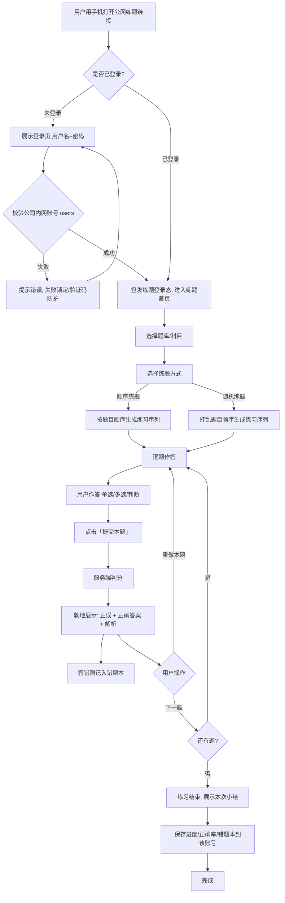
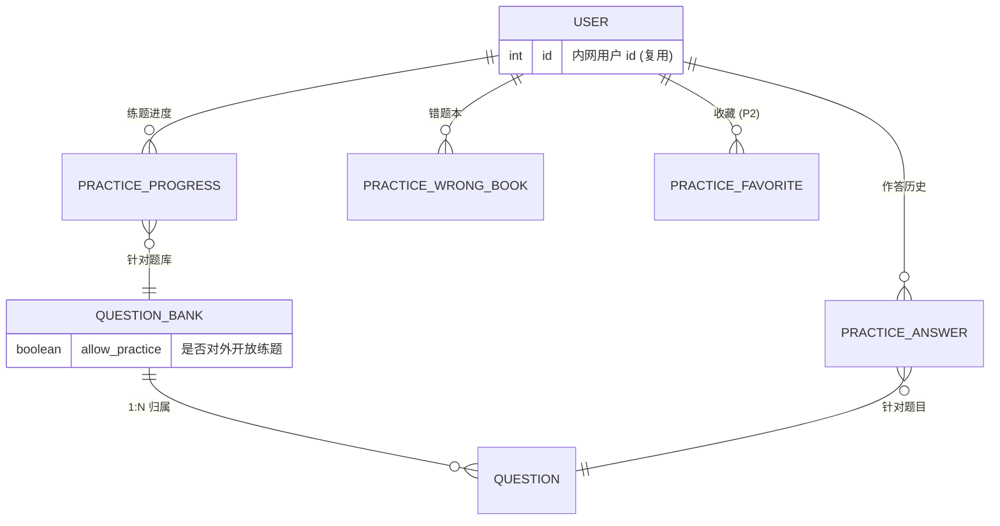

# 企业内部在线考试系统 — 增量 PRD：公网练题功能（v1.5）

> 本文档为 **docs/01-PRD.md（v1.0）与 docs/03-PRD-increment.md（v1.3）的增量补丁**，只描述本次新增的「公网可访问练题功能」，不重写原有功能的完整 PRD。
>
> ✅ **用户已就关键决策拍板**（访问模式、账号来源、终端、微信、本期范围），本文档为**定稿方案**。
>
> ⚠️ **本轮只交付方案，不做实现。** 本文档即方案中的「产品需求」部分。

---

## 1. 文档信息

| 项目 | 内容 |
| --- | --- |
| 文档版本 | v1.5（增量：公网练题功能，决策已拍板） |
| 日期 | 2025-10-23 |
| 作者 | 产品经理 许清楚 |
| 变更类型 | 增量（新功能 + 访问边界扩展 + 用户决策定稿） |
| 基线文档 | `docs/01-PRD.md`（v1.0）、`docs/03-PRD-increment.md`（v1.3）、`docs/02-architecture.md`、`docs/04-architecture-increment.md` |
| 现有形态 | 前后端分离（Vue 3 + Node.js/Express + MySQL `enterprise_exam_system`），**仅限公司内网访问**，账号由管理员创建，无注册/短信/找回能力 |
| 目标形态 | 在**不改变现有内网考试**的前提下，新增**公网可访问的「练题」入口**：**必须登录（复用公司内网账号）后进入**，仅面向**移动端（含微信内置浏览器）**，与考试数据完全隔离 |
| 影响红线 | 只涉及数据库 `enterprise_exam_system`；严禁触碰同实例下 `exam_system` 库 |

### 文档变更记录

| 版本 | 日期 | 作者 | 变更说明 |
| --- | --- | --- | --- |
| v1.3 | 2025-10-13 | 许清楚 | 增量：答题次数上限（1–10）+ 答题页考生信息展示（姓名·科室） |
| v1.4 | 2025-10-22 | 许清楚 | 增量：新增**公网可访问的练题功能**，与考试数据完全隔离；给出公网访问模式选项对比与推荐、练题内容来源策略、练题与考试关系界定 |
| v1.5 | 2025-10-23 | 许清楚 | **用户拍板**：访问模式定为「**必须登录 + 复用公司内网账号**」（无匿名路径）；终端定为「**仅移动端（含微信内置浏览器）**」；本期范围「**登录 + 进度 + 错题本**」纳入本期交付，收藏仍列 P2；据此修订 §2/§3/§4/§5/§6/§7/§9/§10/§11/§12/§14 |

---

## 2. 本次增量目标

一句话：**在保持现有「内网考试」体系不变的前提下，新增一个面向公网的「练题」模块——用户通过手机（含微信内置浏览器）打开练题入口，用**公司内网账号登录**后，按题库/科目进入、顺序或随机刷题、逐题作答并即时判分看解析，登录用户的进度与错题本被保存；练题数据与考试记录完全隔离，不产生考试记录、不影响成绩统计。**

可验收目标（3~5 条）：

1. **公网移动可达**：练题入口可在公网正常访问，无需接入公司内网/VPN；**以手机浏览器与微信内置浏览器为主要场景**，均可正常打开、作答、查看解析。
2. **登录即练**：练题入口**必须登录后进入**（无匿名路径）；登录**复用公司内网账号**（校验现有 `users` 凭证），登录成功后进入练题首页。
3. **练题可用**：用户可选择题库/科目进入，支持「顺序练题」「随机练题」两种模式，逐题作答，**提交单题后立即判分并展示正误 + 解析**。
4. **边界清晰 · 数据隔离**：练题仅能访问「被标记为对外开放练题」的题库，考试专属/敏感题目不出现在公网；练题**不产生 `exam_records`、不进入成绩报表、不影响任何考试统计**。
5. **进度可沉淀**：登录用户的练题**进度**与**错题本**在本期落地、可跨设备继续练习；正确率统计同步提供。

> 说明：目标 1/2/4 是本次最核心的「安全边界 + 登录门槛」验收项，直接对应 §7 的公网访问模式决策。

---

## 3. 变更范围总览

| 模块 | 变更类型 | 说明 |
| --- | --- | --- |
| 公网练题入口（新页面/新路由） | **新增** | 面向移动端的公网练题页面（独立布局，无管理后台侧栏）；**必须登录后进入** |
| 练题登录（复用内网账号） | **复用/扩展** | 练题登录**复用公司现有账号**（校验 `users` 表凭证）；登录成功签发练题登录态（JWT）；**无匿名、无自助注册** |
| 练题题库筛选/授权 | **新增** | 题库新增「对外开放练题」开关；仅被开放的题库可在公网练题中被访问 |
| 练题作答与即时判分 | **新增** | 逐题作答 → 提交单题 → 立即判分并展示正误 + 解析 |
| 练题模式 | **新增** | 支持「顺序练题」「随机练题」；可选题量、题型的筛选 |
| 练题进度 + 错题本（**本期**） | **新增** | 登录用户沉淀练题进度、错题本、正确率统计（**本期交付**） |
| 练题收藏（P2） | **新增** | 收藏题目，预留至 P2 |
| 移动端适配 + 微信内置浏览器兼容（**本期**） | **新增** | 仅移动端（含微信内核）可用；不带桌面端布局要求 |
| 现有考试模块（录题/组卷/考试/答题/报表） | **不变** | 内网考试逻辑、判分、防作弊、成绩报表**完全不受影响** |
| 现有答题组件 | **复用** | 复用 `QuestionCard`（题干/选项渲染）；`CountdownTimer`（倒计时）与 `VisibilityGuard`（切屏检测）**不复用**（练题无倒计时/无防作弊） |
| 部署/网络 | **新增** | 需新增公网暴露面：反向代理 + HTTPS + 限流（架构师设计，产品侧只提要求，见 §12） |

---

## 4. 用户故事

> 视角：公网练题用户。**访问模式已拍板为「必须登录 + 复用公司内网账号」**，故所有练题行为均发生在**登录之后**；用户以**手机（含微信内置浏览器）**为主要使用场景。

### 4.1 公网练题用户（登录后练题）

**US-P1：登录后进入练题**
- As a 持有公司账号的员工，I want 用我的公司账号在公网登录后进入练题，so that 我能在移动端随时开始刷题，且账号与内网一致、无需另记一套密码。
- 验收标准 AC：
  - 公网练题入口打开后**首先要求登录**；未登录时无法进入任何练题内容页。
  - 登录**复用公司现有账号**（用户名 + 密码校验 `users` 表）；登录成功签发练题登录态并进入练题首页。
  - **无匿名练题入口、无自助注册入口**；未持有账号者无法练题。

**US-P2：按题库/科目进入并选择练题方式**
- As a 练题用户，I want 按题库/科目分类进入，并选择「顺序练题」或「随机练题」，so that 我能按需系统复习或随机自测。
- 验收标准 AC：
  - 登录后首页展示**已对外开放**的题库列表（名称、分类、题目数）。
  - 进入题库后可选「顺序练题」（按题目顺序）或「随机练题」（打乱顺序）；可选练题范围（题型/题量）。

**US-P3：逐题作答并即时看解析**
- As a 练题用户，I want 每答完一题就立刻知道对错并看到解析，so that 我能即时纠正理解、边练边学。
- 验收标准 AC：
  - 单选/多选/判断题型均支持；提交单题后立即展示：正误标识、正确答案、解析。
  - 答错后支持「重做本题」或「继续下一题」（详见 §6 规则）。
  - **无倒计时、无防作弊检测、无次数限制**。

**US-P4：跨设备继续练题（本期）**
- As a 练题用户，I want 我的练题进度与错题被保存下来，so that 我能换设备继续练、重点攻克错题。
- 验收标准 AC：
  - 登录用户自动保存练题进度（做到第几题）与答题历史，可跨设备续练到上次位置。
  - 提供「错题本」（自动收集答错题），支持从错题本再次进入练题；提供正确率统计。
  - **本期交付**；「收藏」（P2）不在本期范围。

**US-P5：微信内置浏览器可用（本期）**
- As a 练题用户，I want 在微信中打开练题链接即可正常作答，so that 我能直接在微信里刷题、无需跳出到系统浏览器。
- 验收标准 AC：
  - 微信内置浏览器中可正常打开首页、登录、作答、提交判分、查看解析。
  - 移动端响应式布局在手机屏幕上无横向滚动、无遮挡；**不做微信授权登录**（仍走账号密码登录）。

### 4.2 管理员 / 出题人（内容供给方）

**US-M1：开放练题题库与内容把关**
- As a 管理员/出题人，I want 指定「哪些题库对外开放练题」，so that 我能在不泄露考试专属题目的前提下对外提供练习内容。
- 验收标准 AC：
  - 题库管理页新增「对外开放练题」开关（默认**关闭**）。
  - 关闭时该题库的题目**绝不**出现在公网练题接口与页面中。
  - 权限沿用现有：仅 admin / author（内网）可操作该开关。

---

## 5. 需求池

> P0 = 本期必须实现（发布红线）；P1 = 本期应实现，资源不足可顺延；P2 = 本期不做，预留扩展。

| 编号 | 需求 | 优先级 | 验收要点 |
| --- | --- | --- | --- |
| P0-1 | 公网练题入口（移动端独立页面/路由，公网可达） | P0 | 公网可访问；不依赖内网/VPN；移动端布局与管理后台解耦 |
| P0-2 | **练题必须登录（复用公司内网账号）** | P0 | 未登录无法进入练题；登录校验现有 `users` 凭证；**无匿名、无自助注册** |
| P0-3 | 对外开放练题题库开关（题库级） | P0 | 默认关闭；仅开启的题库对外可见；未开启题库的内容**不透出**（含接口层过滤，非仅前端隐藏） |
| P0-4 | 公网练题题库/科目列表 | P0 | 只展示已开放题库；显示名称/分类/题目数 |
| P0-5 | 练题模式：顺序练题 / 随机练题 | P0 | 两种模式可选；随机模式打乱题序 |
| P0-6 | 逐题作答（单选/多选/判断） | P0 | 三种题型可答；复用现有 `QuestionCard` 渲染 |
| P0-7 | 单题提交即时判分 + 展示正误 + 解析 | P0 | 提交后立即返回对错、正确答案、解析；判分口径与考试一致 |
| P0-8 | 练题与考试数据完全隔离 | P0 | 练题不写 `exam_records`；不影响成绩报表；无考试/试卷接口暴露 |
| P0-9 | 移动端响应式适配（**仅移动端**） | P0 | 手机屏幕（≥360px）可用；作答/翻页/看解析无横向滚动；不带桌面端布局要求 |
| P0-10 | **微信内置浏览器兼容** | P0 | 微信内置浏览器可正常打开/登录/作答/判分/看解析；**不做微信授权登录** |
| P0-11 | **练题进度 + 正确率统计（本期交付）** | P0 | 登录用户进度落库、可跨设备续练；展示已练题数、正确率 |
| P0-12 | **错题本（本期交付）** | P0 | 自动收集答错题；可从错题本重新练题 |
| P0-13 | 公网接口安全防护 + 登录防护 | P0 | IP+设备限流；登录失败锁定/验证码；不提供一次性全量拉题接口 |
| P1-1 | 练题范围筛选（题型/题量选择） | P1 | 可按题型筛选，可选题量（如 10/20/50 题） |
| P2-1 | 收藏题目 | P2 | 可收藏/取消收藏，收藏夹可进入练题 |
| P2-2 | 练题排行/积分/打卡 | P2 | 激励体系，预留 |
| P2-3 | 练题分享（生成练习链接/二维码） | P2 | 预留 |
| P2-4 | 公网练题账号自助注册 | P2 | **当前决策不采用**（复用内网账号）；仅当未来变更访问模式时预留 |

---

## 6. 练题核心流程

### 6.1 公网练题主流程



### 6.2 练题判分与作答规则（与考试的关键差异）

| 维度 | 考试 | 练题（本次） |
| --- | --- | --- |
| 触发判分时机 | 交卷后整体判分 | **提交单题即判分** |
| 是否展示解析 | 交卷后展示逐题解析 | **每题提交后立即展示** |
| 时间限制 | 有倒计时、到点自动交卷 | **无倒计时、无自动交卷** |
| 防作弊（切屏检测） | 有 | **无** |
| 次数限制 | 有答题次数上限 | **无，可反复练** |
| 数据落库 | 写入 `exam_records` | **不写考试记录**；写入练题专用表（`practice_*`），用于进度/错题本/统计 |
| 是否影响成绩 | 是 | **否，完全隔离** |

**练题判分口径**：沿用考试判分规则（单选/判断全对得分；多选全对得分，多选少选/错选按现有考试口径处理），保证「练题对错」与「考试对错」一致，避免误导。

**「答错后重做 / 看答案后重试」规则（建议）**：
- 提交后即展示正误与解析；**允许「重做本题」**（重新作答，不扣分、不限制次数）。
- 同一题重复作答时，进度/正确率统计以**首次作答结果**为准（避免刷正确率），并可标注「该题此前答错」（错题本逻辑，**本期交付**）。
- 判断题/单选/多选均一致。

---

## 7. 公网访问模式：用户已确认的决策

> **本节为已拍板结论，不再是选项对比。** 用户明确选择「**必须登录才能练 + 复用公司内网账号**」，并**明确接受由此带来的安全风险**。

### 7.1 决策内容

| 决策项 | 结论 |
| --- | --- |
| 访问模式 | **必须登录才能练题**；**不存在匿名练题路径** |
| 账号来源 | **复用公司现有内网账号**（校验 `users` 表用户名 + 密码），**不新建公网账号、不做自助注册** |
| 进入方式 | 打开公网练题入口 → **强制登录页** → 登录成功后方可进入练题首页；未登录不能访问任何练题内容页 |
| 登录态 | 登录成功后签发练题登录态（JWT）；未登录/失效一律回到登录页 |
| 风险接受 | 用户已知悉并接受「内网账号在公网登录」的残余风险（见 §7.2） |

**明确排除的路径**：
- ❌ 无匿名游客练题（不存在「打开即练」）。
- ❌ 无公网独立注册/登录（不引入第二套账号体系）。
- ❌ 无微信授权登录（微信内仍走账号密码登录）。

### 7.2 风险与缓解（残余风险须留痕）

> 本决策把内网账号暴露到公网登录，**属高风险选择**，用户已确认接受；下列缓解措施**必须强制实施**。

**残余风险**

| # | 风险 | 说明 |
| --- | --- | --- |
| R1 | **撞库攻击** | 攻击者用其它平台泄露的账号密码在公网登录接口批量尝试，命中员工账号 |
| R2 | **暴力破解** | 对单账号/单 IP 高频尝试密码 |
| R3 | **内网用户名暴露于公网** | 登录接口若不严谨，可能可枚举/探测内网用户名是否存在 |
| R4 | **公网攻击面扩大** | 公网可访问登录接口，成为对内网账号库的攻击入口 |

**强制缓解措施（本期必做）**

| 缓解措施 | 对应风险 | 要求 |
| --- | --- | --- |
| **全站 HTTPS** | R1/R2/R4 | 公网练题全链路强制 HTTPS，关键接口不缓存 |
| **登录失败锁定 / 验证码** | R1/R2 | 连续失败 N 次锁定账号或强制验证码（阈值可配），并记录失败次数 |
| **IP + 设备维度限流** | R1/R2/R4 | 登录接口与练题接口均限流；高频触发短时封禁 |
| **登录接口只读校验** | R1/R4 | 登录**只做凭证校验，绝不修改内网密码**；不改动内网 `users` 敏感字段 |
| **审计日志** | R1/R2/R3/R4 | 记录登录成功/失败、来源 IP、设备、时间，供安全审计与告警 |
| **用户名枚举防护** | R3 | 登录失败提示统一（不区分「用户不存在」与「密码错误」）；不提供用户名探测接口 |

> **范围红线（再次强调）**：公网练题接口**仅暴露练题所需能力**；公网不得经任何练题接口访问试卷、考试、成绩、用户管理等内网数据。练题登录态**不等于**内网管理权限，即使登录成功也**只能访问练题功能**，不得复用为内网后台凭证。

---

## 8. 练题内容来源

### 8.1 备选策略与建议

| 策略 | 说明 | 建议 |
| --- | --- | --- |
| ① 定向开放若干题库 | 在现有题库上加「对外开放练题」开关，挑选合适的题库对外 | ✅ **推荐**（默认做法） |
| ② 新建专门的公网练题题库 | 为公网练题单独建库，题源干净可控 | ✅ **推荐（与①组合）** |
| ③ 开放全部题库 | 所有题库题目对公网可见 | ❌ **不建议**（泄露考试专属/敏感题） |

### 8.2 推荐做法：**①「定向开放」+ ②「专门建库」组合，绝不全量开放**

- **机制**：题库新增「**对外开放练题**」开关，**默认关闭**；只有被开启的题库才能在公网练题中被访问。开关由**管理员/出题人**控制。
- **操作建议**：优先**新建专门的「公网练题题库」**，把适合公开的题目（如通用知识、入职基础、宣传性内容）**复制/导入**进去再开放；避免直接开放考试在用题库。
- **安全硬约束（关键）**：
  - 练题需要展示正确答案与解析，因此**被开放的题目内容（含答案）必然下发到公网客户端**——一旦开放即应视为「可公开内容」。
  - 因此**凡是涉及考试专属、内部敏感、涉密或正在用于考核的题目，一律不得开放**。
  - 未开启开关的题库，**在接口层即被过滤**（不是仅前端隐藏），确保无法通过构造请求绕过。
- **接口层底线**：公网练题接口**只暴露** `题干 / 选项 / 题型 / 解析（提交后）`，**绝不暴露**题目所属试卷、考试关联、其他题库内容。

---

## 9. UI 设计稿说明

> 公网练题**仅面向移动端**（手机浏览器 + 微信内置浏览器）；**不要求桌面端布局**。整体沿用现有主色（`#2563EB`）与圆角/卡片风格，但**布局独立**（无后台侧栏），强调「单题聚焦 + 即时反馈」。
>
> **兼容要求**：需在**微信内置浏览器**中正常打开、登录、作答、提交判分、查看解析；对微信内核（X5/WKWebView）做兼容性处理（如避免使用不被支持的 CSS/JS 特性、必要时降级）。

### 9.1 移动端布局（唯一场景，≥360px）

**① 练题首页（题库列表）**

```
┌───────────────────────────────┐
│  📚 在线练题         张三 ▾    │  ← 顶栏（已登录，显示当前账号）
├───────────────────────────────┤
│  选择一个题库开始练习          │
│ ┌───────────────────────────┐ │
│ │ 安全知识题库               │ │
│ │ 分类:安全知识 · 36 题      │ │
│ │                [开始练题]  │ │
│ └───────────────────────────┘ │
│ ┌───────────────────────────┐ │
│ │ 企业文化题库               │ │
│ │ 分类:企业文化 · 24 题      │ │
│ │                [开始练题]  │ │
│ └───────────────────────────┘ │
│  （空态：暂无可练习的题库）    │
└───────────────────────────────┘
```

**② 选练题方式（弹层）**

```
┌───────────────────────────────┐
│  安全知识题库 · 开始练习   [×] │
│  ───────────────────────────  │
│  练题方式:  ● 顺序   ○ 随机   │
│  题量:   ○ 全部  ● 20 题      │
│  题型:   ☑单选 ☑多选 ☑判断    │
│           [ 开始 ]            │
└───────────────────────────────┘
```

**③ 练题作答页（单题聚焦 + 即时反馈）**

```
┌───────────────────────────────┐
│ ‹ 返回   3/20   ●●●○○○            │  ← 顶部进度（无倒计时）
├───────────────────────────────┤
│ 第 3 题            [单选题]    │
│ 下列哪种行为符合信息安全规范？  │
│                               │
│  ○ A. 共享账号给同事           │
│  ● B. 使用个人密码并定期更换   │  ← 选中
│  ○ C. ……                      │
│                               │
│         [ 提交本题 ]           │  ← 未提交前
├───────────────────────────────┤
│ ✅ 回答正确！                  │  ← 提交后即时反馈
│ 正确答案：B                    │
│ 解析：共享账号会导致责任不清…  │
│                               │
│   [ 重做本题 ]     [ 下一题 › ]│
│   ⭐ 加入错题本（本期）         │
└───────────────────────────────┘
```

**④ 本次练习小结**

```
┌───────────────────────────────┐
│  本次练习完成 🎉               │
│  已练 20 题 · 正确 16 · 正确率80%│
│  ✅ 进度与错题本已保存到你的账号 │
│   [ 再练一次 ]   [ 查看错题本 ] │
└───────────────────────────────┘
```

### 9.2 组件复用说明（产品层面）

| 现有组件 | 练题是否复用 | 说明 |
| --- | --- | --- |
| `QuestionCard`（题干 + 选项渲染，单选/多选/判断） | **复用** | 练题的单题作答直接复用其题干/选项/题型渲染；提交后在其下方**追加反馈区**（正误/答案/解析），不建议改动其原有行为以免影响考试 |
| `AnswerSheet`（答题卡） | **不复用** | 移动端空间有限，改用轻量「进度点」呈现；练题可自由跳题，不需要考试式答题卡 |
| `CountdownTimer`（倒计时） | **不复用** | 练题**无倒计时**，不引入该组件 |
| `VisibilityGuard`（切屏检测） | **不复用** | 练题**无防作弊**，不使用切屏检测 |
| 全局样式 token / 卡片风格 | **复用** | 沿用现有配色与圆角卡片风格，保持品牌一致 |

---

## 10. 数据实体建议

> 说明：以下为产品层面建议，具体字段类型/索引/约束由架构师设计。所有新增仅作用于 `enterprise_exam_system`。

| 实体 | 关键字段 | 说明 | 变更 |
| --- | --- | --- | --- |
| **QuestionBank（题库）** | 原字段 + **`allow_practice`（是否对外开放练题，布尔，默认 false）** | 控制该题库是否对公网练题开放；接口层据此过滤 | **修改** |
| **PracticeProgress（练题进度，本期）** | `id`、`user_id`、`bank_id`、`last_question_id`、`done_count`、`correct_count`、`updated_at` | 登录用户的练题进度与统计；`user_id` 指向**内网 users** | **新增（本期）** |
| **PracticeAnswer（练题作答明细，本期）** | `id`、`user_id`、`question_id`、`is_correct`、`answered_at` | 登录用户的逐题作答历史；用于正确率、错题本 | **新增（本期）** |
| **PracticeWrongBook（错题本，本期）** | `id`、`user_id`、`question_id`、`wrong_count`、`last_wrong_at` | 由 `PracticeAnswer` 派生/维护的错题集合 | **新增（本期）** |
| **PracticeFavorite（收藏，P2）** | `id`、`user_id`、`question_id`、`created_at` | 收藏题目（本期不做） | **新增（P2）** |
| **User（内网用户）** | 原字段不变 | 练题登录**读** `users` 做凭证校验；**练题不修改 `users` 任何字段**（尤其不改密码） | **不变（只读复用）** |
| **Exam / ExamRecord / Paper / …** | 保持不变 | 练题**不写**考试相关表，考试侧完全不受影响 | **不变** |

> 说明：**不再新增公网账号表**（决策为复用内网账号，见 §7）。`practice_*` 各表的 `user_id` 引用现有内网 `users.id`。

**关系（示意）**



**隔离原则（硬约束）**
- 练题相关表**独立命名**（`practice_*`），与 `exam_records`、`papers`、`exams` 无任何关联。
- 公网练题接口对 `users` **只读**（仅登录凭证校验），**不得**读写内网考试域表（`exams`/`papers`/`exam_records`）。

---

## 11. 接口需求概览

> 仅到「需求层面」，具体请求/响应结构、状态码、错误码由架构师设计。建议公网练题接口使用独立前缀 `/api/practice`（与内网管理接口 `/api` 区分，便于单独做公网限流与暴露控制）。**除登录接口外，所有练题接口均需携带练题登录态。**

### 11.1 登录（复用公司内网账号）

| 方法 | 路径建议 | 用途 | 权限 |
| --- | --- | --- | --- |
| POST | `/api/practice/auth/login` | 用户名 + 密码登录，**校验内网 `users`**，签发练题 JWT | 公开（登录接口本身无需登录态） |
| GET | `/api/practice/auth/me` | 获取当前登录用户 | 已登录 |
| POST | `/api/practice/auth/logout` | 登出 | 已登录 |

> 登录接口须落实 §7.2 的缓解措施：失败锁定/验证码、IP+设备限流、只读校验、审计日志、统一失败提示。

### 11.2 练题（需登录）

| 方法 | 路径建议 | 用途 | 权限 |
| --- | --- | --- | --- |
| GET | `/api/practice/banks` | 对外开放练题的题库列表 | 已登录 |
| GET | `/api/practice/banks/:id/questions` | 取该题库题目（**不含答案**，用于作答） | 已登录（仅限 `allow_practice=true` 的题库） |
| POST | `/api/practice/check` | 提交单题作答 → 返回**正误 + 正确答案 + 解析** | 已登录 |
| POST | `/api/practice/sessions` | 生成一次练习序列（顺序/随机、题量、题型筛选） | 已登录 |
| GET | `/api/practice/progress` | 查询我的练题进度 | 已登录 |
| PUT | `/api/practice/progress` | 保存练题进度 | 已登录 |
| GET | `/api/practice/wrong-book` | 错题本列表（**本期**） | 已登录 |
| GET | `/api/practice/stats` | 练题正确率/统计 | 已登录 |

### 11.3 管理端（内容供给，仅内网）

| 方法 | 路径建议 | 用途 | 权限 |
| --- | --- | --- | --- |
| PUT | `/api/banks/:id` | 题库编辑（含「对外开放练题」开关） | admin / author |
| GET | `/api/practice/audit`（P2） | 开放题库/练题量审计 | admin |

> **权限要点**：
> - **未登录一律不可访问练题接口**（除登录接口本身）；练题登录态**仅解锁练题能力**，不作为内网后台凭证。
> - 练题接口的题库访问**始终**以 `allow_practice=true` 为前置条件。
> - 公网练题接口对 `users` **只读**；不暴露试卷/考试/成绩/用户管理接口。

---

## 12. 非功能需求

| 项 | 要求 |
| --- | --- |
| **安全 · 边界** | 公网仅暴露 `/api/practice/**`；除登录接口外**所有练题接口均需登录**；公网无法经练题接口访问试卷/考试/成绩/用户管理数据 |
| **安全 · 登录防护** | 强制执行 §7.2：登录失败锁定/验证码、IP+设备限流、登录接口**只读校验绝不改内网密码**、审计日志、用户名枚举防护 |
| **安全 · 内容** | 仅 `allow_practice=true` 的题库可被访问，**接口层过滤**（非前端隐藏）；开放题目视为「可公开内容」，敏感题一律不开放 |
| **安全 · 防刷/限流** | 按 **IP + 设备** 维度限流；单 IP 高频请求（如快速遍历题库/提交）触发限流与短时封禁；`/api/practice/check`、登录与题库列表接口均需限流 |
| **安全 · 防爬** | 不提供「一次性全量拉题」接口；题库题目分页/按需下发；`check` 接口不返回整卷答案，仅返回当前题结果 |
| **安全 · 传输** | 公网强制 **HTTPS**；关键接口不缓存（`Cache-Control: no-store`） |
| **性能** | 移动端弱网可用：单题页面首屏 ≤ 2s（4G）；`check` 接口 P95 ≤ 500ms；单机支持 ≥ 100 并发练题 |
| **响应式（仅移动端）** | **只做移动端**：以手机为主（≥360px 起可用），断点建议 360 / 414 / 768；**不做桌面端布局要求**；作答区无横向滚动；按钮触控区 ≥ 44px |
| **微信内置浏览器兼容** | **必须**在微信内置浏览器（X5 / WKWebView）中正常打开、登录、作答、提交判分、查看解析；避免依赖微信不支持的 CSS/JS 特性，必要时降级；**不做微信授权登录** |
| **可用性** | 登录流程顺畅；登录态失效自动回登录页；接口异常有友好提示 |
| **内容安全** | 开放题库前建议由管理员人工复核内容合规；预留「内容举报/下架」机制（P2） |
| **可观测** | 公网练题接口与登录接口均有访问日志与异常告警（供运维排查刷量/攻击） |
| **数据隔离** | 练题数据（`practice_*`）与考试数据（`exam_records` 等）**物理隔离**；练题不影响任何考试统计口径 |

---

## 13. 本轮增量小结（与现有系统的关系）

- **对现有考试系统的影响：零。** 录题/组卷/考试/答题/判分/防作弊/报表逻辑与数据**完全不变**。
- **新增的是一条独立的「公网练题」通道**：独立入口、独立接口前缀、独立数据表；**必须登录（复用内网账号）后进入**。
- **共用点**：内网账号（`users`，**只读**用于登录校验）、题库数据（通过 `allow_practice` 开关复用）、题目渲染组件（`QuestionCard`）、视觉风格。
- **访问模式**：**必须登录 + 复用公司内网账号**（用户已确认并接受残余风险，见 §7）。
- **终端**：**仅移动端**（含微信内置浏览器）；不做桌面端布局。
- **本期范围**：登录、练题、进度、错题本；收藏列 P2。
- **安全边界**：公网暴露面被严格限定在 `/api/practice/**` 与「已开放题库」范围内，且除登录接口外一律需登录态。

---

## 14. 已确认决策 与 待确认问题

### 14.1 已确认（用户已拍板，作为本方案定稿依据）

| # | 决策项 | 结论 |
| --- | --- | --- |
| C1 | **公网访问模式** | **必须登录才能练 + 复用公司内网账号**（无匿名路径）；用户明确接受残余风险（见 §7） |
| C2 | **账号来源** | **复用现有内网账号**（校验 `users`），不新建公网账号、不做自助注册 |
| C3 | **终端** | **仅移动端**；不做桌面端布局 |
| C4 | **微信** | **需保证微信内置浏览器可正常打开/作答/看解析**；**不做微信授权登录** |
| C5 | **本期范围** | **登录 + 进度 + 错题本 纳入本期交付**；**收藏列 P2** |

### 14.2 待确认（仍需用户拍板）

1. **练题内容来源**：采用 **「定向开放若干题库」+「新建专门公网练题题库」组合（建议）**，还是开放全部题库？（开放全部**不建议**）
2. **练题与考试数据是否互通**：请确认**「完全独立，练题不产生考试记录、不影响成绩统计」（建议）**；是否允许管理员查看练题数据（如正确率排行）？
3. **公网域名与部署**：练题使用**独立域名**还是现有站点加路径？（影响 HTTPS 证书、限流与安全策略，需与运维/架构师确认）
4. **开放范围治理**：开放题库是否需要审批流程？是否需要给「公网练题题库」设置单独的可见范围（如全员/指定人群）？
5. **是否允许「看答案后重试 / 重做本题」**：产品侧建议**允许重做**，但统计以**首次作答**为准。是否认可？
6. **多选题判分口径**：练题是否与考试**完全一致**（建议一致）；还是练题采用更宽松口径（如少选部分给分）？
7. **登录失败锁定阈值**：连续失败 N 次锁定/触发验证码的 N 值（建议默认 5 次），以及是否需要验证码。请与安全/架构师确认默认值。

---

*—— 增量 PRD（v1.5）结束 ——*
