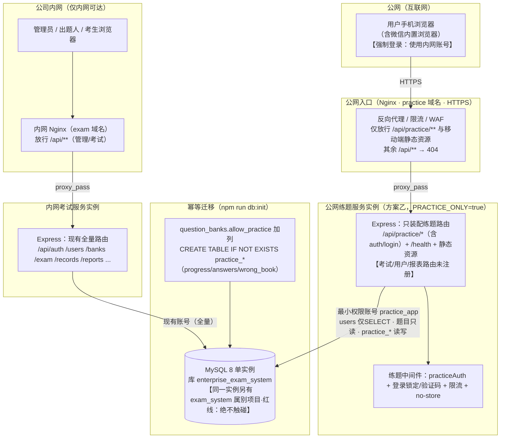
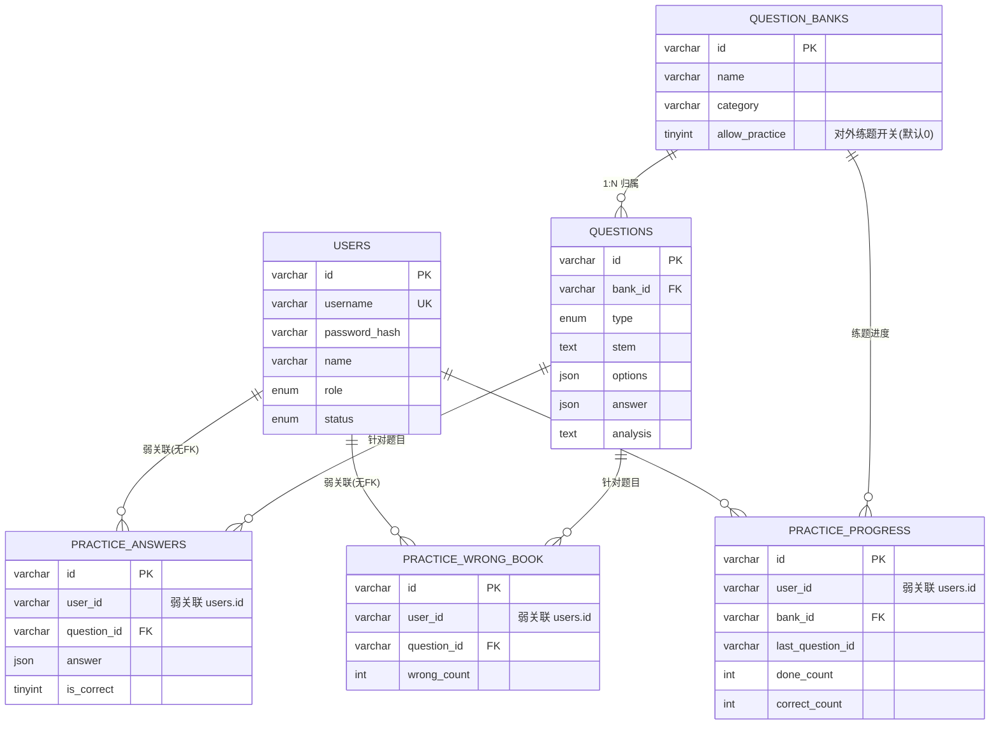
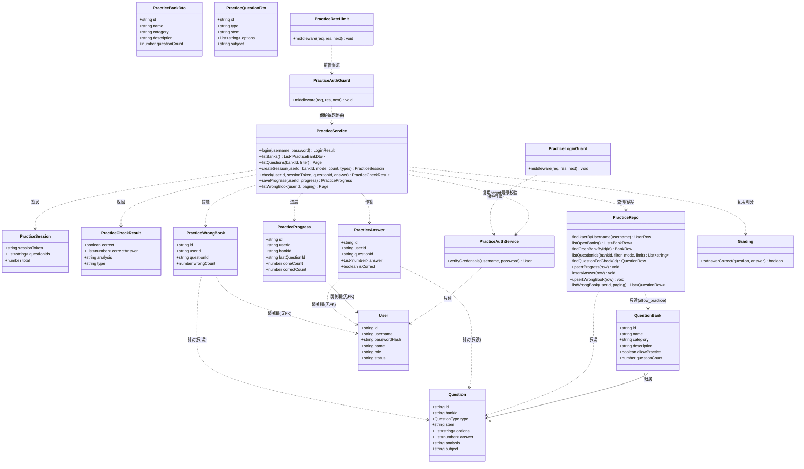
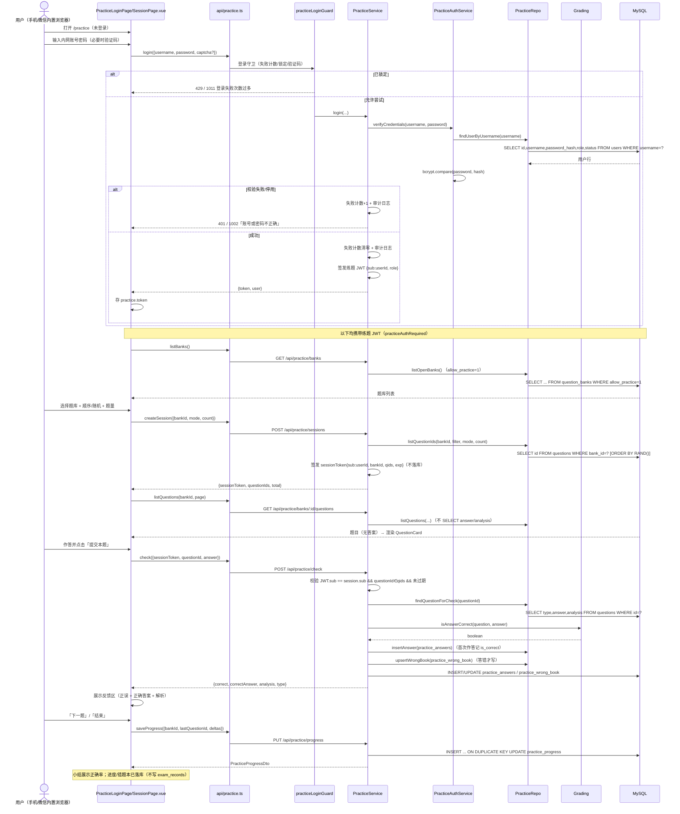
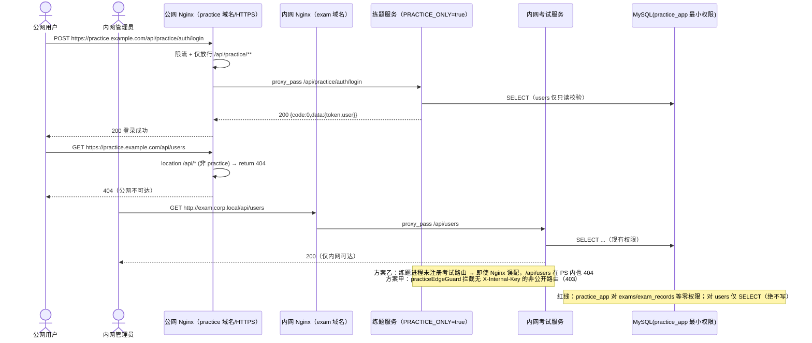
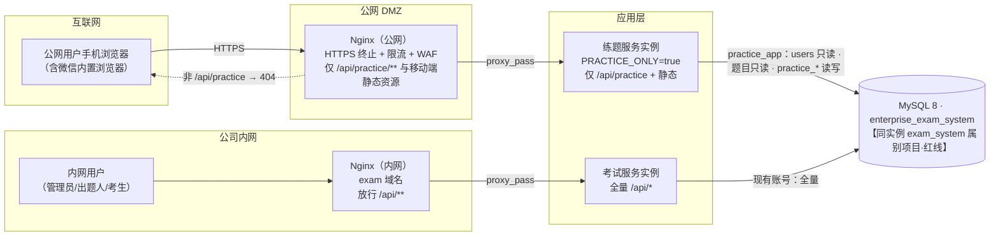
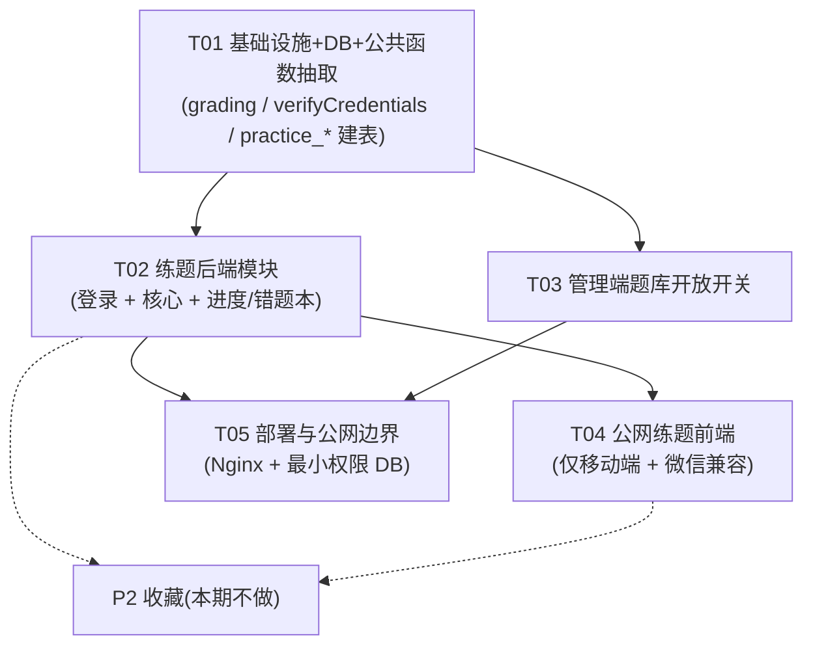

# 企业内部在线考试系统 — 增量架构设计与任务分解：公网练题功能（v1.4 修订版）

> 文档版本：v1.4-rev（增量 · 公网可访问练题模块 · **强制登录 + 复用内网账号**）｜ 架构师：高见远（Gao）｜ 日期：2025-10-22
> 上游输入：`docs/05-PRD-practice-increment.md`（增量 PRD v1.4，许清楚）+ **用户拍板结论（2025-10-22）**
> 基线文档：`docs/01-PRD.md`、`docs/02-architecture.md`（v1.0）、`docs/04-architecture-increment.md`（v1.3，**当前实现基线**）、`docs/class-diagram*.mermaid`、`docs/sequence-diagram*.mermaid`
> 变更主题：**在完全不动现有内网「考试」体系的前提下，新增一条公网可访问的「练题」通道**——用户**登录后**按题库/科目进入 → 顺序/随机刷题 → 逐题作答 → **提交单题即时判分并展示正误 + 正确答案 + 解析**；练题与考试数据**物理隔离**（不写 `exam_records`、不进报表、不影响任何成绩统计）。
>
> ⚠️ **本轮为方案设计，供用户确认，不产出实现代码。**
> ⚠️ **数据库红线**：所有变更仅作用于 `enterprise_exam_system`；严禁对同实例 `exam_system` 库做任何 DDL/DML。
>
> **【v1.4-rev 变更摘要（相对上一版设计）】**
> 1. **访问模式改为「强制登录 + 复用公司内网账号」**（用户明确接受风险）。**取消匿名路径**——练题所有接口均需登录态；登录**读内网 `users` 表**复用 `auth.service.ts` 的 bcrypt 校验（抽公共函数）。→ 练题实例 DB 账号**必须具备 `users` 表 SELECT 权限**（仅 SELECT）；`practice_users` 独立身份表**废弃**；`practice_*` 的 `user_id` 改为指向内网 `users.id`（**弱关联，无外键**，见 §3.3）。
> 2. **终端：仅移动端**——移除桌面端布局与任务项；断点以手机为主，保留「无横向滚动、触控区 ≥44px」。
> 3. **微信内置浏览器可用即可**（不做微信授权登录）——新增兼容要求（X5/WKWebView、iOS 输入框聚焦与视口/`100vh`、返回/回退状态、回归验证）。
> 4. **本期范围合并 P0+P1**：登录 + 进度 + 错题本本期做；**收藏留 P2**。
> 5. 补齐**安全缓解**要点（HTTPS、登录失败锁定、验证码、限流、审计日志）。

---

## 0. 前提与已确认事实（直接采信，不再推翻）

| # | 事实 / 决策 | 来源 |
| --- | --- | --- |
| F1 | 现有系统 = 前后端分离：**前端 Vue 3 + Vite + Element Plus + Pinia + vue-router 4**（`src/`）；**后端 Node.js + Express + TS（ESM/NodeNext）**（`server/src/`）；**MySQL 8 库 `enterprise_exam_system`**（10 张表）。 | 现网代码 |
| F2 | 后端模块结构：`server/src/modules/<name>/` = `xxx.router.ts`（路由编排）/ `xxx.service.ts`（业务）/ `xxx.repo.ts`（数据访问）/ `xxx.schema.ts`（zod 校验）；`server/src/app.ts` 顺序 `cors → express.json → /api 路由 → 404 → errorHandler`，各模块 `api.use('/<name>', <name>Router)`。 | `server/src/app.ts` |
| F3 | 鉴权：`middleware/auth.ts` 的 `authRequired` 解析 `Authorization: Bearer <JWT>`（HS256，载荷 `{sub, role, departmentId}`）；`middleware/role.ts` 的 `requireRole` 做角色校验。密码 bcrypt（`modules/auth/auth.service.ts`）。**现有系统无注册/验证码/找回**，账号由管理员创建——**练题复用这批内网账号**。 | `server/src/middleware/*`、`modules/auth/*` |
| F4 | 统一响应 `{code,message,data}`（`utils/response.ts`），错误码表见 `utils/errors.ts`（0/1001~1008/5000），zod 校验中间件 `validate` 返回 1001。 | `server/src/utils/*` |
| F5 | **判分权威实现**在 `server/src/modules/records/records.service.ts`：`isAnswerCorrect(question, answer)`（单选/判断单值相等；多选排序后完全相等，漏选/错选均 0 分）与 `grade()`。**练题单题判分口径必须与之完全一致**。 | `records.service.ts:28-47` |
| F6 | 试题表 `questions`：`type ENUM('single','multiple','judge')`、`stem`、`options JSON`、`answer JSON`（选项索引数组，多选升序）、`analysis TEXT`、`subject`、`bank_id VARCHAR(64)`（1:N 归属 `question_banks`）。 | `server/src/db/schema.ts` |
| F7 | `question_banks` 现字段：`id/name/description/category/created_by/created_at`，**无对外练题开关**。 | `schema.ts` / `banks.repo.ts` |
| F8 | 幂等迁移模式：`db/init.ts` 的 `applyMigrations()` 先查 `information_schema`（`COLUMN`/`STATISTICS`）再决定是否 `ALTER`，重复执行安全（MySQL 不支持 `ADD COLUMN IF NOT EXISTS`）。 | `server/src/db/init.ts` |
| F9 | 前端唯一 axios 实例 `src/api/http.ts`：`baseURL='/api'`、请求注入 Token、响应解包 `{code,message,data}`、401 全局登出；已支持按请求配置 `skipAuthRedirect`/`suppressErrorToast`。 | `src/api/http.ts` |
| F10 | 前端路由 `src/router/index.ts` 已有 `meta.public` 与 `meta.roles` 双守卫；答题组件 `src/views/exam/components/QuestionCard.vue`（题干/选项/题型渲染，`props: {index, question, score, modelValue}`，不显示答案）。 | `src/router/index.ts` / `QuestionCard.vue` |
| F11 | 部署现状：开发态 Vite `:5173` 代理 `/api`→Express `:3001`；生产部署方式文档未固定；**系统目前仅限公司内网访问**。 | 交接说明 |
| **F13** | **【用户拍板】公网练题访问模式 = 强制登录 + 复用公司内网账号**；**仅移动端**；**微信内置浏览器可用即可（不做微信授权登录）**；**本期范围 = 登录 + 进度 + 错题本（收藏留 P2）**。用户明确接受「内网账号暴露到公网」的风险（对应 PRD §7 选项 C）。 | 用户拍板 |
| F14 | 主理人本轮指令：只设计不写码；数据库变更仅 `enterprise_exam_system`；对现有代码仅做「最小必要扩展」；语言中文；风格对齐 `docs/04-architecture-increment.md`。 | 本轮任务书 |

> ⚠️ **重要风险提示（架构师须显式声明）**：F13 选择「强制登录 + 复用内网账号」= PRD §7 中的**选项 C**，是本需求**风险最高**的选项——把内网账号库的登录入口暴露到公网，存在**撞库/暴力破解/账号枚举**风险。PRD 与上一版架构均**不建议**该选项。**既然用户已明确接受**，本架构的职责是**把风险缓解做到位**（§1.3、§4.2、§4.6、§4.9 安全缓解清单），并保证：**练题实例对 `users` 表只读（仅 SELECT 校验登录），绝不 INSERT/UPDATE/DELETE、绝不修改内网密码、不读取考试域其他表**。

---

# Part A：系统设计

## 1. 增量架构总览

### 1.1 本次核心技术挑战

1. **公网/内网攻击面隔离（本次最关键）**：现有系统仅内网可访问、承载考试与成绩等敏感数据。新增公网入口后，必须保证**除登录校验所需的 `users` 只读外，公网域不可触达任何考试域接口与数据**。隔离在**网络层 + 进程层 + 数据库账号权限层**三重收敛（非前端隐藏）。
2. **【新增】复用内网账号 = 公网撞库风险**：登录校验必须复用 `auth.service.ts` 的 bcrypt 逻辑，但**只读 `users`**；必须叠加**登录失败锁定 + 验证码 + 限流 + 审计**，把撞库/爆破成本抬高（§4.2）。
3. **判分口径唯一**：练题「单题即时判分」必须与考试判分**逐字节一致**（F5）→ 必须**抽取复用** `isAnswerCorrect()`，不得复制。
4. **登录态贯穿**：取消匿名后，练题**所有接口需登录态**；练习序列需承载 `userId`（防「遍历题目暴力取答案」，§4.5）。
5. **练题数据与考试数据物理隔离**：新表一律 `practice_*` 前缀；`user_id` 指向内网 `users.id`（**弱关联**），**不写** `exam_records`、不进报表（§3）。
6. **仅移动端 + 微信内置浏览器兼容**：主场景为手机浏览器（含**微信内置浏览器**），需移动优先布局 + 视口/输入框/返回态兼容（§5）。
7. **移动端弱网性能**：单题首屏 ≤2s（4G）、`check` P95 ≤500ms（PRD §12）。

### 1.2 部署拓扑备选

> 目标：在不改变现有内网考试的前提下，把练题暴露到公网；公网攻击面限定在 `/api/practice/**` + 「已开放题库」范围内。

#### 方案甲：同一套后端 + Nginx 反向代理（单实例、边界收敛）

```
公网域名 practice.example.com ──HTTPS──▶ Nginx
   ├─ location /practice/*        → 静态资源（公网练题前端，移动端）
   ├─ location /api/practice/*    → proxy_pass http://127.0.0.1:3001/api/practice/
   └─ location /api/*             → return 404   （内网管理/考试接口不对公网开放）

内网域名 exam.corp.local     ──HTTP───▶ Nginx（内网 server 块）
   └─ location /                → 静态资源（后台管理端）
   └─ location /api/*           → proxy_pass http://127.0.0.1:3001/api/
```

- **优点**：零新增服务器/部署单元；复用现有 Express 与连接池；改动最小。
- **缺点/取舍**：公网与内网**共享进程与连接池**——公网被刷可能挤占内网考试资源；**必须加应用层边界兜底**（§4.9）防公网直连 `:3001` 绕过 Nginx。
- **账号复用影响**：同一进程直接共享连接池，`users` 只读访问天然可行；无需额外账号。

#### 方案乙：公网侧独立部署「练题服务」实例（进程级隔离，**推荐主线**）

- **做法**：复用同一代码库，以 `PRACTICE_ONLY=true` 启动 → **只注册练题路由 + 登录路由 + 健康检查 + 静态资源**（考试/成绩/报表等管理路由在该进程内**根本不存在**）；连**同一 MySQL**，但用**最小权限账号 `practice_app`**（见 §1.3）。
- **优点**：**进程级隔离**——公网侧被攻击/崩溃不影响内网考试；攻击面在进程内已裁剪；部署单元可独立扩缩。**在「复用内网账号」后优势更明显**：即便公网入口被攻破，能触达的也只有练题逻辑与 `users` 只读，考试域表在该账号下**零权限**。
- **缺点/取舍**：需两个部署单元与相应运维；`app.ts` 需按环境变量条件挂载（属「最小必要扩展」）。

#### 方案丙：独立公网服务 + MySQL 只读副本（最强隔离，成本最高）

- 在方案乙基础上，`users` 校验与题目读取走**只读副本**，`practice_*` 写主库（或独立实例）。
- **优点**：读写隔离最强；**缺点**：需配主从复制，运维成本最高；有复制延迟（登录校验需注意：副本延迟可能导致刚改的密码/停用状态短暂不一致）。**本期不默认**。

#### 拓扑对比与推荐

| 维度 | 方案甲 单实例+反代 | 方案乙 独立练题实例（推荐） | 方案丙 乙+只读副本 |
| --- | --- | --- | --- |
| 攻击面收敛强度 | 中（依赖 Nginx + 应用兜底） | **高（进程内路由已裁剪）** | 高 |
| 公网↔内网可用性耦合 | **有** | 无 | 无 |
| 部署/运维成本 | **最低** | 中 | 最高 |
| 对现有系统侵入 | 低 | 中 | 高 |
| 与「复用内网账号」契合 | 可用 | **最佳**（独立账号最小权限） | 可用（须处理副本延迟） |

**推荐：方案乙（独立练题实例 + 最小权限 DB 账号）**。理由：用最直接、最不易出错的方式实现核心红线——**公网进程里不存在考试路由，且 `practice_app` 账号对考试域表零权限**；对「复用内网账号」这一高风险选择的缓解也最彻底。
**运维资源有限**时退化为**方案甲**，但**必须**补齐应用层边界兜底（§4.9）。

> **与「登录/账号」的关系**：三种拓扑均**不改动内网登录逻辑**，仅新增「练题登录入口」（复用同一 `users` 表与 bcrypt 校验）。拓扑只决定「公网看到哪些路由 + 用哪个 DB 账号」，与登录实现解耦。

### 1.3 攻击面收敛清单（三层防线）

1. **网络层（Nginx/网关）**
   - 公网**独立域名** + **强制 HTTPS**（HTTP 301→HTTPS）+ HSTS；`:3001` **不映射公网**（仅监听 `127.0.0.1`/内网网卡）；
   - 公网 server 块**只放行** `location /api/practice/` 与练题静态资源；其余 `location /api/` 一律 `return 404`；
   - Nginx 侧 `limit_req`（IP）+ `limit_conn` 作第一道限流，登录接口单独更严 zone。

2. **进程/应用层（Express）**
   - **方案乙**：`PRACTICE_ONLY=true` → 只装配练题路由（考试域路由不注册，物理不可达）；
   - **方案甲**：`practiceEdgeGuard`（§4.9）——非公开路由须带 Nginx 注入的内部头 `X-Internal-Key`，防公网直连绕过；
   - 练题**所有接口**挂 `practiceAuthRequired`（练题专属 JWT，§4.2）；练题对题库访问**始终**以 `allow_practice=1` 为前置；
   - 练题响应统一 `Cache-Control: no-store`。

3. **数据库账号权限最小化（已按「复用内网账号」修订）** —— 公网练题实例账号 `practice_app`：

| 表 | 权限 | 说明 |
| --- | --- | --- |
| `users` | **仅 SELECT（列级最小集）** | 仅用于**登录校验**：`GRANT SELECT (id, username, password_hash, name, role, status) ON enterprise_exam_system.users TO practice_app`。**绝不 INSERT/UPDATE/DELETE**（**不得改内网密码/状态**）。建议用列级授权，不授予 `department_id` 等无关列 |
| `questions` | `SELECT` | 题目只读（仅 `allow_practice=1` 题库的题） |
| `question_banks` | `SELECT` | 题库只读（读 `allow_practice` 与题库基础信息） |
| `practice_progress` / `practice_answers` / `practice_wrong_book` | `SELECT,INSERT,UPDATE,DELETE` | 练题自身数据读写 |
| `exams` / `papers` / `paper_questions` / `paper_bank_refs` / `exam_records` / `import_batches` / `departments` | **无任何权限** | 考试域，物理隔离 |

> 授权 SQL 见 §11 交付物 `deploy/db-grants-practice.sql`，可复跑（幂等）。内网实例沿用现有账号。

4. **HTTPS / 限流 / 审计落点**

| 项 | 落点 | 说明 |
| --- | --- | --- |
| HTTPS 终止 | Nginx 公网 server 块 | 证书（Let's Encrypt / 企业证书）；HTTP→HTTPS；HSTS |
| IP 维度限流 | Nginx `limit_req_zone` | 第一道（登录接口单独更严） |
| IP+设备指纹限流 | `middleware/practiceRateLimit.ts` | 第二道（内存令牌桶，零新增依赖，§4.6） |
| **登录审计日志** | `middleware/` + 日志文件/表 | 记录登录成功/失败、来源 IP、UA、时间、账号（**不记密码**）；失败告警 |
| 访问日志 | Nginx 独立 `access_log` | IP/UA/路径/状态/耗时 |

### 1.4 架构总览图



### 1.5 登录模式与能力分层（本期合并交付）

> **单一模式：强制登录。** 无匿名路径。用户使用**公司内网账号**登录练题（与内网登录同一 `users` 表、同一 bcrypt 校验）。

| 能力 | 本期（P0+P1 合并） | 依赖登录 | 落库 | 说明 |
| --- | --- | --- | --- | --- |
| 练题登录（复用内网账号） | ✅ | — | 否（只读 users 校验） | 入口 `/practice` 需登录 |
| 题库列表 → 顺序/随机 → 逐题作答 → 单题即时判分 | ✅ | 是 | 否（无状态会话） | 核心闭环 |
| 练题进度（做到第几题 / 正确率） | ✅ | 是 | 是（`practice_progress`/`practice_answers`） | 跨设备续练 |
| 错题本（自动收集 + 再次练题） | ✅ | 是 | 是（`practice_wrong_book`） | 由 `practice_answers` 派生 |
| 收藏 | ⏸ P2 | 是 | 是（`practice_favorite` 预留） | 本期不做 |

---

## 2. 技术选型表

### 2.1 后端（增量部分）

| 类别 | 选型 | 版本 | 理由 |
| --- | --- | --- | --- |
| 登录校验 | **复用 `bcryptjs` + `auth.service.ts` 逻辑**（抽公共函数） | ^2.4.3 | 与内网登录口径一致；账号复用；**零新增依赖** |
| 练题令牌 | **复用 `jsonwebtoken`** | ^9.0.2 | 练题专属 JWT（独立 secret），载荷 `{sub:userId, role}`，供 `practiceAuthRequired` 校验 |
| 练习序列会话 | **复用 `jsonwebtoken`（无状态签名）** | ^9.0.2 | `sessionToken` 承载 `{sub:userId, bankId, qids, exp}`，零新增表且防枚举（§4.5） |
| 限流 / 登录失败锁定 | **自研内存计数/令牌桶** | — | 零新增依赖；单机（≥100 并发）足够；登录失败锁定键 = 账号 + IP |
| **验证码（可选增强）** | **首选自研轻量 SVG/算术验证码**（零依赖）；退路 `svg-captcha` | ^1.4.0（可选） | 登录失败达阈值后触发；若时间紧可引入 1 个轻量依赖，否则自研 |
| 校验 / DB / HTTP | `zod` / `mysql2/promise` / `express`（复用） | 现有 | — |

> **依赖增量：0（首选）或 1（如选 `svg-captcha`）**。

### 2.2 前端（增量部分）

| 类别 | 选型 | 版本 | 理由 |
| --- | --- | --- | --- |
| 框架/组件/路由/状态 | Vue 3 + Element Plus + vue-router 4 + Pinia（**复用**） | 现有 | 与后台同栈；练题独立布局（无侧栏） |
| HTTP | `axios` 实例 `src/api/http.ts`（**复用**） | ^1.7.7 | 练题请求走同一实例；解包一致 |
| 移动端适配 | 原生 CSS 媒体查询 + EP 响应式 | — | **仅移动端**（手机为主）；不引入新 UI 框架 |
| 微信内置浏览器兼容 | 原生 Viewport API / `env(safe-area-inset-*)` / 兼容处理（§5.5） | — | 不做微信授权登录，仅保证可用 |

> **前端依赖增量：0。**

---

## 3. MySQL 数据库设计（仅 `enterprise_exam_system`）

### 3.0 库隔离约定（红线）

- 所有变更仅作用于 **`enterprise_exam_system`**；同实例 `exam_system`（另一个项目）**严禁任何 DDL/DML**。
- 迁移入口沿用 `server/src/db/init.ts` 的幂等风格（先查 `information_schema` 再决定是否变更）。

### 3.1 question_banks 加列（必做）

```sql
-- 对外练题开关：默认关闭（0）。仅 allow_practice = 1 的题库可被公网练题访问。
ALTER TABLE question_banks
  ADD COLUMN allow_practice TINYINT(1) NOT NULL DEFAULT 0 AFTER category;
```

- 语义：`0`=不对外开放（默认）；`1`=对外开放练题。
- **接口层过滤**：练题所有题库/题目/会话/判分接口**一律以 `allow_practice = 1` 为前置条件**（非前端隐藏）。
- 加列**不影响任何现有考试逻辑**（现有查询按显式列名）。

### 3.2 新增表（本期）= `practice_progress` + `practice_answers` + `practice_wrong_book`

> 约束：`practice_*` 命名独立；**`user_id` 指向内网 `users.id`（弱关联，无外键，见 §3.3）**；`question_id`/`bank_id` 指向题域（`questions`/`question_banks`）可用外键；**绝不**关联 `exams/papers/exam_records`。字符集 `utf8mb4 COLLATE utf8mb4_unicode_ci`、引擎 `InnoDB`、时间 `DATETIME(3)`（UTC），与现有一致。

```sql
-- 练题进度（按 用户×题库 唯一）
CREATE TABLE IF NOT EXISTS practice_progress (
  id               VARCHAR(64) NOT NULL,
  user_id          VARCHAR(64) NOT NULL,      -- 弱关联内网 users.id（无外键）
  bank_id          VARCHAR(64) NOT NULL,
  last_question_id VARCHAR(64) NULL,
  done_count       INT NOT NULL DEFAULT 0,
  correct_count    INT NOT NULL DEFAULT 0,
  updated_at       DATETIME(3) NOT NULL,
  PRIMARY KEY (id),
  UNIQUE KEY uk_pp_user_bank (user_id, bank_id),
  KEY idx_pp_user (user_id),
  CONSTRAINT fk_pp_bank FOREIGN KEY (bank_id) REFERENCES question_banks(id)
    ON DELETE CASCADE ON UPDATE CASCADE
) ENGINE=InnoDB DEFAULT CHARSET=utf8mb4 COLLATE=utf8mb4_unicode_ci;

-- 练题作答明细（正确率/错题本数据源；「首次作答为准」统计口径见 §10-6）
CREATE TABLE IF NOT EXISTS practice_answers (
  id          VARCHAR(64) NOT NULL,
  user_id     VARCHAR(64) NOT NULL,           -- 弱关联内网 users.id（无外键）
  question_id VARCHAR(64) NOT NULL,
  answer      JSON NOT NULL,                  -- 用户作答（选项索引数组）
  is_correct  TINYINT(1) NOT NULL,
  answered_at DATETIME(3) NOT NULL,
  PRIMARY KEY (id),
  KEY idx_pa_user (user_id),
  KEY idx_pa_user_question (user_id, question_id),
  CONSTRAINT fk_pa_question FOREIGN KEY (question_id) REFERENCES questions(id)
    ON DELETE CASCADE ON UPDATE CASCADE
) ENGINE=InnoDB DEFAULT CHARSET=utf8mb4 COLLATE=utf8mb4_unicode_ci;

-- 错题本（由 practice_answers 派生维护）
CREATE TABLE IF NOT EXISTS practice_wrong_book (
  id            VARCHAR(64) NOT NULL,
  user_id       VARCHAR(64) NOT NULL,         -- 弱关联内网 users.id（无外键）
  question_id   VARCHAR(64) NOT NULL,
  wrong_count   INT NOT NULL DEFAULT 1,
  last_wrong_at DATETIME(3) NOT NULL,
  PRIMARY KEY (id),
  UNIQUE KEY uk_pwb_user_question (user_id, question_id),
  CONSTRAINT fk_pwb_question FOREIGN KEY (question_id) REFERENCES questions(id)
    ON DELETE CASCADE ON UPDATE CASCADE
) ENGINE=InnoDB DEFAULT CHARSET=utf8mb4 COLLATE=utf8mb4_unicode_ci;
```

> `practice_favorite`（收藏，P2）本期不建；如后续需要，结构同 `practice_wrong_book` + `created_at`。

### 3.3 `practice_users` 独立身份表 —— **废弃（本期不建）**

- **原因**：F13 改为复用内网 `users` 账号，不再需要公网独立身份表。上一版设计的 `practice_users` **不再创建**。
- **影响**：练题登录走内网 `users`（只读校验）；练题数据通过 `user_id` 直接关联内网用户。

### 3.4 `user_id` 关联方式取舍：**弱关联（无外键）**，而非外键

**决策：`practice_* .user_id` 不加外键，指向 `users` 仅作逻辑关联（弱关联）。**

**理由：**
1. **规避对考试域表的 DDL 依赖**：外键 `practice_*.user_id → users(id)` 会在**表结构层**把练题数据与考试域表 `users` 强绑定，破坏「练题 DDL 不依赖考试域表」的既定约定，且 `practice_app` 账号需要在 `users` 上有 `REFERENCES` 权限（违背最小权限，只应给 SELECT）。
2. **保留可删性与解耦**：内网 `users` 有既有删除规则（有 `exam_records` 记录的用户删除被 RESTRICT）。若练题也建外键，会**叠加新的删除约束**，可能反过来**阻碍内网用户管理**（违背「不改动现有考试体系」的红线）。弱关联让练题数据可被独立清理，不影响内网用户生命周期。
3. **符合最小权限与最小侵入**：`practice_app` 对 `users` 只有 SELECT，无需 REFERENCES。

**影响评估（已接受）：**
- **可能产生悬垂 `user_id`**（内网删用户后，其练题数据残留）。**缓解**：所有涉及用户的练题查询以 `JOIN users ON users.id = practice_*.user_id` 过滤（用户不存在则视为无数据）；并提供**运维清理脚本**（按 `practice_*` 中不在 `users` 的 `user_id` 清理）。
- **无数据库级引用完整性**：由 `practice.service` 在写入前校验 `userId` 来自**已认证 JWT**（天然保证用户存在，除非并发删除）——风险极低。
- `question_id`/`bank_id` **保留外键**（题域内 CASCADE），因题域与考试域无交叉、且题目删除时练题历史为可丢弃数据。

> 对比：若选择**外键**，则需 `practice_app` 获得 `users` 的 `REFERENCES` 权限并可能阻碍内网用户删除——**不采用**。

### 3.5 幂等增量迁移（对齐 `db/init.ts` 风格）

| # | 升级项 | 检测方式 | 变更语句 |
| --- | --- | --- | --- |
| 1 | `question_banks.allow_practice` | `information_schema.COLUMNS` 是否存在 | `ALTER TABLE question_banks ADD COLUMN allow_practice TINYINT(1) NOT NULL DEFAULT 0 AFTER category` |
| 2 | `practice_progress` / `practice_answers` / `practice_wrong_book` | `CREATE TABLE IF NOT EXISTS`（天然幂等） | 加入 `DDL_STATEMENTS` 或独立 `PRACTICE_DDL_STATEMENTS` |

**注意：**
1. 沿用「先查 `information_schema` 再 ALTER」的幂等模式；无变更时打印「无需变更（已是最新）」。
2. `schema.ts`（DDL 权威来源）与 `schema.sql`（文档副本）**同步更新**。
3. **`allow_practice` 默认 0**：迁移后**存量题库一律不开放**（安全默认）。
4. **`db:init` 只建表/加列/种子，不执行授权**：`practice_app` 的授权由运维按 `deploy/db-grants-practice.sql` 执行（或以 root 调用独立脚本），避免应用初始化脚本触碰账号权限。

### 3.6 ER 图（练题域）



> 图中 `USERS ... : 弱关联(无FK)` 的连线即为 §3.4 的弱关联约定（**数据库层面无外键**，仅逻辑关联）。

### 3.7 隔离硬约束（编码红线，已按新访问模式修订）

- 公网练题代码路径**只允许**：
  - `users`：**只读**（仅登录校验：`username`/`password_hash`/`status`/`role`/`name`），**绝不写**；
  - `questions`、`question_banks`：**只读**（仅 `allow_practice=1` 的题库及其题目）；
  - `practice_progress` / `practice_answers` / `practice_wrong_book`：读写。
- **禁止**读写 `exams / papers / paper_questions / paper_bank_refs / exam_records / import_batches / departments`。
- 由 §1.3 第 3 条**数据库账号权限**物理兜底（即使代码写错，`practice_app` 也无权访问考试域表或写 `users`）。

---

## 4. 后端 API 设计

### 4.1 统一响应与错误码

- 成功 `{code:0,message:'ok',data}`；失败 `{code,message,data:null}`（复用）。
- **错误码增量**（`server/src/utils/errors.ts`）：

| code | HTTP | 含义 | 示例 message |
| --- | --- | --- | --- |
| 1009 | 404 | 练题题库不可用（未开放/不存在，**不暴露存在性**） | 该题库暂未开放练题 |
| 1010 | 429 | 请求过于频繁（限流） | 操作过于频繁，请稍后再试 |
| 1011 | 429 | 登录失败次数过多，账号/IP 临时锁定 | 登录失败次数过多，请 X 分钟后再试 |
| 1012 | 400 | 需要/校验验证码 | 请输入验证码 / 验证码错误 |
| 1002 | 401 | **练题登录态失效**（复用） | 登录状态已失效，请重新登录 |

### 4.2 鉴权守卫与登录安全（练题专属）

| 中间件 | 文件 | 行为 |
| --- | --- | --- |
| `practiceAuthRequired` | `server/src/middleware/auth.ts`（**扩展**）或 `middleware/practiceAuth.ts`（新增） | 校验练题专属 JWT（独立 secret `PRACTICE_JWT_SECRET`），挂 `req.user = {id, role}`；失败 1002/401 |
| `practiceLoginGuard` | `server/src/middleware/practiceLoginGuard.ts`（**新增**） | 登录接口安全：① 失败计数（键=账号+IP，内存）达阈值 → 1011/429 锁定；② 达软阈值要求验证码；③ 校验验证码（1012） |
| `practiceRateLimit` | `server/src/middleware/practiceRateLimit.ts`（**新增**） | 内存令牌桶限流（键=IP+设备指纹）；登录/check/题库列表分别设阈值 |
| `practiceEdgeGuard` | `server/src/middleware/practiceEdge.ts`（**新增**） | 边界兜底（方案甲，§4.9） |

**登录契约（`POST /api/practice/auth/login`）：**
1. 入参 `{ username, password, captchaId?, captcha? }`（zod 校验，中文文案）。
2. `practiceLoginGuard`：若该 `username+IP` 处于锁定 → 1011；若已触发验证码要求 → 校验 `captchaId+captcha`（1012）。
3. 调 **`verifyCredentials(username, password)`**（从 `auth.service.ts` 抽出的**公共函数**，复用 bcrypt 校验；**只读 `users`**）。
4. 失败：失败计数 +1；写**登录审计日志**（成功/失败/来源 IP/UA），返回 401/1002 统一文案「账号或密码不正确」。
5. 成功：失败计数清零；签发练题 JWT（`{sub: userId, role}`，HS256，`PRACTICE_JWT_SECRET`，TTL 见 env）；返回 `{ token, user: PracticeUserDto }`（user 仅含 id/username/name/role，**不含**任何考试域敏感字段）。

> **不改内网密码**：练题实例对 `users` 只读，登录流程**绝不**写 `users`（含 `status`/`password_hash`）。

### 4.3 练题模块结构

```
server/src/modules/practice/
  ├─ practice.router.ts        # 路由编排（挂载到 /api/practice；全部挂 practiceAuthRequired，登录接口除外）
  ├─ practice.service.ts       # 业务：题库过滤、登录、无状态会话签发/验签、单题判分（复用 grading）、进度/错题本
  ├─ practice.repo.ts          # SQL：users 只读(登录) + questions/question_banks 只读 + practice_* 读写
  └─ practice.schema.ts        # zod 校验（login/session/check/progress/分页）
server/src/middleware/
  ├─ practiceAuth.ts           # 练题 JWT 守卫
  ├─ practiceLoginGuard.ts     # 登录失败锁定 + 验证码
  ├─ practiceRateLimit.ts      # 限流
  └─ practiceEdge.ts           # 边界兜底（方案甲）
server/src/utils/
  └─ grading.ts                # 【新增】从 records.service 抽出的判分纯函数（考试与练题共用）
server/src/modules/auth/
  └─ auth.service.ts           # 【改】抽出并导出 verifyCredentials()（bcrypt 校验，复用）
```

### 4.4 判分复用（最小改动抽取，口径唯一）

把 `records.service.ts` 的 `isAnswerCorrect` 抽为**纯函数** `server/src/utils/grading.ts`：

```ts
// server/src/utils/grading.ts（新增，纯函数，无副作用）
import type { QuestionType } from '../types/domain.js';

/** 判分规则（与考试完全一致）：单选/判断单值相等；多选排序后完全相等（漏选/错选均 0 分）。 */
export function isAnswerCorrect(
  question: { type: QuestionType; answer: number[] },
  answer: number[] | undefined,
): boolean {
  if (!answer || answer.length === 0) return false;
  if (question.type === 'multiple') {
    const user = [...answer].sort((a, b) => a - b).join(',');
    const correct = [...question.answer].sort((a, b) => a - b).join(',');
    return user === correct;
  }
  return answer.length === 1 && answer[0] === question.answer[0];
}
```

- `records.service.ts` 改为 `import { isAnswerCorrect } from '../../utils/grading.js';`（删除本地副本）——**最小改动、行为零变化**（现有单测应保持全绿）。
- `practice.service.ts` 同样 `import { isAnswerCorrect }` 单题判分。

### 4.5 练习会话（无状态签名，承载登录态；零新表）

> 现在**强制登录**，会话在「无状态签名」基础上**绑定登录用户**——`sessionToken` 的 `sub` = 登录 JWT 的 `userId`，`check` 时校验两者一致。

```
POST /api/practice/sessions   （需登录态）
  body: { bankId, mode: 'sequence'|'random', count?, types?[] }
  校验：bankId 存在且 allow_practice = 1（否则 1009/404）；count 上限（缺省=全部，上限 100）
  取题：SELECT id FROM questions WHERE bank_id=? [AND type IN (...)]
        - sequence → ORDER BY created_at ASC
        - random   → ORDER BY RAND()   LIMIT count
  签名：sessionToken = JWT.sign({ sub: req.user.id, bankId, qids, mode }, PRACTICE_SESSION_SECRET, { expiresIn: '30m' })
        （qids 为题目 id 数组；不落库）
  返回：{ sessionToken, questionIds: string[], total: number }
```

- **承载登录态**：`sessionToken` 绑定 `sub=userId`；`check` 需**同时**携带练题 JWT 与 `sessionToken`，服务端校验两者 `sub` 一致、且 `questionId ∈ qids`、未过期 → **杜绝遍历 `questionId` 暴力取答案**。
- **零新表**：会话不落库；进度/错题本落库走独立接口（§4.7）。

### 4.6 限流 / 防爬 / 登录安全（合并）

| 手段 | 落点 | 说明 |
| --- | --- | --- |
| IP 维度限流 | Nginx `limit_req_zone` | 第一道；**登录接口单独更严 zone** |
| IP+设备指纹限流 | `practiceRateLimit.ts` | 第二道；键=`sha1(ip + '|' + X-Device-Fp)`；`check`/`banks`/`login` 分组阈值 |
| **登录失败锁定** | `practiceLoginGuard.ts` | 键=账号+IP；连续失败 N 次（如 5）→ 临时锁定（如 15 分钟，指数退避）；返回 1011 |
| **验证码** | `practiceLoginGuard.ts` | 失败达软阈值（如 3 次）后要求验证码；自研轻量 SVG/算术验证码（零依赖）或 `svg-captcha` |
| 题目分页下发 | `GET /api/practice/banks/:id/questions?page&pageSize` | `pageSize` 上限（如 50）；**不提供全量拉题接口** |
| 会话内取答案 | `check` 须带合法 `sessionToken` | 只能对本会话内的题判分 |
| 不缓存 | 响应头 `Cache-Control: no-store` | 练题所有接口 |

> **限流/锁定实现（零依赖）**：进程内 `Map` + 惰性补充令牌 + LRU 上限；多实例时替换为 redis（接口不变）。**注意**：内存锁定在多实例下需共享存储，方案乙单实例场景足够。

### 4.7 接口清单（本期合并 P0+P1；对齐 PRD §11）

#### 登录（必需）

| 方法 | 路径 | 用途 | 权限 | 请求关键字段(zod) | 响应 data |
| --- | --- | --- | --- | --- | --- |
| POST | `/api/practice/auth/login` | 练题登录（**复用内网账号 bcrypt 校验**，只读 users） | 公开 | `username, password, captchaId?, captcha?` | `{ token, user: PracticeUserDto }` |

#### 练题核心（需登录态）

| 方法 | 路径 | 用途 | 权限 | 请求关键字段 | 响应 data |
| --- | --- | --- | --- | --- | --- |
| GET | `/api/practice/banks` | 对外开放练题题库列表 | 登录 | — | `PracticeBankDto[]` |
| GET | `/api/practice/banks/:id/questions` | 取题库题目（**不含答案/解析**） | 登录（须 `allow_practice=1`） | `type?, subject?, page?, pageSize?` | 分页 `{list, total, page, pageSize}` |
| POST | `/api/practice/sessions` | 生成一次练习序列（顺序/随机/题量/题型） | 登录 | `bankId, mode, count?, types?[]` | `{ sessionToken, questionIds:string[], total }` |
| POST | `/api/practice/check` | 提交单题作答 → **正误 + 正确答案 + 解析** | 登录（须合法 `sessionToken`） | `sessionToken, questionId, answer:number[]` | `{ correct, correctAnswer:number[], analysis, type }` |

#### 进度 / 错题本（需登录态；本期做）

| 方法 | 路径 | 用途 | 响应 data |
| --- | --- | --- | --- |
| GET | `/api/practice/progress?bankId=` | 查询我的练题进度与统计 | `PracticeProgressDto` |
| PUT | `/api/practice/progress` | 保存练题进度 | `PracticeProgressDto` |
| GET | `/api/practice/wrong-book?page&pageSize` | 错题本列表 | 分页 `PracticeQuestionDto[]` |
| POST | `/api/practice/wrong-book/reans`（可选） | 从错题本生成练习序列 | `PracticeSession` |

> 收藏（P2）：`POST/DELETE /api/practice/favorites` 本期**不做**。

#### 管理端（内网 `/api`）

| 方法 | 路径 | 用途 | 权限 | 变化 |
| --- | --- | --- | --- | --- |
| PUT | `/api/banks/:id` | 题库编辑（**新增 `allowPractice`**） | admin/author | `bankSchema` 增 `allowPractice`；`banks.repo.update` 增列 |

> `GET /api/banks`、`GET /api/banks/:id` 的 DTO（`BankDto`/`BankDetailDto`）**追加 `allowPractice: boolean`**。

### 4.8 进度/错题本写入契约（本期）

- `PUT /api/practice/progress`：body `{ bankId, lastQuestionId?, doneCountDelta?, correctCountDelta? }` → 按 `user_id+bank_id` upsert（`INSERT ... ON DUPLICATE KEY UPDATE`），`updated_at=now`。
- **统计口径（PRD §6.2）**：正确率以**首次作答**为准——`practice_answers` 记录首次结果；重做不覆盖首次（`practice_answers` 仅在「该 `user+question` 无记录」时插入，或按 `is_first` 标记）。错题本 `wrong_count` 记录历史答错次数。
- 每次 `check` 成功后（登录态）：① 追加/更新 `practice_answers`；② 若答错则 upsert `practice_wrong_book`；③ 可选同步 `practice_progress` 计数。
- 全部写入仅 `practice_*`，**绝不**写 `exam_records`。

### 4.9 边界兜底中间件（方案甲）

```
practiceEdgeGuard（仅当配置 PRACTICE_EDGE_SECRET 且非 PRACTICE_ONLY 时启用）：
  对进入的 /api/* 请求：
    - 若路径以 /api/practice 开头 或 = /api/health  → 放行（公网可见）
    - 否则要求请求头 X-Internal-Key === PRACTICE_EDGE_SECRET（由内网 Nginx 注入）
      · 命中 → 放行；未命中 → 403（防公网直连 :3001 绕过 Nginx）
```

> **方案乙**下无需此中间件（考试路由根本不注册），但保留以增强纵深防御。

---

## 5. 前端设计（**仅移动端** + 微信内置浏览器兼容）

### 5.1 目录结构（增量）

```
src/
  ├─ api/
  │   └─ practice.ts                    # 【新增】练题接口（走同一 http 实例）
  ├─ stores/
  │   └─ practiceAuth.ts                # 【新增】练题登录会话（token/user 存 localStorage）
  ├─ layouts/
  │   └─ PracticeLayout.vue             # 【新增】练题独立布局（无侧栏，移动端）
  ├─ views/
  │   └─ practice/
  │       ├─ PracticeLoginPage.vue       # 【新增】练题登录页（复用内网账号；含验证码）
  │       ├─ PracticeHomePage.vue        # 【新增】练题首页：题库列表
  │       ├─ PracticeSessionPage.vue     # 【新增】练题作答页：单题聚焦 + 即时反馈 + 小结
  │       └─ components/
  │           ├─ PracticeOptionModal.vue # 【新增】选练题方式（顺序/随机、题量、题型）
  │           ├─ PracticeFeedback.vue    # 【新增】反馈区（正误/正确答案/解析）
  │           ├─ PracticeProgressDots.vue# 【新增】移动端进度点
  │           └─ PracticeWrongBookPage.vue / PracticeProgressPanel.vue  # 【新增】错题本/进度面板（可并入 Home）
  ├─ router/index.ts                     # 【改】新增 /practice 路由（需登录守卫）
  └─ types/index.ts                      # 【改】新增 Practice* 类型
```

> **组件复用**：作答复用 `src/views/exam/components/QuestionCard.vue`（`props:{index,question,score,modelValue}`），在其**下方**由 `PracticeFeedback.vue` 渲染反馈区（**不改 QuestionCard 内部**）。**不复用** `CountdownTimer.vue`/`VisibilityGuard.vue`/`AnswerSheet.vue`（练题无倒计时/无防作弊；移动端用轻量进度点）。**移除**上一版的桌面端布局/侧边答题卡相关设计。

### 5.2 路由与登录守卫

```
/practice            → PracticeLoginPage.vue   （未登录重定向至此）
/practice/home       → PracticeHomePage.vue     （题库列表 + 进度/错题本入口）
/practice/banks/:id  → PracticeSessionPage.vue  （作答 + 小结）
```

- 练题路由**标记 `meta.requiresPracticeAuth: true`**，`router.beforeEach` 中校验 `practiceAuth` store；未登录 → 跳 `/practice`。
- 与内网路由**互不干扰**：练题 token 独立存储（如 `localStorage['practice.token']`），不复用内网 `exam_sys.token`。

### 5.3 `src/api/practice.ts` 与 `http.ts` 的关系

- **走同一 axios 实例**（`http.ts`）：统一解包与错误提示。
- **差异处理**：
  - 练题请求**注入练题 token**（而非内网 token）——需在 `http.ts` 支持按请求指定 token 来源（如 `config.practiceAuth:true` 时用 `practice.token`），或用练题专用轻量 axios 实例封装在 `api/practice.ts` 内。**建议**：`api/practice.ts` 内部维护练题 token 注入，避免污染内网 `http.ts` 的全局拦截器。
  - 练题 401（练题登录态失效）→ 清 `practice.token` + 跳 `/practice`；**不**触发内网全局登出（传 `skipAuthRedirect:true`）。
  - 登录失败 401（账号密码错误）与锁定的 1011/验证码 1012 → 页面内提示，不走全局登出。

### 5.4 移动端响应式（**仅移动端**）

- **主场景手机**：设计基准 **375px**；覆盖 **360 / 414** 常见宽；`≥768` 仅做**可用性兜底**（居中单列，不专门设计平板/桌面版）。
- **硬性要求**（保留）：作答区**无横向滚动**；按钮触控区 **≥44px**；单题首屏 ≤2s（4G）。

### 5.5 微信内置浏览器兼容（新增要求）

> 目标：**微信内置浏览器（iOS 微信 = WKWebView；Android 微信 = X5/QQ 浏览器内核）中「可正常打开并完整练题」**；**不做微信授权登录**。

| 关注点 | 要求 / 处理 |
| --- | --- |
| 内核兼容 | 覆盖 **WKWebView（iOS）与 X5（Android）**；避免使用其不支持的高级 API；必要时加 polyfill/降级（如 `Intl`、`URL`、可选链在极老内核的兼容） |
| **iOS 视口/`100vh` 问题** | iOS 微信下 `100vh` 含地址栏导致底部被遮挡；**禁用裸 `100vh`**，改用 `100dvh`/`-webkit-fill-available` 或动态视口 API（`visualViewport`）计算可用高度；`env(safe-area-inset-bottom)` 处理底部安全区 |
| **输入框聚焦跳动** | iOS 微信键盘弹起时页面可能整体上移/滚动错位；聚焦元素滚动用 `scrollIntoView` 后的稳定处理；作答页以「无输入框」为主（客观题点选），登录页输入做聚焦态处理 |
| **返回/回退状态** | 微信返回按钮 = 浏览器后退；用 `history` 状态管理（`pushState`/`replaceState`）保证「题间前进/后退」与页面状态一致；离开作答页前 `popstate` 拦截二次确认（如需） |
| 页面滚动 | 避免整页被 `overflow:hidden` 锁死导致 iOS 无法滚动；单选/多选题无需锁定滚动 |
| `localStorage` | 微信内核支持，但注意隐私模式可能异常，须 try/catch 兜底（token 读取失败则视为未登录） |
| 回归验证 | **明确验证方式**：真机回归清单（iPhone 微信 / Android 微信各 ≥1 机型）+ 微信开发者工具「公众号网页调试」；核心路径（登录→选题→作答→判分→看解析→进度/错题本）逐项通过 |

### 5.6 关键交互（对齐 PRD §6.1）

打开 `/practice` → **登录**（内网账号，失败锁定/验证码）→ 题库列表 → 选练题方式（顺序/随机、题量、题型）→ `POST /sessions` 得 `sessionToken` + `questionIds` → 逐题渲染（`GET /banks/:id/questions` 拉题，本地按 `questionIds` 组装）→ 作答 → `POST /check` 得正误/答案/解析 → 展示反馈区 → 「重做本题」（本地清答案，不扣分、不限次，统计以首次为准）/「下一题」→ 结束展示小结（含正确率，进度已保存）。

---

## 6. 类图（练题域 + 对外接口）



> **隔离体现在类图**：`PracticeService` 依赖 `PracticeRepo`（题域只读 + `practice_*`）+ `PracticeAuthService`（`users` 只读校验）+ `Grading`（纯函数）；**没有任何指向 `ExamService/ExamRecordService/ReportService` 的依赖**。

---

## 7. 时序图

### 7.1 登录 → 练题 → 进度/错题本落库（本期主流程）



### 7.2 公网暴露边界（登录读 users；内网管理接口不可达）



---

## 8. 部署图（公网 / 内网隔离拓扑，方案乙）



**运维要点：**
- `:3001`（练题）与内网服务端口**均不映射公网**，仅经各自 Nginx 反代；
- 公网练题静态资源与内网静态资源**域名分离**；
- `practice_app` 账号由运维按 `deploy/db-grants-practice.sql` 创建/授权（幂等）。

---

## 9. 依赖包清单

```
# 后端（server/package.json）
- 复用：express / mysql2 / jsonwebtoken / zod / dotenv / cors / bcryptjs
- 新增：无（登录复用 bcryptjs；令牌/会话复用 jsonwebtoken；限流/锁定自研内存）
- 可选：svg-captcha@^1.4.0（仅当不自研 SVG 验证码时）

# 前端（根 package.json）
- 复用：vue / vue-router / pinia / element-plus / axios / @element-plus/icons-vue
- 新增：无（移动端适配用原生 CSS；微信兼容用原生 API）

# 运维（非 npm）
- Nginx（反向代理/HTTPS/限流）—— 现有或新增
- 证书：Let's Encrypt 或企业证书
```

---

## 10. 共享知识（跨文件约定）

1. **响应结构**：复用 `{code, message, data}`；新增错误码 **1009（题库不可用/未开放，404）**、**1010（限流，429）**、**1011（登录失败锁定，429）**、**1012（验证码，400）**，写入 `errors.ts` 的 `ERROR_CODES`/`ERROR_HTTP_STATUS`。
2. **路由前缀**：公网练题**统一前缀 `/api/practice`**（与内网 `/api/**` 区分，便于 Nginx 暴露与限流）。**除 `auth/login` 外**，练题路由**均挂 `practiceAuthRequired`（强制登录）**。
3. **登录（复用内网账号）**：`POST /api/practice/auth/login` 复用 `auth.service.ts` 抽出的 **`verifyCredentials(username, password)`**（bcrypt）；**只读 `users`**，**绝不写**；统一失败文案「账号或密码不正确」（不暴露账号是否存在）。
4. **练题 JWT**：独立 secret `PRACTICE_JWT_SECRET`，载荷 `{sub:userId, role}`，HS256；前端存 `localStorage['practice.token']`（**与内网 `exam_sys.token` 分离**）。
5. **判分唯一**：判分纯函数集中在 **`server/src/utils/grading.ts`** 的 `isAnswerCorrect()`；考试（`records.service.ts`）与练题（`practice.service.ts`）均 import，不得各自实现。
6. **统计口径**：正确率以**首次作答**为准（重做不覆盖首次）；`practice_answers` 记录首次结果；`practice_wrong_book.wrong_count` 记历史答错次数。
7. **答案不下发**：`GET /api/practice/banks/:id/questions` 返回的 DTO **不含 `answer`/`analysis`**；答案与解析**仅**经 `POST /api/practice/check`（须合法 `sessionToken` 且登录态）逐题返回。
8. **无状态会话**：`POST /api/practice/sessions` 用 HS256 签发 `sessionToken`（载荷 `{sub:userId, bankId, qids, exp}`，TTL 30 分钟），**不落库**；`check` 必须验签且 `sub` 与登录态一致、`questionId ∈ qids`。
9. **题库开放前置**：练题所有题库/题目/会话/判分接口**一律以 `allow_practice = 1` 为前置条件**，未开放题库统一 404/1009（**不暴露存在性**）。
10. **数据隔离红线**：练题代码路径**只读** `users`（登录校验）与题域（`questions`/`question_banks`）；**读写** `practice_*`；**禁读写** `exams/papers/paper_questions/paper_bank_refs/exam_records/import_batches/departments`。DB 侧由 `practice_app` 权限物理兜底。
11. **`user_id` 弱关联**：`practice_*.user_id` **无外键**，逻辑指向 `users.id`；涉及用户的练题查询以 `JOIN users` 过滤；提供悬垂数据清理脚本。
12. **命名与类型**：新增实体 ID 为字符串（`VARCHAR(64)`）；前端类型追加 `PracticeBankDto/PracticeQuestionDto/PracticeSession/PracticeCheckResult/PracticeProgressDto/PracticeUserDto` 到 `src/types/index.ts`，后端同步 `server/src/types/domain.ts`。
13. **时间与分页**：复用 `DATETIME(3)`(UTC) + ISO 字符串；分页复用 `{list,total,page,pageSize}`（默认 20、上限 100；题目列表 `pageSize` 上限 50）。
14. **缓存头**：练题所有接口 `Cache-Control: no-store`。
15. **限流/锁定键**：`IP + 设备指纹`（`X-Device-Fp`）；登录失败锁定键 = **账号 + IP**。
16. **前端 http 复用**：练题请求走 `src/api/http.ts` 同一实例；练题 401 用 `skipAuthRedirect:true`，**不触发内网全局登出**；练题 token 注入建议在 `api/practice.ts` 内维护。
17. **组件复用边界**：练题复用 `QuestionCard.vue`（**不改其内部**）、不复用 `CountdownTimer/VisibilityGuard/AnswerSheet`；反馈区为 `PracticeFeedback.vue`。
18. **终端范围**：**仅移动端**（手机为主，含**微信内置浏览器**）；不做桌面版；见 §5.4/§5.5。
19. **权限三重同步（增量）**：题库开放开关需三处一致——题库管理页（`QuestionBankFormDialog.vue`）+ 后端 `banks.schema.ts`（`allowPractice`）+ 练题接口过滤（`allow_practice=1`）。
20. **环境变量（`server/.env`，严禁硬编码）**：
    ```
    # 练题（增量）
    ENABLE_PRACTICE=true                 # 内网实例是否注册练题路由（默认 true，便于联调）
    PRACTICE_ONLY=false                  # true=仅装配练题路由（方案乙公网实例）
    PRACTICE_EDGE_SECRET=                # 方案甲：Nginx 注入 X-Internal-Key 的共享密钥；空=不启用兜底
    PRACTICE_JWT_SECRET=<随机长串>        # 练题登录 JWT secret（与内网 JWT_SECRET 分离）
    PRACTICE_SESSION_SECRET=<随机长串>    # 无状态 sessionToken 签名密钥
    PRACTICE_SESSION_TTL=1800            # 会话有效期（秒）
    PRACTICE_LOGIN_MAX_FAILS=5           # 登录失败锁定阈值
    PRACTICE_LOGIN_LOCK_MINUTES=15       # 锁定时长（分钟）
    PRACTICE_CAPTCHA_AFTER_FAILS=3       # 失败多少次后要求验证码
    PRACTICE_RATE_CHECK_PER_MIN=60       # check 每设备每分钟上限
    PRACTICE_RATE_BANKS_PER_MIN=30       # 题库列表每设备每分钟上限
    PRACTICE_RATE_LOGIN_PER_MIN=10       # 登录每设备每分钟上限
    PRACTICE_DB_USER=practice_app        # 方案乙：最小权限账号（缺省复用 DB_USER）
    PRACTICE_DB_PASSWORD=<...>
    ```

---

# Part B：任务分解

> **角色均为 engineer。** 本期范围 = P0+P1 合并（登录 + 练题核心 + 进度 + 错题本；**收藏 P2 不做**）。任务按依赖排序，**共 5 个**（第一个为基础设施）。
> 同一文件在同一阶段不得被两个并行任务同时修改（已标注冲突点）。

## 11. 任务列表（合并后，有序，含依赖）

| 编号 | 任务名 | 涉及文件（相对路径 `D:/项目/考试1/`） | 依赖 | 验收标准 |
| --- | --- | --- | --- | --- |
| **T01** | **基础设施 + 数据库 + 公共函数抽取** | `server/src/db/schema.ts`、`server/src/db/schema.sql`、`server/src/db/init.ts`（幂等：加 `allow_practice` + 建 `practice_*` 3 表）、`server/src/utils/grading.ts`（**新增**，判分纯函数）、`server/src/modules/records/records.service.ts`（改为 import `grading`）、`server/src/modules/auth/auth.service.ts`（**抽出并导出 `verifyCredentials()`**）、`server/src/config/env.ts`（练题环境变量）、`server/.env.example`、`server/package.json`（如需，依赖不变） | 无 | `npm run db:init` 幂等新增 `question_banks.allow_practice`（默认 0）+ 建 `practice_progress/practice_answers/practice_wrong_book`（二次运行「无需变更」）；`isAnswerCorrect` 抽取后 `records` 单测**全绿**、行为不变；`verifyCredentials` 抽出后 `auth` 登录单测**全绿**；`.env.example` 含练题变量；无对 `exam_system` 库的任何操作 |
| **T02** | **练题后端模块（登录 + 核心 + 进度/错题本）** | `server/src/modules/practice/practice.router.ts`、`practice.service.ts`、`practice.repo.ts`、`practice.schema.ts`（**均新增**）、`server/src/middleware/practiceAuth.ts`、`practiceLoginGuard.ts`、`practiceRateLimit.ts`、`practiceEdge.ts`（**均新增**）、`server/src/utils/errors.ts`（新增 1009~1012）、`server/src/types/domain.ts`（Practice DTO 类型）、`server/src/app.ts`（按 `ENABLE_PRACTICE`/`PRACTICE_ONLY` 条件挂载 `/api/practice` 与边界兜底） | T01 | 登录 `POST /api/practice/auth/login`（复用 `verifyCredentials`，只读 users；失败锁定 1011 / 验证码 1012）；登录后可用：`banks`、`banks/:id/questions`（不含答案）、`sessions`、`check`（复用 grading）、`progress`（GET/PUT）、`wrong-book`（GET）；未开放题库 404/1009；限流 1010；`no-store`；`PRACTICE_ONLY=true` 时进程内**无**考试路由；**不写任何 `exam_records`** |
| **T03** | **管理端题库开放开关** | `server/src/modules/banks/banks.schema.ts`（`allowPractice`）、`banks.repo.ts`（`update`/`SELECT` 增列）、`banks.service.ts`（映射 `allowPractice`）、`server/src/types/domain.ts`（`BankDto`/`BankDetailDto` 增 `allowPractice`）；前端 `src/types/index.ts`、`src/api/banks.ts`、`src/views/author/QuestionBankFormDialog.vue`（开关） | T01 | 题库管理页可开启/关闭「对外开放练题」（默认关）；关闭后该题库**接口层不透出**；`GET /api/banks` 返回含 `allowPractice` |
| **T04** | **公网练题前端（仅移动端 + 微信兼容）** | `src/api/practice.ts`（**新增**）、`src/stores/practiceAuth.ts`（**新增**）、`src/layouts/PracticeLayout.vue`（**新增**）、`src/views/practice/PracticeLoginPage.vue`、`PracticeHomePage.vue`、`PracticeSessionPage.vue`、`src/views/practice/components/PracticeOptionModal.vue`、`PracticeFeedback.vue`、`PracticeProgressDots.vue`（**均新增**）、`src/router/index.ts`（新增 `/practice` 登录守卫路由）、`src/types/index.ts`（Practice 类型） | T02 | 手机浏览器（含微信内置浏览器）可登录 → 题库列表 → 选方式 → 逐题作答 → 单题即时判分看解析 → 进度/错题本；复用 `QuestionCard`；**370/360/414 无横向滚动、触控区≥44px**；iOS 微信 `100vh`/输入框/返回态处理到位；**无桌面端设计** |
| **T05** | **部署与公网边界（Nginx + 最小权限 DB）** | `deploy/nginx-practice.conf`（**新增**：公网 server 块仅放行 `/api/practice`+`/practice`）、`deploy/db-grants-practice.sql`（**新增**：`practice_app` 最小权限授权：users 列级 SELECT + 题目只读 + practice_* 读写）、`deploy/cleanup-orphan-practice.sql`（**新增**：悬垂 user_id 清理）、`server/README.md` 或部署说明（方案甲/乙切换、环境变量、启动方式）、`server/src/app.ts`（复核 `PRACTICE_ONLY` 双模式） | T02, T03 | 可按文档在公网实例以 `PRACTICE_ONLY=true` 启动、只暴露练题；Nginx 公网域名 `/api/**`（非 practice）返回 404；`practice_app` 对 `users` 仅列级 SELECT、对考试域表零权限（授权脚本可复跑）；HTTPS + 限流 + 审计日志配置就位 |

> **文件冲突点**：T02 与 T03 均改 `server/src/types/domain.ts`（并列新增 `Practice*` 与 `BankDto.allowPractice`）→ **建议 T03 先改 `types/domain.ts` 的 `BankDto` 后并入 T02**，或将两处类型改动在同一任务先落地。**T04 依赖 T02**（接口契约）；**T05 依赖 T02/T03**。
> **P2（本期不做）**：收藏 `practice_favorite` + `POST/DELETE /api/practice/favorites` + 前端收藏 UI —— 独立小任务，依赖 T02/T04。

## 12. 任务依赖图



---

## 13. 安全缓解清单（汇总，因选择「复用内网账号」而必须重点落实）

| 缓解项 | 落点 | 状态 |
| --- | --- | --- |
| **HTTPS 强制** | Nginx 公网 server 块（301→HTTPS + HSTS） | 必做（T05） |
| **登录失败锁定** | `practiceLoginGuard`（账号+IP，N 次失败锁定 + 指数退避） | 必做（T02） |
| **验证码** | `practiceLoginGuard`（失败软阈值后触发；自研 SVG 或 `svg-captcha`） | 必做（T02） |
| **限流** | Nginx `limit_req` + `practiceRateLimit`（IP+设备指纹） | 必做（T02/T05） |
| **审计日志** | 登录成功/失败、IP、UA、时间；失败告警 | 必做（T02/T05） |
| **数据库最小权限** | `practice_app`：users 列级 SELECT；考试域表零权限 | 必做（T05） |
| **进程/路由隔离** | `PRACTICE_ONLY=true` 只装练题路由 | 必做（T02） |
| **不暴露账号存在性** | 登录失败统一文案 | 必做（T02） |
| **答案防爬** | 会话内 `check` + 分页下发 + `no-store` | 必做（T02） |

---

## 14. 待明确事项（需用户 / 运维确认）

1. **部署拓扑**：采用 **方案乙（独立练题实例，推荐）/ 方案甲（单实例+反代）/ 方案丙（+只读副本）**？是否有可用公网服务器与带宽？
2. **域名与 HTTPS 证书**：练题使用**独立域名**还是现有站点加路径？证书来源（Let's Encrypt / 企业证书）？
3. **`practice_app` 授权落地**：由运维手工执行 `deploy/db-grants-practice.sql`，还是由 root 调用独立脚本？（`db:init` **不**执行授权，保持职责单一）
4. **登录安全阈值**：失败锁定阈值（默认 5 次）、锁定时长（默认 15 分钟）、验证码触发阈值（默认 3 次）、限流阈值是否合适？验证码用自研（零依赖）还是引入 `svg-captcha`？
5. **风险再确认**：「复用内网账号 + 公网暴露」为**高风险选项 C**（撞库/爆破）。**请用户书面确认**已知悉，并接受「练题实例仅 users 只读、绝不改内网密码」的约束。是否需要**额外**手段（IP 白名单、企业微信/SSO 前置网关、二次认证）？
6. **微信范围**：微信内置浏览器「可用即可」是否排除**微信小程序**？（本设计为 H5，不覆盖小程序）是否需要小程序后续支持？
7. **练题内容治理**：开放题库是否需要**审批流**？是否需要给「公网练题题库」设置单独可见范围？开放前是否强制人工复核？
8. **管理员查看练题数据**：是否允许管理员查看练题统计（正确率排行/练题量）？若允许，需新增内网 `GET /api/practice/audit`（P2），**只读 `practice_*`、不进成绩报表**。
9. **多选题判分口径**：练题是否与考试**完全一致**（本架构默认一致，复用 `grading`）；是否需更宽松口径（如少选部分给分）？
10. **悬垂数据清理策略**：内网删除用户后其练题数据是否**保留**（弱关联，本设计默认保留 + 提供清理脚本）还是定期清理？

---

*—— 增量架构设计（v1.4-rev · 公网练题功能 · 强制登录 + 复用内网账号 · 仅移动端 · 微信内置浏览器可用 · P0+P1 合并）结束 ——*
